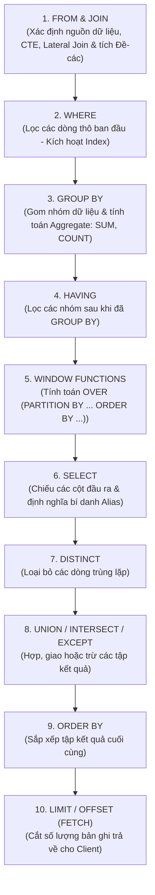
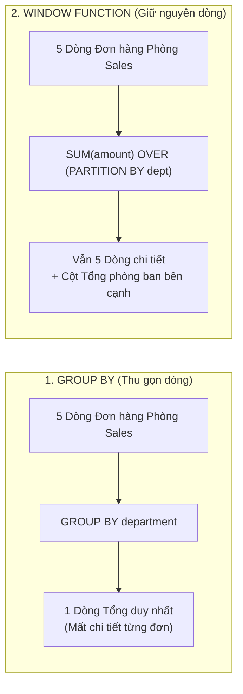
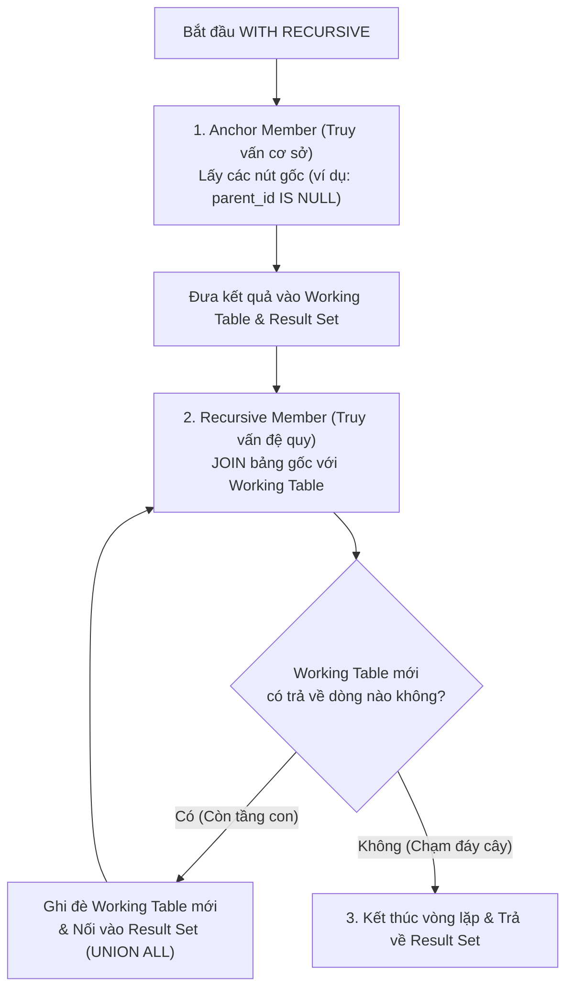

## I. KHÁI QUÁT (OVERVIEW)

### 1. Tư duy Tập hợp (Set-based Thinking) vs Tư duy Thủ tục (Procedural Thinking)
Sai lầm lớn nhất của các kỹ sư Backend khi làm việc với cơ sở dữ liệu là mang **tư duy lập trình thủ tục (Imperative / Procedural)** từ JavaScript/TypeScript vào SQL: kéo hàng chục ngàn dòng dữ liệu thô về RAM của Node.js rồi dùng vòng lặp `for`, `.map()`, `.filter()`, `.reduce()` để gom nhóm, xếp hạng hoặc nối dữ liệu.

Cách tiếp cận này gây ra 3 hệ lụy nghiêm trọng trên Production:
1. **Bão hòa băng thông mạng (Network I/O Saturation):** Truyền hàng chục MB dữ liệu thừa từ PostgreSQL sang Node.js.
2. **Nghẽn Event Loop & Tràn bộ nhớ V8 Heap (OOM):** Node.js phải cấp phát hàng vạn đối tượng tạm thời trong RAM chỉ để tính tổng hoặc lọc lấy Top 5, kích hoạt Garbage Collector (Stop-the-World pause).
3. **Đánh mất bộ tối ưu hóa C-level của Database Engine:** PostgreSQL được viết bằng C, có khả năng xử lý các phép toán tập hợp (**Set-based Operations**) trực tiếp trên các trang bộ nhớ đệm (`Shared Buffers`) với tốc độ nhanh hơn hàng chục lần so với tầng ứng dụng.

---

### 2. Thứ tự Thực thi Thực tế của một Câu lệnh SQL (Logical Query Processing Order)
Để viết và tối ưu hóa SQL nâng cao, bạn bắt buộc phải phân biệt giữa **Thứ tự viết câu lệnh (Lexical Order)** và **Thứ tự thực thi logic bên trong Engine (Logical Execution Order)**:



> [!IMPORTANT]
> **3 Hệ quả Kỹ thuật Quan trọng từ Thứ tự Thực thi:**
> 1. **Tại sao không dùng được Alias của `SELECT` trong `WHERE`?** Vì `WHERE` chạy ở Bước 2, trong khi `SELECT` mới định nghĩa Alias ở Bước 6! (Tuy nhiên `ORDER BY` chạy ở Bước 9 nên dùng được Alias của `SELECT`).
> 2. **Tại sao không thể lọc trực tiếp Window Function (`ROW_NUMBER() = 1`) trong `WHERE` hoặc `HAVING`?** Vì Window Functions chỉ được tính toán ở **Bước 5** (sau cả `WHERE` và `HAVING`). Muốn lọc kết quả của Window Function, bạn bắt buộc phải bọc nó trong một **CTE (`WITH`)** hoặc **Subquery**.
> 3. **Window Functions nhìn thấy dữ liệu sau `GROUP BY`:** Do chạy ở Bước 5, một Window Function có thể tính toán trực tiếp trên kết quả của hàm `SUM()` hoặc `COUNT()` được sinh ra từ Bước 3, ví dụ: `SUM(SUM(amount)) OVER ()` (Tính tỷ trọng doanh thu của từng nhóm trên tổng doanh thu toàn hệ thống trong 1 query duy nhất).

---

## II. CHI TIẾT KỸ THUẬT (DETAILED DEEP DIVE)

### 1. Window Functions Chuyên Sâu (Hàm Cửa Sổ & Khung Trượt)

Khác với `GROUP BY` (gom nhiều dòng thành 1 dòng duy nhất và làm mất chi tiết từng bản ghi), **Window Function** thực hiện tính toán trên một tập hợp các dòng liên quan (**Window Partition**) nhưng **giữ nguyên số lượng dòng ban đầu**.



#### a. Giải phẫu cú pháp chuẩn của một Window Function
```sql
function_name(expression) FILTER (WHERE condition) OVER (
    [PARTITION BY partition_expression, ...]
    [ORDER BY sort_expression [ASC | DESC] [NULLS FIRST | LAST]]
    [frame_mode BETWEEN frame_start AND frame_end [frame_exclusion]]
)
```

* **`PARTITION BY`:** Chia tập dữ liệu thành các phân vùng độc lập (tương tự `GROUP BY` nhưng không gộp dòng). Window Function sẽ khởi tạo lại từ đầu khi sang Partition mới.
* **`ORDER BY`:** Quy định thứ tự các dòng bên trong từng Partition.
* **Window Frame (`ROWS` vs `RANGE` vs `GROUPS`):** Định nghĩa "khung cửa sổ trượt" bên trong Partition tính từ dòng hiện tại (`CURRENT ROW`).

#### b. Cạm bẫy kinh điển: `RANGE` (Mặc định) vs `ROWS` vs `GROUPS`
Khi bạn viết `OVER (ORDER BY created_at)` mà không khai báo Frame, PostgreSQL tự động áp dụng khung mặc định là:
$$\text{RANGE BETWEEN UNBOUNDED PRECEDING AND CURRENT ROW}$$

| Chế độ Frame | Bản chất đơn vị tính | Hành vi khi gặp các dòng có cùng giá trị `ORDER BY` (Peers) | Ứng dụng thực tế |
| :--- | :--- | :--- | :--- |
| **`RANGE`** *(Default)* | Theo **Giá trị (Logical Value Offset)** của cột sắp xếp | Gom **TẤT CẢ** các dòng trùng giá trị `ORDER BY` vào chung một bước cộng dồn! | Cộng dồn theo khoảng thời gian (`RANGE BETWEEN INTERVAL '7 days' PRECEDING AND CURRENT ROW`). |
| **`ROWS`** | Theo **Vị trí dòng vật lý (Physical Row Offset)** | Cộng dồn chính xác từng dòng một theo đúng thứ tự xuất hiện. | Luồng sao kê tài khoản ngân hàng (Running Balance), trung bình trượt $N$ dòng (`ROWS BETWEEN 6 PRECEDING AND CURRENT ROW`). |
| **`GROUPS`** | Theo **Nhóm giá trị đồng hạng (Peer Groups)** | Đếm theo số cụm giá trị phân biệt đứng trước/sau. | Thống kê theo cụm mốc điểm số hoặc cụm ngày. |

> [!CAUTION]
> **Cạm bẫy hàm `LAST_VALUE()` và khung mặc định:**
> Nếu bạn viết `LAST_VALUE(salary) OVER (PARTITION BY dept_id ORDER BY salary ASC)`, kết quả trả về sẽ luôn là **chính dòng hiện tại** thay vì dòng cuối cùng của phòng ban!
> **Lý do:** Khung mặc định kết thúc tại `CURRENT ROW`. Để lấy đúng giá trị cuối cùng của toàn bộ Partition, bạn bắt buộc phải mở rộng khung tới `UNBOUNDED FOLLOWING`:
> ```sql
> LAST_VALUE(salary) OVER (
>     PARTITION BY dept_id 
>     ORDER BY salary ASC
>     ROWS BETWEEN UNBOUNDED PRECEDING AND UNBOUNDED FOLLOWING
> )
> ```

#### c. Phân biệt các hàm Xếp hạng và Dịch chuyển
* **`ROW_NUMBER()`:** Đánh số thứ tự tăng dần duy nhất (`1, 2, 3, 4`), kể cả khi 2 dòng bằng điểm nhau.
* **`RANK()`:** Xếp hạng có nhảy bậc khi đồng hạng (`1, 2, 2, 4` — mất hạng 3).
* **`DENSE_RANK()`:** Xếp hạng liên tục không nhảy bậc khi đồng hạng (`1, 2, 2, 3`).
* **`LAG(col, offset, default)` & `LEAD(col, offset, default)`:** Truy xuất trực tiếp giá trị của dòng đứng trước (`LAG`) hoặc đứng sau (`LEAD`) cách `offset` dòng mà **không cần Self-Join** bảng!

---

### 2. Common Table Expressions (CTEs) & Đệ quy Đồ thị (`WITH RECURSIVE`)

#### a. CTE Thông thường và Cơ chế Materialization (PostgreSQL 12+)
* Trước PostgreSQL 12, mọi khối `WITH cte AS (...)` đều là một **Optimization Fence (Hàng rào ngăn tối ưu hóa)**: Postgres luôn thực thi CTE trước, lưu kết quả vào bộ nhớ tạm (Materialize), khiến các điều kiện lọc `WHERE` bên ngoài không thể đẩy xuống (Predicate Pushdown) để dùng Index bên trong CTE.
* Từ **PostgreSQL 12+**, nếu một CTE chỉ được gọi 1 lần và không có hiệu ứng phụ, Planner sẽ tự động **Inline (Gộp)** CTE vào câu truy vấn chính để đẩy điều kiện lọc xuống dùng Index.
* Bạn có thể ép buộc hành vi của Planner bằng từ khóa tường minh:
  * `WITH cte AS MATERIALIZED (...)`: Bắt buộc tính toán đúng 1 lần và lưu cache kết quả vào `work_mem` (dùng khi CTE chứa hàm tính toán nặng hoặc được gọi nhiều lần).
  * `WITH cte AS NOT MATERIALIZED (...)`: Bắt buộc gộp vào câu query cha để tận dụng Index.

#### b. Cấu trúc của một Recursive CTE (`WITH RECURSIVE`)
Dùng để duyệt cấu trúc cây phân cấp (Cây danh mục sản phẩm đa cấp, Sơ đồ tổ chức công ty Manager-Subordinate, Hệ thống bình luận lồng nhau, Đồ thị mạng lưới giới thiệu Affiliate):



```sql
-- Duyệt cây danh mục sản phẩm đa cấp + Tự động phát hiện vòng lặp vô hạn (PostgreSQL 14+ CYCLE)
WITH RECURSIVE category_tree AS (
    -- 1. Anchor Member: Lấy các danh mục gốc (Cấp 1)
    SELECT 
        id, 
        name, 
        parent_id, 
        1 AS depth,
        name::TEXT AS breadcrumb
    FROM categories
    WHERE parent_id IS NULL

    UNION ALL

    -- 2. Recursive Member: Tìm các danh mục con nối với tầng trước
    SELECT 
        c.id, 
        c.name, 
        c.parent_id, 
        ct.depth + 1,
        ct.breadcrumb || ' > ' || c.name
    FROM categories c
    INNER JOIN category_tree ct ON c.parent_id = ct.id
    WHERE ct.depth < 10 -- Chốt chặn độ sâu an toàn
)
CYCLE id SET is_cycle USING path_history -- Cú pháp chuẩn PG 14+ chống lỗi lặp vòng tròn dữ liệu!
SELECT id, name, depth, breadcrumb
FROM category_tree
WHERE NOT is_cycle;
```

---

### 3. `LATERAL JOIN`: Vòng lặp `forEach` Tương quan trong SQL

Trong một phép `JOIN` thông thường, bảng bên phải **không được phép tham chiếu** tới các cột của bảng bên trái ở bên trong mệnh đề Subquery của nó. Từ khóa **`LATERAL`** phá bỏ giới hạn này: nó cho phép Subquery bên phải đọc trực tiếp từng dòng của bảng bên trái, giống như một vòng lặp `for (const leftRow of leftTable)`.

#### Giải bài toán Kinh điển: "Lấy Top-N bản ghi mới nhất cho mỗi nhóm" (Top-N per Group)
Giả sử bạn có 1,000 danh mục (`categories`) và 10,000,000 sản phẩm (`products`). Bạn cần lấy ra **3 sản phẩm bán chạy nhất của mỗi danh mục**:

| Phương pháp | Cơ chế hoạt động của PostgreSQL Planner | Độ phức tạp với 1,000 Categories & 10M Products |
| :--- | :--- | :--- |
| **Cách 1: Window Function `ROW_NUMBER()`** | Phải quét và sắp xếp toàn bộ 10,000,000 dòng sản phẩm để đánh số thứ tự rồi mới lọc `rn <= 3`. | Rất chậm (~2,500 ms), tràn `work_mem` phải ghi Temp File ra đĩa. |
| **Cách 2: `LEFT JOIN LATERAL` + Index** | Duyệt 1,000 danh mục. Với mỗi danh mục, nhảy vào Composite Index `(category_id, sold_count DESC)` nhặt đúng 3 dòng đầu tiên rồi dừng ngay! | **Siêu tốc (~8 ms)** — chỉ đọc đúng $1000 \times 3 = 3000$ nút Index! |

---

### 4. Thao tác Nguyên tử Nâng cao: `UPSERT`, `RETURNING` & `FILTER`

#### a. `INSERT ... ON CONFLICT` (Atomic Upsert)
Thay vì thực hiện `SELECT` kiểm tra tồn tại rồi mới `INSERT` hoặc `UPDATE` ở tầng Node.js (gây lỗi Race Condition khi 2 request cùng chạy song song), PostgreSQL cung cấp cơ chế Upsert nguyên tử 100% ở mức Engine:

```sql
INSERT INTO daily_product_metrics (product_id, report_date, view_count, revenue)
VALUES ($1, CURRENT_DATE, 1, $2)
ON CONFLICT (product_id, report_date) 
DO UPDATE SET
    view_count = daily_product_metrics.view_count + 1,
    revenue = daily_product_metrics.revenue + EXCLUDED.revenue,
    updated_at = NOW()
WHERE daily_product_metrics.is_locked = false -- Chỉ update nếu kỳ báo cáo chưa khóa
RETURNING *;
```
* Từ khóa đặc biệt **`EXCLUDED`** đại diện cho dòng dữ liệu bạn định chèn vào nhưng bị trùng khóa.

#### b. `FILTER (WHERE ...)` cho Pivot Table & Thống kê Đa chiều
Thay vì dùng `SUM(CASE WHEN status = 'PAID' THEN amount ELSE 0 END)` dài dòng và khó đọc, PostgreSQL hỗ trợ mệnh đề chuẩn SQL:2003 `FILTER`:

```sql
SELECT 
    DATE_TRUNC('month', created_at) AS month,
    COUNT(*) AS total_orders,
    COUNT(*) FILTER (WHERE status = 'COMPLETED') AS completed_orders,
    COUNT(*) FILTER (WHERE status = 'CANCELLED') AS cancelled_orders,
    COALESCE(SUM(total_amount) FILTER (WHERE status = 'COMPLETED'), 0) AS net_revenue
FROM orders
GROUP BY 1
ORDER BY 1 DESC;
```

---

## III. VÍ DỤ MINH HỌA VÀ PHÂN TÍCH CODE THỰC CHIẾN

### Bối cảnh Nghiệp vụ: Hệ thống Báo cáo Tài chính & Tăng trưởng Thương mại Điện tử (Analytics Engine)
Xây dựng một API trả về báo cáo doanh thu theo từng tháng của từng danh mục, bao gồm:
1. Doanh thu tháng hiện tại (`current_revenue`).
2. Doanh thu tháng liền trước (`prev_month_revenue`) và **Tỷ lệ tăng trưởng MoM %** (`mom_growth_pct`).
3. **Lũy kế doanh thu từ đầu năm (YTD Running Total - `ytd_revenue`)**.
4. **Trung bình trượt 3 tháng gần nhất (`moving_avg_3m`)**.

```typescript
// ==============================================================
// File: src/analytics/revenue-analytics.service.ts
// Thực thi toàn bộ báo cáo tài chính phức tạp trong 1 câu SQL duy nhất
// ==============================================================
import { Injectable } from '@nestjs/common';
import { DataSource } from 'typeorm';

export interface MonthlyCategoryGrowthRow {
  categoryId: number;
  categoryName: string;
  reportMonth: string;
  currentRevenue: number;
  prevMonthRevenue: number | null;
  momGrowthPct: number | null;
  ytdRevenue: number;
  movingAvg3Months: number;
  categoryRankInMonth: number;
}

@Injectable()
export class RevenueAnalyticsService {
  constructor(private readonly dataSource: DataSource) {}

  async getCategoryGrowthReport(year: number): Promise<MonthlyCategoryGrowthRow[]> {
    const sql = `
      WITH monthly_sales AS (
        -- Bước 1: Gom nhóm doanh thu theo Danh mục & Tháng
        SELECT 
          c.id AS category_id,
          c.name AS category_name,
          DATE_TRUNC('month', o.created_at)::DATE AS report_month,
          SUM(oi.quantity * oi.unit_price)::NUMERIC(14, 2) AS monthly_revenue
        FROM order_items oi
        INNER JOIN orders o ON o.id = oi.order_id
        INNER JOIN products p ON p.id = oi.product_id
        INNER JOIN categories c ON c.id = p.category_id
        WHERE o.status = 'COMPLETED'
          AND o.created_at >= MAKE_DATE($1, 1, 1)
          AND o.created_at < MAKE_DATE($1 + 1, 1, 1)
        GROUP BY c.id, c.name, DATE_TRUNC('month', o.created_at)::DATE
      )
      -- Bước 2: Áp dụng Window Functions kèm NAMED WINDOW để tối ưu hiệu năng
      SELECT 
        category_id AS "categoryId",
        category_name AS "categoryName",
        TO_CHAR(report_month, 'YYYY-MM') AS "reportMonth",
        monthly_revenue::FLOAT8 AS "currentRevenue",
        
        -- Lấy doanh thu tháng trước của cùng danh mục
        LAG(monthly_revenue, 1) OVER w_category_time::FLOAT8 AS "prevMonthRevenue",
        
        -- Tính % tăng trưởng MoM (Month-over-Month Growth)
        ROUND(
          (monthly_revenue - LAG(monthly_revenue, 1) OVER w_category_time) * 100.0
          / NULLIF(LAG(monthly_revenue, 1) OVER w_category_time, 0),
          2
        )::FLOAT8 AS "momGrowthPct",
        
        -- Lũy kế từ đầu năm (Running Total dùng ROWS để tránh lỗi trùng giá trị)
        SUM(monthly_revenue) OVER (
          w_category_time
          ROWS BETWEEN UNBOUNDED PRECEDING AND CURRENT ROW
        )::FLOAT8 AS "ytdRevenue",
        
        -- Trung bình trượt 3 tháng gần nhất (2 tháng trước + tháng hiện tại)
        ROUND(
          AVG(monthly_revenue) OVER (
            w_category_time
            ROWS BETWEEN 2 PRECEDING AND CURRENT ROW
          ),
          2
        )::FLOAT8 AS "movingAvg3Months",
        
        -- Xếp hạng danh mục có doanh thu cao nhất trong cùng 1 tháng
        DENSE_RANK() OVER (
          PARTITION BY report_month 
          ORDER BY monthly_revenue DESC
        )::INT AS "categoryRankInMonth"
      FROM monthly_sales
      WINDOW w_category_time AS (
        PARTITION BY category_id 
        ORDER BY report_month ASC
      )
      ORDER BY report_month DESC, "categoryRankInMonth" ASC;
    `;

    return await this.dataSource.query(sql, [year]);
  }
}
```

> [!TIP]
> **Mẹo Tối ưu Cú pháp với `WINDOW w_name AS (...)`:**
> Khi nhiều hàm cửa sổ (`LAG`, `SUM`, `AVG`) cùng chia sẻ chung một cách phân vùng và sắp xếp (`PARTITION BY category_id ORDER BY report_month ASC`), việc khai báo mệnh đề `WINDOW w_category_time AS (...)` ở cuối câu lệnh không chỉ giúp code sạch sẽ mà còn giúp PostgreSQL nhận diện và **chỉ thực hiện bước Sort đúng 1 lần duy nhất** cho cả 3 hàm!

---

## IV. LƯU Ý, CẠM BẪY VÀ QUY TẮC CỐT LÕI (BEST PRACTICES)

> [!CAUTION]
> ### 1. Cạm bẫy `NOT IN` khi tập dữ liệu con có chứa giá trị `NULL`
> Trong logic ba trị (Three-valued Logic: `TRUE`, `FALSE`, `UNKNOWN`) của SQL, phép so sánh `x <> NULL` luôn trả về `UNKNOWN`.
> * Do câu lệnh `WHERE id NOT IN (1, 2, NULL)` tương đương với `id <> 1 AND id <> 2 AND id <> NULL`, toàn bộ biểu thức sẽ trở thành `UNKNOWN`, khiến câu truy vấn **luôn luôn trả về 0 dòng (Empty Result)**!
> * **Quy tắc bắt buộc:** Luôn sử dụng **`NOT EXISTS`** (hoặc `LEFT JOIN ... WHERE right.id IS NULL`) thay vì `NOT IN` khi làm việc với Subquery! `NOT EXISTS` vừa an toàn tuyệt đối với `NULL`, vừa kích hoạt thuật toán **Hash Anti Join / Nested Loop Anti Join** nhanh hơn rất nhiều.

> [!WARNING]
> ### 2. Cạm bẫy `UNION` vs `UNION ALL`
> * `UNION` mặc định sẽ thực hiện thêm một bước **Sort hoặc Hash Aggregate toàn bộ tập kết quả** để lọc trùng (`DISTINCT`), tiêu tốn rất nhiều CPU và `work_mem`.
> * Nếu bạn biết chắc 2 tập dữ liệu không trùng nhau (hoặc không cần lọc trùng), **luôn luôn sử dụng `UNION ALL`** để nối trực tiếp kết quả với chi phí bằng 0.

> [!IMPORTANT]
> ### 3. Cạm bẫy Phân trang `OFFSET` lớn trên Bảng Hàng Triệu Dòng
> Khi bạn chạy `SELECT * FROM orders ORDER BY created_at DESC LIMIT 20 OFFSET 1000000`, PostgreSQL **không thể nhảy cóc** qua 1 triệu dòng. Nó bắt buộc phải đọc lên từ đĩa/RAM toàn bộ **1,000,020 dòng**, sắp xếp chúng, rồi vứt bỏ 1,000,000 dòng đầu tiên!
> * **Giải pháp Chuẩn Production (Keyset / Seek / Cursor Pagination):**
>   Dùng giá trị `(created_at, id)` của phần tử cuối cùng ở trang trước làm mỏ neo cho trang tiếp theo:
>   ```sql
>   -- Sử dụng Row Value Comparison nhảy thẳng vào vị trí trên B-Tree Index (Độ trễ O(log N) dưới 1ms ở mọi trang!)
>   SELECT id, customer_id, total_amount, created_at
>   FROM orders
>   WHERE (created_at, id) < ($1::TIMESTAMPTZ, $2::BIGINT)
>   ORDER BY created_at DESC, id DESC
>   LIMIT 20;
>   ```
>   *(Yêu cầu có Composite Index: `CREATE INDEX idx_orders_cursor ON orders (created_at DESC, id DESC)`)*.
