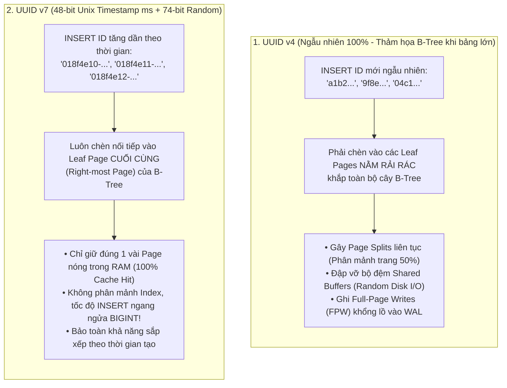
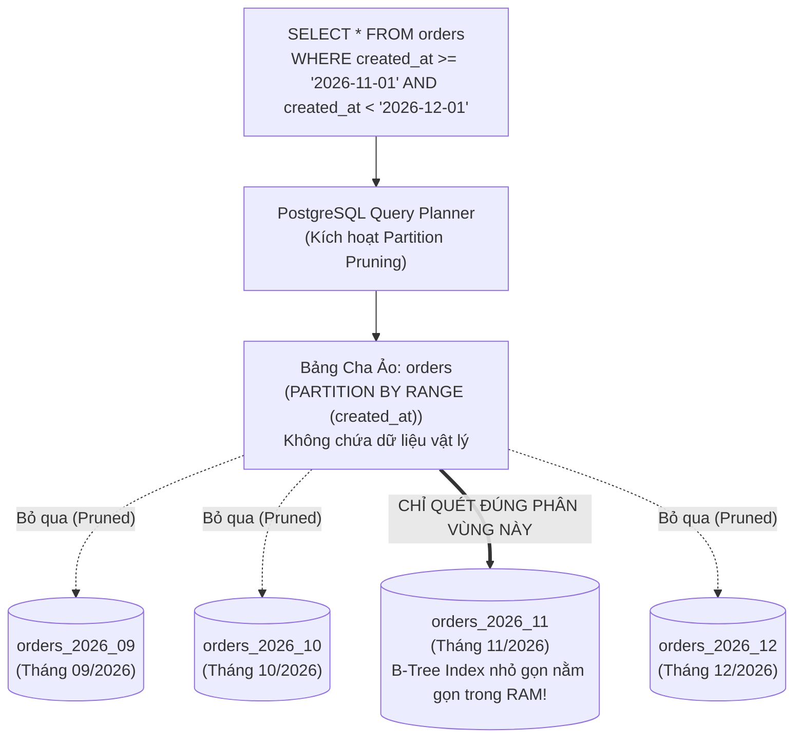

## I. KHÁI QUÁT (OVERVIEW)

### 1. Tầm quan trọng của Thiết kế Lược đồ (Schema Design) ở Quy mô Lớn
Một câu lệnh SQL viết tồi có thể được sửa trong 5 phút bằng một bản hotfix code, nhưng một **Schema Database thiết kế sai** (chọn sai kiểu khóa chính làm phân mảnh B-Tree, dùng kiểu số thực cho tiền tệ, hoặc để một bảng đơn lẻ phình lên 500 triệu dòng không phân vùng) sẽ đòi hỏi hàng tuần lễ di chuyển dữ liệu (Data Migration) đầy rủi ro trên môi trường Production.

Bài học này đi sâu vào 4 trụ cột thiết kế vật lý trong PostgreSQL:
1. **Chuẩn hóa (Normalization 1NF $\to$ BCNF)** và thời điểm phá chuẩn có kiểm soát (**Strategic Denormalization**).
2. **Lựa chọn Kiểu dữ liệu Chuẩn Production:** Cuộc chiến khóa chính `BIGINT` vs `UUID v4` vs **`UUID v7` (RFC 9562)**.
3. **Cấu trúc Lưu trữ Vật lý dưới Đĩa:** Cơ chế **TOAST** (lưu dữ liệu lớn) và **Kỹ thuật Sắp xếp Cột (Column Alignment / Tetris)** tiết kiệm 20% RAM & Disk.
4. **Phân vùng Bảng (Declarative Table Partitioning):** Chia để trị các bảng hàng trăm triệu đến hàng tỷ bản ghi.

---

## II. CHI TIẾT KỸ THUẬT (DETAILED DEEP DIVE)

### 1. Chuẩn hóa (Normalization) vs Phi chuẩn hóa Chiến lược (Denormalization)

```mermaid
flowchart LR
    Unnorm["Dữ liệu Thô<br/>(Lặp cột, Mảng chuỗi)"] -->|Triệt tiêu nhóm lặp,<br/>mỗi ô 1 giá trị nguyên tử| NF1["1NF<br/>(First Normal Form)"]
    NF1 -->|Loại bỏ phụ thuộc hàm bộ phận<br/>vào Composite PK| NF2["2NF<br/>(Second Normal Form)"]
    NF2 -->|Loại bỏ phụ thuộc bắc cầu<br/>(A -> B -> C)| NF3["3NF<br/>(Third Normal Form)"]
    NF3 -->|Mọi định thức (Determinant)<br/>đều là Candidate Key| BCNF["BCNF<br/>(Boyce-Codd Normal Form)"]
```

* **Nguyên tắc mặc định (90% nghiệp vụ OLTP):** Luôn thiết kế lược đồ đạt chuẩn **3NF / BCNF** trước để loại bỏ hoàn toàn các dị thường khi Thêm/Sửa/Xóa (Update/Insert/Delete Anomalies) và đảm bảo một sự thật chỉ lưu ở một nơi duy nhất (Single Source of Truth).
* **Khi nào được phép Denormalize (Phi chuẩn hóa)?**
  1. **Lưu trữ Lịch sử Bất biến (Historical Snapshot):** Trong bảng `order_items`, bạn **bắt buộc phải sao chép** `product_name` và `unit_price` tại thời điểm mua hàng thay vì chỉ lưu `product_id`. Nếu chỉ JOIN sang bảng `products`, khi chủ shop đổi giá sản phẩm vào tháng sau, toàn bộ hóa đơn lịch sử của năm trước sẽ bị nhảy số sai lệch!
  2. **Bộ đếm và Tổng hợp Nóng (Pre-computed Counters):** Với các bảng có tỷ lệ Đọc/Ghi là $1000:1$ (ví dụ: tổng số bình luận của bài viết `comment_count`, số dư ví `current_balance`), ta duy trì cột tổng hợp trực tiếp trên bảng cha (cập nhật qua Transaction hoặc Trigger) để tránh phải chạy `SELECT COUNT(*)` quét hàng vạn dòng mỗi lần tải trang.

---

### 2. Lựa chọn Kiểu Dữ liệu Chuẩn Production & Bài toán `UUID v4` vs `UUID v7`

#### a. Thảm họa Hiệu năng Ngầm của `UUID v4` trên B-Tree Index
Nhiều hệ thống chọn `UUID v4` (ví dụ: `f47ac10b-58cc-4372-a567-0e02b2c3d479`) làm khóa chính (`PRIMARY KEY`) để chống lộ số lượng bản ghi và dễ sinh ID ở tầng Microservices. Tuy nhiên, **122 bits của `UUID v4` là hoàn toàn ngẫu nhiên**:



* **Giải pháp Chuẩn Hiện đại (`UUID v7` - Chuẩn IETF RFC 9562 & Native trong PostgreSQL 17/18+):**
  * **Cấu trúc 128-bit của `UUID v7`:**
    * **48 bits đầu:** Unix Timestamp tính bằng mili-giây (đảm bảo tính đơn điệu tăng dần theo thời gian).
    * **4 bits:** Version (`0111` = 7).
    * **12 bits:** Số thứ tự tăng dần trong cùng 1 mili-giây hoặc ngẫu nhiên (`rand_a`).
    * **2 bits:** Variant (`10`).
    * **62 bits cuối:** Chuỗi ngẫu nhiên mật mã học (`rand_b`) chống đoán ID.
  * **Kết quả Benchmark thực tế (Chèn 10,000,000 dòng trên PostgreSQL):**
    * `BIGINT GENERATED ALWAYS AS IDENTITY`: Thời gian chèn **~42 giây**, kích thước Index **214 MB**.
    * `UUID v7`: Thời gian chèn **~51 giây**, kích thước Index **301 MB** (Hầu như không phát sinh Random Disk I/O).
    * `UUID v4`: Thời gian chèn **~285 giây (chậm hơn 5.5 lần!)**, kích thước Index phình lên **490 MB** do Page Split, lượng ghi WAL tăng gấp 3.8 lần!

#### b. Bảng Quy chuẩn Chọn Kiểu Dữ liệu trong PostgreSQL

| Nhu cầu Lưu trữ | ❌ Kiểu Dữ liệu Sai lầm (Anti-pattern) | ✅ Kiểu Dữ liệu Chuẩn Production | Lý do Kỹ thuật Cốt lõi |
| :--- | :--- | :--- | :--- |
| **Khóa chính (PK)** | `SERIAL` hoặc `UUID v4` | `BIGINT GENERATED ALWAYS AS IDENTITY` hoặc `UUID` (chứa giá trị **UUID v7**) | `SERIAL` là kiểu 32-bit cũ dễ tràn ở 2.1 tỷ dòng. `IDENTITY` là chuẩn SQL mới. `UUID v7` tối ưu B-Tree cho hệ thống phân tán. |
| **Tiền tệ & Số dư** | `FLOAT`, `REAL`, `DOUBLE PRECISION`, `MONEY` | `NUMERIC(19, 4)` hoặc `BIGINT` (lưu theo đơn vị nhỏ nhất: xu/đồng) | Trong chuẩn IEEE 754, `0.1 + 0.2 = 0.30000000000000004`. Dùng `FLOAT` cho tài chính sẽ làm lệch sổ cái kế toán! |
| **Chuỗi ký tự** | `CHAR(n)` (cố định) | `TEXT` (kèm `CHECK (char_length(col) <= N)`) hoặc `VARCHAR(N)` | Trong Postgres, `TEXT` và `VARCHAR` dùng chung cấu trúc C `varlena` có tốc độ **ngang nhau 100%**. `CHAR(n)` tự động chèn khoảng trắng gây tốn RAM. |
| **Thời gian** | `TIMESTAMP` (Without Time Zone) | **`TIMESTAMPTZ`** (`TIMESTAMP WITH TIME ZONE`) | `TIMESTAMPTZ` tự động quy đổi mọi múi giờ về chuẩn **UTC** (8 bytes microseconds) khi lưu đĩa, miễn nhiễm với lỗi lệch múi giờ server hay Daylight Saving Time. |
| **JSON Động** | `JSON` | **`JSONB`** (Binary JSON) | `JSON` lưu dưới dạng chuỗi text thô (mỗi lần đọc phải parse lại). `JSONB` phân rã thành cây nhị phân, hỗ trợ đánh chỉ mục **GIN Index**. |

---

### 3. Cơ chế TOAST & Nghệ thuật Sắp xếp Cột (Column Alignment / Struct Padding)

#### a. Cơ chế TOAST (The Oversized-Attribute Storage Technique)
Một trang dữ liệu (Data Page) của PostgreSQL có kích thước cố định là **8KB (8192 bytes)** và một dòng dữ liệu (Tuple) không được phép nằm vắt ngang qua 2 trang. Vậy làm sao Postgres lưu được một bài viết dài 5MB trong cột `TEXT` hoặc `JSONB`?
* Khi kích thước một dòng vượt quá ngưỡng `TOAST_TUPLE_THRESHOLD` (**~2KB**), PostgreSQL tự động kích hoạt cơ chế **TOAST**:
  1. **Nén dữ liệu (Compression):** Sử dụng thuật toán nén siêu tốc **LZ4** (từ PG 14+) hoặc `pglz`.
  2. **Tách ra bảng phụ (Out-of-Line Storage):** Nếu sau khi nén vẫn lớn hơn 2KB, Postgres cắt dữ liệu thành các mảnh nhỏ (chunks) lưu sang một bảng ẩn đi kèm (`pg_toast.pg_toast_<oid>`), và chỉ để lại một con trỏ nhỏ gọn **18 bytes** ở bảng chính!
* **Hệ quả tối ưu:** Khi bạn chạy `SELECT id, title FROM articles` (không chọn cột `content` nặng 5MB), PostgreSQL **hoàn toàn không chạm vào bảng TOAST**, giúp tốc độ quét bảng chính nhanh như chớp! (Đây là lý do tuyệt đối không nên dùng `SELECT *` trên các bảng có cột `TEXT`/`JSONB` lớn).

#### b. Kỹ thuật "Xếp gạch Cột" (Column Tetris / CPU Memory Alignment)
CPU hiện đại đọc bộ nhớ theo các từ (Words) 8 bytes. Trong PostgreSQL, một kiểu dữ liệu có kích thước $N$ bytes (`align = 8`, `4`, `2`, hoặc `1`) bắt buộc phải nằm ở địa chỉ bộ nhớ chia hết cho $N$. Nếu bạn khai báo xen kẽ một cột `BOOLEAN` (1 byte) rồi đến một cột `BIGINT` (8 bytes), PostgreSQL buộc phải chèn thêm **7 bytes rỗng (Padding Waste)** vào giữa!

```text
❌ CÁCH KHAI BÁO CỘT TỒI (Tốn 40 Bytes cho mỗi dòng - Lãng phí 13 Bytes Padding!):
[ is_active: bool (1B) ][ 7B PADDING! ][ id: bigint (8B) ][ status: smallint (2B) ][ 6B PADDING! ][ created_at: timestamptz (8B) ][ role_id: int (4B) ][ 4B PADDING! ]

✅ CÁCH KHAI BÁO CỘT TỐI ƯU (Chỉ tốn 24 Bytes - Tiết kiệm 40% dung lượng bảng!):
Xếp từ kiểu cố định lớn nhất (8 Bytes) -> 4 Bytes -> 2 Bytes -> 1 Byte -> Kiểu độ dài biến thiên (TEXT, VARCHAR, NUMERIC, JSONB) ở cuối cùng:
[ id: bigint (8B) ][ created_at: timestamptz (8B) ][ role_id: int (4B) ][ status: smallint (2B) ][ is_active: bool (1B) ][ 1B Pad ][ email: text (varlena) ]
```

---

### 4. Phân vùng Bảng (Declarative Table Partitioning) cho Dữ liệu Hàng Tỷ Dòng

Khi một bảng đơn lẻ (ví dụ: `audit_logs`, `transactions`, `orders`) vượt quá **50 triệu – 100 triệu dòng** (hoặc dung lượng bảng vượt quá dung lượng RAM vật lý của Server):
* Cây B-Tree Index trở nên quá sâu và phình to không thể nằm vừa trong `Shared Buffers` $\to$ Mọi thao tác đọc/ghi đều gây **Disk I/O Thrashing**.
* Tiến trình `Autovacuum` chạy mất hàng giờ đồng hồ không xong.
* Việc xóa dữ liệu cũ (`DELETE FROM audit_logs WHERE created_at < NOW() - INTERVAL '1 year'`) tạo ra hàng chục triệu Dead Tuples làm treo cứng hệ thống.

#### Giải pháp: Declarative Partitioning (`PARTITION BY RANGE / LIST / HASH`)



1. **`RANGE Partitioning` (Phổ biến nhất):** Chia bảng theo khoảng thời gian (`created_at` theo Tháng/Năm).
2. **`LIST Partitioning`:** Chia bảng theo danh sách giá trị rời rạc (ví dụ: `region_code IN ('VN', 'SG', 'JP')` hoặc `tenant_id`).
3. **`HASH Partitioning`:** Chia đều dữ liệu thành $N$ phần bằng hàm băm trên `user_id` khi không có cột thời gian tự nhiên.

---

## III. VÍ DỤ MINH HỌA VÀ PHÂN TÍCH CODE THỰC CHIẾN

### 1. Triển khai Bảng Phân vùng Theo Tháng kết hợp `UUID v7` trong PostgreSQL & Node.js

#### a. Định nghĩa DDL Phân vùng Chuẩn Production trong PostgreSQL
```sql
-- 1. Tạo hàm sinh UUID v7 nguyên bản bằng PL/pgSQL (Dùng cho PG < 18, hoặc dùng hàm uuidv7() sẵn có trên PG 18+)
CREATE OR REPLACE FUNCTION generate_uuid_v7() RETURNS UUID AS $$
DECLARE
    v_time BIGINT;
    v_bytes BYTEA;
BEGIN
    -- Lấy Unix timestamp hiện tại tính bằng mili-giây (48 bits)
    v_time := FLOOR(EXTRACT(EPOCH FROM clock_timestamp()) * 1000);
    -- Tạo 16 bytes ngẫu nhiên từ pgcrypto / gen_random_uuid
    v_bytes := decode(replace(gen_random_uuid()::TEXT, '-', ''), 'hex');
    
    -- Ghi đè 6 bytes đầu (48 bits) bằng timestamp big-endian
    v_bytes := set_byte(v_bytes, 0, ((v_time >> 40) & 255)::INT);
    v_bytes := set_byte(v_bytes, 1, ((v_time >> 32) & 255)::INT);
    v_bytes := set_byte(v_bytes, 2, ((v_time >> 24) & 255)::INT);
    v_bytes := set_byte(v_bytes, 3, ((v_time >> 16) & 255)::INT);
    v_bytes := set_byte(v_bytes, 4, ((v_time >> 8)  & 255)::INT);
    v_bytes := set_byte(v_bytes, 5, (v_time         & 255)::INT);
    
    -- Đặt Version = 7 (0111xxxx tại byte thứ 6)
    v_bytes := set_byte(v_bytes, 6, (get_byte(v_bytes, 6) & 15) | 112);
    -- Đặt Variant = RFC 4122/9562 (10xxxxxx tại byte thứ 8)
    v_bytes := set_byte(v_bytes, 8, (get_byte(v_bytes, 8) & 63) | 128);
    
    RETURN encode(v_bytes, 'hex')::UUID;
END;
$$ LANGUAGE plpgsql VOLATILE PARALLEL SAFE;

-- 2. Tạo Bảng Cha Phân vùng (Đã tối ưu thứ tự cột Column Alignment: 16B -> 8B -> 4B -> 2B -> Variable)
CREATE TABLE payment_ledgers (
    -- Nhóm 16 Bytes & 8 Bytes cố định (Alignment = 8)
    id              UUID NOT NULL DEFAULT generate_uuid_v7(),
    account_id      UUID NOT NULL,
    created_at      TIMESTAMPTZ NOT NULL DEFAULT NOW(),
    amount_minor    BIGINT NOT NULL,             -- Lưu theo đơn vị nhỏ nhất (VND hoặc Cents)
    balance_after   BIGINT NOT NULL,
    
    -- Nhóm 2 Bytes & 1 Byte
    direction       SMALLINT NOT NULL,           -- 1: CREDIT (Cộng tiền), -1: DEBIT (Trừ tiền)
    is_reconciled   BOOLEAN NOT NULL DEFAULT FALSE,
    
    -- Nhóm Độ dài biến thiên (varlena) luôn đặt ở cuối cùng
    currency        VARCHAR(3) NOT NULL DEFAULT 'VND',
    reference_code  TEXT NOT NULL,
    metadata        JSONB,

    -- LƯU Ý BẮT BUỘC: Mọi Unique / Primary Key trên bảng Partition PHẢI bao gồm cột Partition Key (created_at)
    PRIMARY KEY (id, created_at),
    CONSTRAINT chk_valid_direction CHECK (direction IN (-1, 1)),
    CONSTRAINT chk_positive_amount CHECK (amount_minor > 0)
) PARTITION BY RANGE (created_at);

-- 3. Tạo Index trên Bảng Cha (Tự động kế thừa xuống mọi Partition con hiện tại và tương lai)
CREATE INDEX idx_ledgers_account_time ON payment_ledgers (account_id, created_at DESC);

-- 4. Tạo các Phân vùng Con theo từng tháng
CREATE TABLE payment_ledgers_2026_11 PARTITION OF payment_ledgers
    FOR VALUES FROM ('2026-11-01 00:00:00+00') TO ('2026-12-01 00:00:00+00');

CREATE TABLE payment_ledgers_2026_12 PARTITION OF payment_ledgers
    FOR VALUES FROM ('2026-12-01 00:00:00+00') TO ('2027-01-01 00:00:00+00');

-- Phân vùng dự phòng (Default Partition) để không bao giờ bị lỗi INSERT nếu quên tạo phân vùng tháng mới
CREATE TABLE payment_ledgers_default PARTITION OF payment_ledgers DEFAULT;
```

#### b. Sinh `UUID v7` tốc độ cao ở tầng Node.js / TypeScript (Không tốn CPU của DB)
```typescript
// ==============================================================
// File: src/common/utils/uuid-v7.util.ts
// Sinh UUID v7 chuẩn RFC 9562 không cần cài thư viện ngoài
// ==============================================================
import { randomBytes } from 'crypto';

export function generateUuidV7(timestampMs = Date.now()): string {
  const bytes = randomBytes(16);
  const timeBigInt = BigInt(timestampMs);

  // Ghi 48-bit timestamp vào 6 bytes đầu tiên (Big-Endian)
  bytes[0] = Number((timeBigInt >> 40n) & 0xffn);
  bytes[1] = Number((timeBigInt >> 32n) & 0xffn);
  bytes[2] = Number((timeBigInt >> 24n) & 0xffn);
  bytes[3] = Number((timeBigInt >> 16n) & 0xffn);
  bytes[4] = Number((timeBigInt >> 8n) & 0xffn);
  bytes[5] = Number(timeBigInt & 0xffn);

  // Version 7 (0111xxxx)
  bytes[6] = (bytes[6] & 0x0f) | 0x70;
  // Variant RFC 9562 (10xxxxxx)
  bytes[8] = (bytes[8] & 0x3f) | 0x80;

  const hex = bytes.toString('hex');
  return `${hex.slice(0, 8)}-${hex.slice(8, 12)}-${hex.slice(12, 16)}-${hex.slice(16, 20)}-${hex.slice(20, 32)}`;
}
```

---

## IV. LƯU Ý, CẠM BẪY VÀ QUY TẮC CỐT LÕI (BEST PRACTICES)

> [!CAUTION]
> ### 1. Cạm bẫy Quên truyền Partition Key vào mệnh đề `WHERE`
> Nếu bảng `payment_ledgers` được phân vùng theo `created_at`, nhưng câu lệnh truy vấn của bạn chỉ viết:
> ```sql
> SELECT * FROM payment_ledgers WHERE id = '018f4e10-...';
> ```
> Vì không có điều kiện lọc trên `created_at`, cơ chế **Partition Pruning bị vô hiệu hóa hoàn toàn**! PostgreSQL buộc phải quét song song qua **tất cả 36 phân vùng tháng** để tìm `id` đó.
> * **Quy tắc cốt lõi:** Mọi câu lệnh `SELECT`, `UPDATE`, `DELETE` trên bảng Partitioned luôn luôn phải đính kèm điều kiện biên của cột Partition Key (`AND created_at >= ...`).

> [!TIP]
> ### 2. Xóa hoặc Lưu trữ Lạnh (Cold Archive) 100 Triệu Dòng Cũ trong 10 Mili-giây mà Không Gây Bloat
> Thay vì chạy `DELETE FROM payment_ledgers WHERE created_at < '2025-01-01'` (tốn hàng giờ I/O, làm đầy WAL và gây Table Bloat khổng lồ), với bảng Partitioned bạn chỉ cần **tháo phân vùng cũ ra không khóa bảng (`DETACH CONCURRENTLY`)**:
> ```sql
> -- Bước 1: Tháo phân vùng tháng cũ ra khỏi bảng cha (Không chặn đọc/ghi trên bảng chính!)
> ALTER TABLE payment_ledgers DETACH PARTITION payment_ledgers_2024_12 CONCURRENTLY;
> 
> -- Bước 2: Sao lưu ra AWS S3 (Parquet / pg_dump) rồi xóa phân vùng tức thì:
> DROP TABLE payment_ledgers_2024_12; -- Giải phóng 100% dung lượng ổ cứng ngay lập tức!
> ```

> [!WARNING]
> ### 3. Cạm bẫy Mở rộng `ENUM` Type và Ràng buộc `FOREIGN KEY` chưa có Index
> * **PostgreSQL không tự động đánh Index cho cột Khóa ngoại (`FOREIGN KEY`)!** (Chỉ tự động đánh Index cho `PRIMARY KEY` và `UNIQUE`). Nếu bảng `orders(customer_id)` tham chiếu tới `customers(id)` mà bạn quên tạo Index trên `orders(customer_id)`, mỗi khi bạn `DELETE` hoặc `UPDATE` một dòng trong bảng `customers`, PostgreSQL sẽ phải **Sequential Scan toàn bộ bảng `orders`** để kiểm tra toàn vẹn tham chiếu!
> * **Quy tắc bắt buộc:** Luôn chủ động `CREATE INDEX` trên mọi cột `FOREIGN KEY`.
