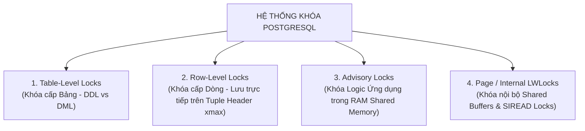
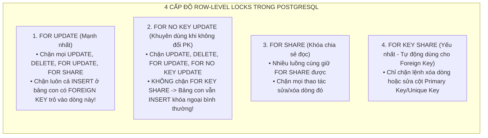

## I. KHÁI QUÁT (OVERVIEW)

### 1. Bản chất của Kiểm soát Đồng thời (Concurrency Control) trong PostgreSQL
Trong một hệ thống Backend có hàng ngàn request đồng thời mỗi giây (Flash Sale, Chuyển tiền ví điện tử, Đặt vé máy bay, Trừ tồn kho), nguyên tắc cơ bản của PostgreSQL MVCC là:
> **"Readers never block Writers, and Writers never block Readers"** *(Luồng đọc không bao giờ chặn luồng ghi, và luồng ghi không bao giờ chặn luồng đọc).*

Tuy nhiên, **Writers DO block Writers** (khi 2 luồng cùng sửa một dòng dữ liệu) và nếu chỉ dựa vào câu lệnh `SELECT` thông thường ở chế độ mặc định `READ COMMITTED`, hệ thống của bạn sẽ ngay lập tức dính các lỗi tài chính chí mạng như **Lost Update (Mất dữ liệu cập nhật)**, **Double Spending (Tiêu tiền 2 lần)**, hoặc **Write Skew (Lệch dữ liệu ghi)**.

Bài học này giải phẫu toàn bộ cơ chế khóa (Locking Hierarchy) từ cấp độ Bảng, cấp độ Dòng (`FOR UPDATE`, `FOR NO KEY UPDATE`, `SKIP LOCKED`) cho tới **Advisory Locks** và cách chẩn đoán, gỡ khóa nóng trên Production.

---

## II. CHI TIẾT KỸ THUẬT (DETAILED DEEP DIVE)

### 1. Hệ thống Phân cấp Khóa trong PostgreSQL (Lock Hierarchy)



#### a. Khóa Cấp Bảng (Table-Level Locks) và Tại sao một lệnh `ALTER TABLE` nhỏ cũng làm sập Production?
Nhiều lập trình viên nghĩ rằng chỉ khi gọi `LOCK TABLE` thì bảng mới bị khóa. Thực tế, **mọi câu lệnh SQL (`SELECT`, `INSERT`, `CREATE INDEX`, `ALTER TABLE`) đều tự động xin một loại Table-Level Lock tương ứng**:

| Chế độ Khóa Bảng | Câu lệnh kích hoạt tiêu biểu | Xung đột với (Chặn các lệnh) | Ý nghĩa Thực chiến |
| :--- | :--- | :--- | :--- |
| **`ACCESS SHARE`** | `SELECT` thuần túy | Chỉ bị chặn bởi `ACCESS EXCLUSIVE` | Cho phép đọc song song không giới hạn. |
| **`ROW EXCLUSIVE`** | `INSERT`, `UPDATE`, `DELETE` | `SHARE`, `SHARE ROW EXCLUSIVE`, `EXCLUSIVE`, `ACCESS EXCLUSIVE` | Các lệnh ghi DML thông thường không chặn lẫn nhau ở cấp bảng (chỉ kiểm tra ở cấp dòng). |
| **`SHARE`** | `CREATE INDEX` *(không có CONCURRENTLY)* | `ROW EXCLUSIVE` (Chặn đứng mọi `INSERT`, `UPDATE`, `DELETE`!) | Chỉ cho `SELECT`, treo toàn bộ thao tác ghi dữ liệu. |
| **`SHARE UPDATE EXCLUSIVE`** | `VACUUM` (thường), `CREATE INDEX CONCURRENTLY` | Chỉ chặn các lệnh DDL khác và `VACUUM` khác | **An toàn cho Production:** Không chặn cả `SELECT` lẫn `INSERT/UPDATE/DELETE`. |
| **`ACCESS EXCLUSIVE`** | `ALTER TABLE`, `DROP TABLE`, `TRUNCATE`, `VACUUM FULL` | **CHẶN TẤT CẢ MỌI THỨ** (Kể cả `SELECT` đơn giản nhất!) | Khóa nguy hiểm nhất. Cần cực kỳ cẩn trọng với **Lock Queue Starvation**! |

> [!CAUTION]
> **Hiện tượng "Đoàn tàu Chết chóc" (Lock Queue Starvation khi chạy `ALTER TABLE`):**
> Giả sử Transaction A đang chạy một câu báo cáo `SELECT` mất **30 giây** (giữ `ACCESS SHARE`).
> * Ở giây thứ 2, bạn chạy `ALTER TABLE users ADD COLUMN ...` (xin `ACCESS EXCLUSIVE`). Vì vướng Transaction A, lệnh `ALTER TABLE` phải xếp hàng chờ trong **Lock Queue**.
> * Ở giây thứ 3 trở đi, 5,000 khách hàng bình thường gửi lệnh `SELECT` và `UPDATE` vào bảng `users`. Mặc dù `SELECT` không xung đột với Transaction A, nhưng vì trong hàng đợi đang có lệnh `ALTER TABLE` (`ACCESS EXCLUSIVE`) đứng chờ trước, **toàn bộ 5,000 request mới đều bị chặn đứng xếp hàng sau lệnh `ALTER TABLE`**! Hệ thống sập hoàn toàn chỉ trong vài giây!
> * **Quy tắc bắt buộc khi chạy Migration DDL trên Production:** Luôn đặt `SET lock_timeout = '2s';` trước mọi lệnh `ALTER TABLE`. Nếu sau 2 giây không lấy được khóa, tự động hủy lệnh migration để bảo vệ luồng traffic của người dùng!

---

### 2. Giải phẫu 4 Chế độ Khóa Cấp Dòng (Row-Level Locks)

Khác với các RDBMS khác lưu Row Lock trong một bảng khóa trên RAM (dễ bị tràn bộ nhớ Lock Escalation khi khóa hàng triệu dòng), PostgreSQL lưu thông tin khóa dòng **ngay bên trong trường `xmax` và `t_infomask` của từng Tuple trên trang đĩa 8KB** — do đó PostgreSQL có thể khóa bao nhiêu dòng tùy ý mà không bao giờ tràn bảng khóa!



> [!TIP]
> **Bí quyết Tối ưu của Chuyên gia: Dùng `FOR NO KEY UPDATE` thay vì `FOR UPDATE`!**
> Khi bạn khóa dòng `SELECT * FROM users WHERE id = 1 FOR UPDATE` để cập nhật tên hoặc số dư của User (nhưng **không hề đổi cột `id`**), lệnh `FOR UPDATE` sẽ chặn luôn cả các lệnh `INSERT INTO orders (user_id, ...)` của chính User đó (vì lệnh `INSERT` vào bảng `orders` cần lấy khóa `FOR KEY SHARE` trên dòng `users(id = 1)` để kiểm tra Khóa ngoại)!
> * Sử dụng **`SELECT ... FOR NO KEY UPDATE`** vừa khóa chặt dòng để không ai sửa số dư được, vừa cho phép các bảng phụ (`orders`, `audit_logs`) chèn bản ghi tham chiếu Khóa ngoại bình thường mà không bị kẹt!

---

### 3. 3 Kịch bản Xung đột Thực chiến & Giải pháp Phòng thủ

#### Kịch bản 1: Trừ Số dư Ví / Tồn kho (Chống Lost Update & Race Condition)
Giả sử tài khoản `id = 1` đang có `balance = 100`. Hai request rút `80` đồng được gửi lên tại cùng một mili-giây.

```mermaid
sequenceDiagram
    autonumber
    participant T1 as Request 1 (Rút 80đ)
    participant DB as PostgreSQL (balance = 100đ)
    participant T2 as Request 2 (Rút 80đ)

    Note over T1,T2: "❌ CÁCH LÀM SAI (Read-Modify-Write ở Node.js không có Lock)"
    T1->>DB: "SELECT balance FROM wallets WHERE id = 1; -> Nhận 100đ"
    T2->>DB: "SELECT balance FROM wallets WHERE id = 1; -> Nhận 100đ"
    Note over T1: "Kiểm tra: 100 >= 80 (Hợp lệ!)<br/>Tính: newBalance = 100 - 80 = 20"
    Note over T2: "Kiểm tra: 100 >= 80 (Hợp lệ!)<br/>Tính: newBalance = 100 - 80 = 20"
    T1->>DB: "UPDATE wallets SET balance = 20 WHERE id = 1; COMMIT;"
    T2->>DB: "UPDATE wallets SET balance = 20 WHERE id = 1; COMMIT;"
    Note over DB: "🚨 THẢM HỌA: Khách rút được 160đ nhưng số dư vẫn còn 20đ!"
```

**3 Giải pháp Chuẩn Production (Xếp theo thứ tự ưu tiên hiệu năng):**

1. **Giải pháp A: Atomic Conditional Update (1 câu SQL duy nhất — Nhanh nhất, Không giữ Lock lâu):**
   ```sql
   UPDATE wallets
   SET balance = balance - $1,
       version = version + 1,
       updated_at = NOW()
   WHERE id = $2 
     AND balance >= $1 -- Kiểm tra điều kiện số dư ngay trong lúc giữ Row Lock của lệnh UPDATE!
   RETURNING id, balance, version;
   ```
   *(Nếu số dòng trả về `rowCount === 0` $\to$ Số dư không đủ! PostgreSQL tự động tuần tự hóa câu lệnh `UPDATE` trên cùng 1 dòng và đánh giá lại điều kiện `WHERE balance >= $1` trên dữ liệu mới nhất vừa được commit).*

2. **Giải pháp B: Pessimistic Locking (`SELECT ... FOR NO KEY UPDATE`) — Khi cần tính toán phức tạp nhiều bảng trước khi trừ:**
   ```sql
   BEGIN;
   SELECT id, balance FROM wallets WHERE id = $1 FOR NO KEY UPDATE;
   -- Tính toán phí bậc thang, kiểm tra hạn mức ngày ở bảng khác...
   UPDATE wallets SET balance = balance - $2 WHERE id = $1;
   COMMIT;
   ```

3. **Giải pháp C: Optimistic Locking (`version` column) — Khi xung đột hiếm gặp:**
   ```sql
   UPDATE wallets
   SET balance = $1, version = version + 1
   WHERE id = $2 AND version = $3; -- Nếu version đã bị luồng khác tăng -> rowCount = 0 -> Báo lỗi Retry!
   ```

---

#### Kịch bản 2: Dị thường Lệch Ghi (Write Skew Anomaly) — Khi cả `FOR UPDATE` trên dòng hiện có cũng bất lực!
**Bài toán Đặt phòng Họp / Lịch trực Bác sĩ:**
* Quy tắc nghiệp vụ: Mỗi ca trực phải có **ít nhất 1 bác sĩ** trực (`COUNT(*) >= 1`).
* Hiện đang có 2 bác sĩ (`Alice` và `Bob`) cùng trực ca tối. Cả hai cùng bấm nút "Xin nghỉ ca tối" tại cùng một thời điểm:
  * Transaction 1 (Alice): Đếm số bác sĩ đang trực $\to$ Thấy `2 >= 2` $\to$ Cập nhật `Alice = OFF`.
  * Transaction 2 (Bob): Đếm số bác sĩ đang trực $\to$ Thấy `2 >= 2` $\to$ Cập nhật `Bob = OFF`.
  * Cả 2 cùng `COMMIT` thành công (vì Alice sửa dòng của Alice, Bob sửa dòng của Bob — **không hề đụng khóa dòng của nhau**!).
  * **Kết quả:** Ca trực còn **0 bác sĩ** (Vi phạm quy tắc nghiệp vụ)!

* **Giải pháp 1 (Chuẩn SQL): Chuyển Transaction sang cấp độ `SERIALIZABLE`:**
  ```sql
  BEGIN ISOLATION LEVEL SERIALIZABLE;
  ```
  Cơ chế **SSI (Serializable Snapshot Isolation)** của PostgreSQL sẽ gắn `SIREAD lock` lên tập kết quả đếm và phát hiện chu trình phụ thuộc hai chiều (`rw-antidependency cycle`), tự động hủy 1 trong 2 transaction với mã lỗi `40001 (serialization_failure)`.
* **Giải pháp 2 (Materialize the Conflict): Khóa dòng Cha (`shifts` hoặc `rooms`):**
  Trước khi kiểm tra số lượng bác sĩ hoặc lịch đặt phòng trùng giờ, thực hiện `SELECT id FROM shifts WHERE id = $1 FOR NO KEY UPDATE;` trên dòng **Ca trực cha** để ép mọi thao tác xin nghỉ trong cùng ca trực phải xếp hàng tuần tự!

---

### 4. PostgreSQL Advisory Locks: Khóa Phân Tán Cấp Ứng Dụng Không Cần Redis

Khi bạn muốn khóa một **quy trình nghiệp vụ trừu tượng** (ví dụ: *"Đảm bảo tại một thời điểm chỉ có 1 tiến trình được phép tổng kết đối soát công nợ tháng cho Merchant #500"*, hoặc *"Chống 2 request cùng tạo mới hồ sơ cho 1 số CCCD khi bản ghi đó chưa hề tồn tại trong DB để dùng `FOR UPDATE`"*), **Advisory Locks** của PostgreSQL là vũ khí tối thượng:
* Chạy hoàn toàn trong **RAM (`Shared Memory`)** của PostgreSQL, nhanh hơn khóa bảng/dòng thông thường và không tạo ra Dead Tuples hay ghi WAL.
* Nhận đầu vào là một số nguyên 64-bit (`BIGINT`) hoặc hai số nguyên 32-bit (`INT, INT`). Bạn có thể dùng hàm băm có sẵn `hashtextextended('merchant_settlement:500', 0)` để biến bất kỳ chuỗi khóa nghiệp vụ nào thành số `BIGINT` 64-bit!

| Hàm Advisory Lock | Phạm vi Giải phóng Khóa | Hành vi khi Khóa đang bận | Khuyến nghị Sử dụng |
| :--- | :--- | :--- | :--- |
| **`pg_advisory_xact_lock(key)`** | Tự động mở khóa ngay khi **`COMMIT` / `ROLLBACK`** | Đợi cho tới khi lấy được khóa (hoặc hết `lock_timeout`). | **Khuyên dùng số 1** (An toàn tuyệt đối với PgBouncer Transaction Pooling!). |
| **`pg_try_advisory_xact_lock(key)`** | Tự động mở khóa ngay khi **`COMMIT` / `ROLLBACK`** | Trả về ngay lập tức `true` (lấy được) hoặc `false` (đang bận, không chờ). | Chống bấm đúp (Double-click), Cronjob định kỳ bỏ qua nếu phiên trước chưa xong. |
| `pg_advisory_lock(key)` | Giữ theo **Session** (Phải tự gọi `pg_advisory_unlock`) | Đợi cho tới khi lấy được khóa. | **Hạn chế dùng** vì nếu quên unlock hoặc dùng chung với Connection Pool sẽ làm kẹt khóa vĩnh viễn! |

---

## III. VÍ DỤ MINH HỌA VÀ PHÂN TÍCH CODE THỰC CHIẾN

### Triển khai Dịch vụ Rút tiền & Đối soát Công nợ An toàn Tuyệt đối trong NestJS / TypeScript

```typescript
// ==============================================================
// File: src/wallet/wallet-concurrency.service.ts
// Kết hợp Advisory Lock, Atomic Update và Retry khi gặp Deadlock/Serialization
// ==============================================================
import {
  Injectable,
  ConflictException,
  BadRequestException,
} from '@nestjs/common';
import { DataSource } from 'typeorm';

@Injectable()
export class WalletConcurrencyService {
  constructor(private readonly dataSource: DataSource) {}

  /**
   * 1. Chuyển tiền giữa 2 Ví (Chống Deadlock bằng Deterministic Lock Ordering + Atomic Check)
   */
  async transferMoney(
    fromWalletId: string,
    toWalletId: string,
    amountMinor: bigint,
  ) {
    if (fromWalletId === toWalletId) {
      throw new BadRequestException('Không thể chuyển tiền cho chính mình');
    }
    if (amountMinor <= 0n) {
      throw new BadRequestException('Số tiền chuyển phải lớn hơn 0');
    }

    // QUY TẮC VÀNG CHỐNG DEADLOCK: Luôn sắp xếp ID theo thứ tự từ điển trước khi khóa!
    const orderedIds = [fromWalletId, toWalletId].sort();

    return await this.dataSource.transaction(async (manager) => {
      // Khóa tối đa 2 giây, tránh treo kết nối nếu có sự cố
      await manager.query(`SET LOCAL lock_timeout = '2s'`);

      // Bước 1: Khóa cả 2 ví theo đúng thứ tự tăng dần ID bằng FOR NO KEY UPDATE
      const lockedWallets = await manager.query(
        `SELECT id, balance_minor
         FROM wallets
         WHERE id IN ($1, $2)
         ORDER BY id ASC
         FOR NO KEY UPDATE`,
        [orderedIds[0], orderedIds[1]],
      );

      if (lockedWallets.length !== 2) {
        throw new BadRequestException('Một trong hai ví không tồn tại');
      }

      const sender = lockedWallets.find((w: any) => w.id === fromWalletId);
      if (BigInt(sender.balance_minor) < amountMinor) {
        throw new BadRequestException('Số dư khả dụng không đủ');
      }

      // Bước 2: Trừ tiền người gửi & Cộng tiền người nhận
      await manager.query(
        `UPDATE wallets
         SET balance_minor = CASE
               WHEN id = $1 THEN balance_minor - $3::BIGINT
               WHEN id = $2 THEN balance_minor + $3::BIGINT
             END,
             updated_at = NOW()
         WHERE id IN ($1, $2)`,
        [fromWalletId, toWalletId, amountMinor.toString()],
      );

      // Bước 3: Ghi bút toán sổ cái kép (Double-Entry Ledger)
      await manager.query(
        `INSERT INTO wallet_transfers (from_wallet_id, to_wallet_id, amount_minor)
         VALUES ($1, $2, $3)`,
        [fromWalletId, toWalletId, amountMinor.toString()],
      );

      return { status: 'SUCCESS', amount: amountMinor.toString() };
    });
  }

  /**
   * 2. Chốt sổ Đối soát Cuối tháng cho Merchant bằng Transaction-level Advisory Lock
   * Đảm bảo nếu Admin bấm nút 5 lần liên tiếp, chỉ có đúng 1 tiến trình được chạy!
   */
  async settleMerchantMonthlyPayout(merchantId: string, monthKey: string) {
    const lockResourceName = `settlement:${merchantId}:${monthKey}`;

    return await this.dataSource.transaction(async (manager) => {
      // Xin khóa Advisory Lock không chờ (Non-blocking) gắn liền với Transaction hiện tại
      const [{ acquired }] = await manager.query(
        `SELECT pg_try_advisory_xact_lock(hashtextextended($1, 0)) AS acquired`,
        [lockResourceName],
      );

      if (!acquired) {
        throw new ConflictException(
          `Tiến trình đối soát tháng ${monthKey} của Merchant ${merchantId} đang được xử lý bởi một luồng khác!`,
        );
      }

      // Thực hiện kiểm tra và chốt sổ an toàn 100% (Khóa tự động nhả khi hàm này return/throw)
      const existing = await manager.query(
        `SELECT id FROM merchant_settlements WHERE merchant_id = $1 AND month_key = $2`,
        [merchantId, monthKey],
      );
      if (existing.length > 0) {
        throw new ConflictException('Kỳ đối soát này đã được thanh toán trước đó');
      }

      const [ inserted ] = await manager.query(
        `INSERT INTO merchant_settlements (merchant_id, month_key, status)
         VALUES ($1, $2, 'COMPLETED')
         RETURNING *`,
        [merchantId, monthKey],
      );

      return inserted;
    });
  }
}
```

---

## IV. CHẨN ĐOÁN VÀ GỠ KHÓA TRÊN PRODUCTION (EMERGENCY RUNBOOK)

> [!IMPORTANT]
> ### 1. Câu truy vấn "Cứu mạng" tìm Thủ phạm gây Treo Khóa (Blocking PIDs Query)
> Khi hệ thống bị treo do kẹt khóa, hãy chạy ngay câu SQL sau để tìm chính xác **Process ID (`pid`) nào đang giữ khóa chặn các Process khác**:
> ```sql
> SELECT 
>     blocked.pid AS blocked_pid,
>     blocked.usename AS blocked_user,
>     now() - blocked.query_start AS blocked_duration,
>     blocked.query AS blocked_query,
>     blocking.pid AS blocking_pid,
>     blocking.state AS blocking_state,
>     now() - blocking.xact_start AS blocking_xact_duration,
>     blocking.query AS blocking_last_query
> FROM pg_stat_activity blocked
> CROSS JOIN LATERAL unnest(pg_blocking_pids(blocked.pid)) AS blocker_pid
> INNER JOIN pg_stat_activity blocking ON blocking.pid = blocker_pid
> ORDER BY blocked_duration DESC;
> ```

> [!WARNING]
> ### 2. Phân biệt `pg_cancel_backend()` và `pg_terminate_backend()` khi Hạ gục Tiến trình Kẹt
> 1. **`SELECT pg_cancel_backend(pid);` (Gửi tín hiệu `SIGINT` — Ưu tiên dùng trước):**
>    Chỉ hủy câu lệnh SQL đang chạy của tiến trình đó nhưng giữ nguyên kết nối. Tuy nhiên, nếu tiến trình thủ phạm đang ở trạng thái **`idle in transaction`** (đã chạy xong câu lệnh nhưng Node.js quên gọi `COMMIT`/`ROLLBACK`), `pg_cancel_backend` sẽ **không có tác dụng**.
> 2. **`SELECT pg_terminate_backend(pid);` (Gửi tín hiệu `SIGTERM` — Dứt điểm):**
>    Đóng thẳng kết nối TCP của tiến trình đó và ép PostgreSQL **Rollback toàn bộ Transaction đang treo ngay lập tức**, giải phóng mọi khóa cho hệ thống hoạt động trở lại! *(Tuyệt đối không bao giờ dùng `kill -9` ở OS lên tiến trình Postgres vì sẽ buộc Postmaster phải tắt toàn bộ các kết nối khác để chạy Crash Recovery!).*
