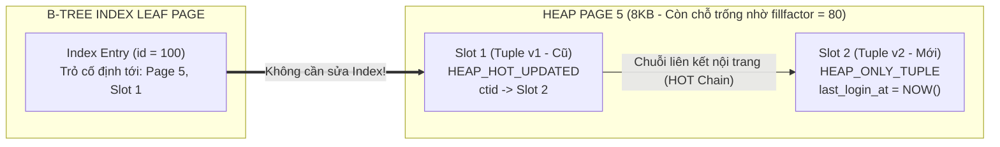
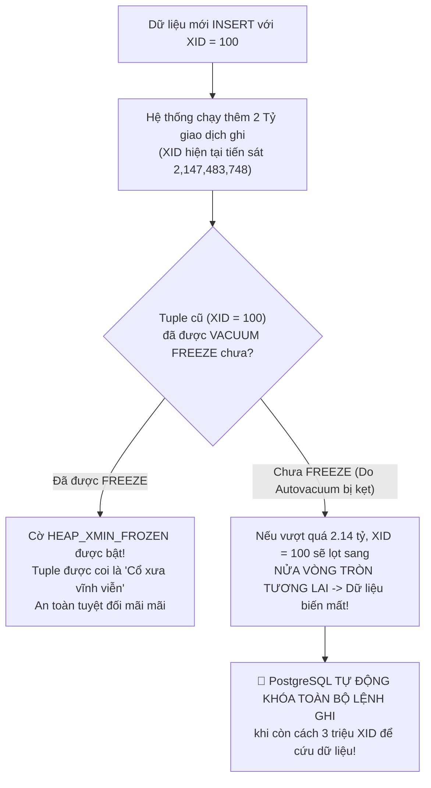

## I. KHÁI QUÁT (OVERVIEW)

### 1. Từ "Chạy được" đến "Chịu tải Hàng Chục Ngàn TPS không Gián đoạn"
Khi cài đặt PostgreSQL mặc định (ví dụ qua Docker `postgres:16-alpine`), file cấu hình `postgresql.conf` được thiết lập cực kỳ bảo thủ để có thể khởi động được trên một chiếc Raspberry Pi chỉ có 512MB RAM (`shared_buffers = 128MB`, `work_mem = 4MB`). Nếu mang nguyên cấu hình mặc định này lên một máy chủ Production 64GB RAM và ổ cứng NVMe SSD, bạn đang lãng phí **90% sức mạnh phần cứng**!

Bài học cuối cùng trong chuỗi PostgreSQL Masterclass đi sâu vào vận hành thực chiến ở quy mô lớn (Database Reliability Engineering - DBRE):
1. **Cơ chế HOT Updates (Heap-Only Tuple) & `fillfactor`:** Tại sao `UPDATE` một cột không có Index vẫn làm phình mọi Index, và cách ngăn chặn.
2. **Tinh chỉnh Autovacuum & Phòng chống Thảm họa Tràn Số Giao dịch (`XID Wraparound`).**
3. **Công thức Tinh chỉnh `postgresql.conf` Chuẩn Production** cho phần cứng hiện đại.
4. **Kiến trúc Sao chép (Streaming vs Logical Replication), Xử lý Độ trễ Đọc (Replication Lag) & High Availability (Patroni + PITR).**

---

## II. CHI TIẾT KỸ THUẬT (DETAILED DEEP DIVE)

### 1. Cơ chế HOT Updates (Heap-Only Tuple) & Tối ưu `fillfactor`

Như đã biết ở Bài 01, mỗi lệnh `UPDATE` trong PostgreSQL sẽ tạo ra một bản ghi vật lý mới (Tuple mới với vị trí `ctid` mới).
* **Vấn đề nghiêm trọng (Write Amplification):** Nếu bảng `users` có **8 cái B-Tree Index**, và bạn chỉ cập nhật cột `last_login_at` (một cột **không hề nằm trong bất kỳ Index nào**), về mặt nguyên tắc vì dòng dữ liệu mới có địa chỉ `ctid` mới, PostgreSQL vẫn phải **cập nhật lại cả 8 cây B-Tree Index** để trỏ tới dòng mới!

#### Giải pháp của PostgreSQL: HOT Updates (Heap-Only Tuple)
PostgreSQL có một cơ chế tối ưu hóa cực kỳ thông minh gọi là **HOT Update** giúp **bỏ qua hoàn toàn việc cập nhật các Index** nếu thỏa mãn đồng thời **2 điều kiện**:
1. Không có bất kỳ cột nào được đánh Index bị thay đổi giá trị trong câu lệnh `UPDATE`.
2. **Trang dữ liệu 8KB hiện tại (Heap Page) vẫn còn đủ chỗ trống** để chứa bản ghi Tuple mới nằm cùng trang với bản ghi cũ!



* **Cách kích hoạt tối đa HOT Updates trên bảng cập nhật liên tục (`wallets`, `sessions`, `products`):**
  Mặc định PostgreSQL có `fillfactor = 100` (nhồi đầy 100% trang 8KB khi `INSERT`, khiến lần `UPDATE` đầu tiên chắc chắn bị tràn sang trang khác và mất HOT Update!).
  Hãy hạ `fillfactor` xuống **`80` hoặc `85`** để luôn chừa lại 15–20% khoảng trống trên mỗi trang 8KB cho các lệnh `UPDATE` tại chỗ:
  ```sql
  ALTER TABLE wallets SET (fillfactor = 80);
  ```

---

### 2. Tinh chỉnh Autovacuum & Thảm họa Tràn Transaction ID (`XID Wraparound`)

#### a. Tại sao Cấu hình Autovacuum Mặc định gây Sập các Bảng Lớn?
Công thức kích hoạt Autovacuum mặc định là:
$$\text{Vacuum Trigger} = 50 + (0.20 \times \text{Tổng số dòng của bảng})$$
* Với một bảng có **100,000,000 dòng**, `0.20 * 100,000,000 = 20,000,000`! Nghĩa là Autovacuum sẽ ngồi im không làm gì cho tới khi bảng tích tụ đủ **20 triệu dòng rác (Dead Tuples)** — lúc đó bảng đã phình to hàng chục GB và khi Autovacuum bắt đầu chạy thì nó ngốn sạch I/O đĩa trong nhiều giờ liền!
* **Quy tắc Tinh chỉnh cho Bảng Lớn (> 10 triệu dòng):** Hạ `scale_factor` xuống `0.01` (1%) hoặc đặt ngưỡng số dòng cố định:
  ```sql
  ALTER TABLE orders SET (
      autovacuum_vacuum_scale_factor = 0.0,
      autovacuum_vacuum_threshold = 50000,       -- Cứ có 50,000 dòng chết là dọn ngay!
      autovacuum_analyze_scale_factor = 0.0,
      autovacuum_analyze_threshold = 25000,
      autovacuum_vacuum_cost_delay = 2           -- Giảm thời gian nghỉ để dọn nhanh hơn trên SSD
  );
  ```

#### b. Thảm họa `Transaction ID Wraparound` (Giới hạn 2 Tỷ Giao dịch)
Transaction ID (`xmin`, `xmax`) trong Tuple Header của PostgreSQL là một số nguyên không dấu **32-bit** ($2^{32} \approx 4.29 \text{ tỷ}$ giá trị). Để so sánh thứ tự trước/sau bằng số học modulo vòng tròn, tại mọi thời điểm chỉ có:
* **2.14 tỷ XID thuộc về Quá khứ** (Hiển thị được - Visible).
* **2.14 tỷ XID thuộc về Tương lai** (Không nhìn thấy - Invisible).



* **Cách Giám sát Tuổi XID (`age(relfrozenxid)`):**
  Ngưỡng kích hoạt `autovacuum_freeze_max_age` mặc định là **200 triệu** giao dịch, và ngưỡng sập hệ thống là **~2.1 tỷ**. Bạn cần đặt cảnh báo Prometheus/Grafana ngay khi bảng nào có tuổi XID vượt quá **500 triệu**:
  ```sql
  SELECT 
      c.oid::regclass AS table_name,
      age(c.relfrozenxid) AS xid_age,
      pg_size_pretty(pg_total_relation_size(c.oid)) AS total_size
  FROM pg_class c
  WHERE c.relkind IN ('r', 'm')
  ORDER BY age(c.relfrozenxid) DESC
  LIMIT 10;
  ```

---

### 3. Bảng Tinh chỉnh `postgresql.conf` Chuẩn Production (Ví dụ Server 16 vCPU, 64GB RAM, NVMe SSD)

| Tham số (`postgresql.conf`) | Giá trị Mặc định | Giá trị Chuẩn Production (64GB RAM / NVMe) | Giải thích Kỹ thuật & Công thức Tính |
| :--- | :--- | :--- | :--- |
| **`shared_buffers`** | `128MB` | **`16GB`** *(25% RAM)* | Bộ nhớ đệm trang dữ liệu của riêng Postgres. Không đặt quá 40% RAM vì cần nhường RAM cho OS Page Cache. |
| **`effective_cache_size`** | `4GB` | **`48GB`** *(75% RAM)* | Không cấp phát RAM thật, chỉ báo cho Planner biết tổng RAM khả dụng (Shared Buffers + OS Cache) để ưu tiên dùng **Index Scan** thay vì Seq Scan. |
| **`work_mem`** | `4MB` | **`32MB` – `64MB`** | RAM cho mỗi thao tác Sort / Hash Join. Đừng đặt `1GB` toàn cục vì 100 kết nối $\times 4$ bước Sort = 400GB (OOM!). Có thể tăng cục bộ cho 1 báo cáo nặng bằng `SET LOCAL work_mem = '256MB'`. |
| **`maintenance_work_mem`** | `64MB` | **`2GB`** | Tăng tốc độ chạy `VACUUM`, `CREATE INDEX`, `ALTER TABLE ADD FOREIGN KEY` lên gấp nhiều lần. |
| **`random_page_cost`** | `4.0` *(Cho đĩa cơ HDD)* | **`1.1`** *(Cho NVMe SSD)* | Mặc định Postgres tưởng đọc ngẫu nhiên đắt gấp 4 lần đọc tuần tự nên rất ngại dùng Index! Hạ xuống `1.1` giúp Planner chọn Index Scan chính xác trên SSD. |
| **`effective_io_concurrency`** | `1` | **`200`** | Cho phép đọc trước nhiều khối đĩa song song trên ổ cứng NVMe trong các bước Bitmap Heap Scan. |
| **`max_wal_size`** | `1GB` | **`16GB` – `32GB`** | Giãn khoảng cách giữa các lần Checkpoint, giảm lượng ghi Full-Page Writes xuống đĩa. |
| **`checkpoint_completion_target`** | `0.9` | **`0.9`** | Trải đều quá trình xả Dirty Pages ra 90% chu kỳ Checkpoint để tránh gai I/O (I/O Spikes). |
| **`wal_compression`** | `off` | **`lz4`** *(hoặc `on`)* | Nén các bản ghi WAL bằng thuật toán LZ4 siêu nhẹ, giảm 40–60% băng thông đĩa ghi WAL. |
| **`track_io_timing`** | `off` | **`on`** | Cho phép `EXPLAIN (ANALYZE, BUFFERS)` hiển thị chính xác số mili-giây đọc/ghi ổ cứng. |

---

### 4. Kiến trúc Sao chép (Replication), Độ trễ Đọc & High Availability

```mermaid
flowchart TD
    subgraph AppLayer["TẦNG ỨNG DỤNG (NODE.JS / NESTJS)"]
        WriteTraffic["Luồng Ghi (INSERT, UPDATE, DELETE)<br/>& Đọc Nhất quán Tức thì (Critical Reads)"]
        ReadTraffic["Luồng Đọc Thống kê, Tìm kiếm, Danh sách<br/>(Chấp nhận trễ vài chục ms)"]
    end

    subgraphHAPool["TẦNG ĐIỀU PHỐI KẾT NỐI & FAILOVER"]
        HAProxy["HAProxy / PgBouncer<br/>• Port 5000: Read-Write (Trỏ tới Primary)<br/>• Port 5001: Read-Only (Load Balance qua Replicas)"]
    end

    subgraph PGCluster["CỤM POSTGRESQL HIGH AVAILABILITY (Quản lý bởi Patroni + etcd)"]
        Primary[("PRIMARY NODE<br/>(Read / Write)")]
        Replica1[("STANDBY REPLICA 1<br/>(Hot Standby - Read Only)")]
        Replica2[("STANDBY REPLICA 2<br/>(Hot Standby - Read Only)")]
    end

    WriteTraffic -->|"Port 5000"| HAProxy
    ReadTraffic -->|"Port 5001"| HAProxy
    HAProxy ==>|"Ghi & Đọc chính"| Primary
    HAProxy -.->|"Phân tải Đọc"| Replica1
    HAProxy -.->|"Phân tải Đọc"| Replica2

    Primary -->|"Streaming WAL Blocks (TCP)"| Replica1
    Primary -->|"Streaming WAL Blocks (TCP)"| Replica2
```

#### a. Phân biệt Physical Streaming Replication vs Logical Replication
| Tiêu chí | Physical Streaming Replication | Logical Replication (`PUBLICATION` / `SUBSCRIPTION`) |
| :--- | :--- | :--- |
| **Bản chất luồng sao chép** | Sao chép nguyên vẹn từng bit nhị phân của trang đĩa 8KB từ WAL (`wal_level = replica`). | Giải mã WAL thành các sự kiện logic (`INSERT`, `UPDATE`, `DELETE`) theo từng bảng (`wal_level = logical`). |
| **Phạm vi sao chép** | Toàn bộ cụm Database (100% giống hệt Primary). | Có thể chọn lọc từng bảng cụ thể, hỗ trợ nối dữ liệu từ nhiều DB về Data Warehouse. |
| **Khả năng ghi trên Replica** | Hoàn toàn **Read-Only** (Không thể tạo bảng mới trên Replica). | Replica là một DB độc lập có thể tạo thêm bảng và Index riêng. |
| **Ứng dụng chính** | **High Availability (HA Failover)** & **Read Scaling (Read Replicas)**. | Nâng cấp phiên bản PostgreSQL Major Version không dừng hệ thống (Zero-Downtime Upgrade), CDC Event Streaming. |

#### b. Cạm bẫy "Vừa Lưu Xong Đọc Lại Không Thấy!" (Read-Your-Own-Writes Anomaly do Replication Lag)
Khi bạn tách luồng Ghi vào **Primary** và luồng Đọc sang **Read Replica** (trong TypeORM hoặc Prisma):
1. Người dùng cập nhật hồ sơ (`POST /profile`) $\to$ Ghi vào **Primary** lúc `12:00:00.010`.
2. Trình duyệt lập tức chuyển trang và gọi `GET /profile` lúc `12:00:00.015` $\to$ Request này được định tuyến sang **Read Replica**.
3. Do mạng nội bộ hoặc tải cao, bản ghi WAL mất `30ms` mới đồng bộ xong sang Replica $\to$ Người dùng nhìn thấy **dữ liệu cũ chưa cập nhật** (hoặc tệ hơn: vừa tạo đơn hàng xong chuyển sang trang chi tiết đơn hàng thì báo **404 Not Found**)!

---

## III. VÍ DỤ MINH HỌA VÀ PHÂN TÍCH CODE THỰC CHIẾN

### Giải pháp Tách Đọc/Ghi Thông Minh (Smart Read/Write Splitting) Chống Lỗi Replication Lag trong NestJS

Khi người dùng vừa thực hiện một thao tác Ghi (`POST`, `PUT`, `PATCH`, `DELETE`), hệ thống gắn một cờ ngắn hạn (ví dụ: Cookie hoặc Redis flag 2 giây) để **ép các truy vấn Đọc ngay sau đó của chính người dùng đó đi vào Primary**, trong khi 99% lượt đọc thông thường vẫn đi qua Read Replica!

```typescript
// ==============================================================
// File: src/database/smart-routing-db.service.ts
// Điều phối truy vấn giữa Primary và Read Replica chống lỗi Replication Lag
// ==============================================================
import { Injectable } from '@nestjs/common';
import { DataSource, EntityTarget, ObjectLiteral, SelectQueryBuilder } from 'typeorm';
import Redis from 'ioredis';

@Injectable()
export class SmartRoutingDbService {
  // Thời gian ghim người dùng vào Primary sau khi họ vừa thực hiện thao tác Ghi (2 giây)
  private readonly STICKY_PRIMARY_TTL_SECONDS = 2;

  constructor(
    private readonly dataSource: DataSource,
    private readonly redis: Redis,
  ) {}

  /**
   * Đánh dấu User vừa thực hiện thao tác GHI (Gọi sau mỗi lệnh INSERT/UPDATE/DELETE)
   */
  async markUserJustWrote(userId: string): Promise<void> {
    await this.redis.set(
      `db_sticky_primary:${userId}`,
      '1',
      'EX',
      this.STICKY_PRIMARY_TTL_SECONDS,
    );
  }

  /**
   * Tạo QueryBuilder tự động chọn Primary hoặc Read Replica an toàn
   * (Đảm bảo Read-Your-Own-Writes Consistency 100%)
   */
  async createReadQueryBuilder<Entity extends ObjectLiteral>(
    entityClass: EntityTarget<Entity>,
    alias: string,
    userId?: string,
  ): Promise<SelectQueryBuilder<Entity>> {
    let replicationMode: 'master' | 'slave' = 'slave';

    if (userId) {
      const recentlyWrote = await this.redis.exists(`db_sticky_primary:${userId}`);
      if (recentlyWrote === 1) {
        // Người dùng vừa ghi trong vòng 2 giây qua -> Đọc từ Primary để tránh Replication Lag!
        replicationMode = 'master';
      }
    }

    const queryRunner = this.dataSource.createQueryRunner(replicationMode);
    return this.dataSource
      .getRepository(entityClass)
      .createQueryBuilder(alias, queryRunner);
  }
}
```

---

## IV. LƯU Ý, CẠM BẪY VÀ QUY TẮC CỐT LÕI (BEST PRACTICES)

> [!IMPORTANT]
> ### 1. Bật tiện ích `pg_stat_statements` ngay từ Ngày Đầu Tiên
> Đây là "hộp đen máy bay" quan trọng nhất của PostgreSQL, giúp ghi lại thống kê thời gian chạy thực tế, số lần gọi, và lượng đọc đĩa của mọi câu truy vấn:
> ```sql
> CREATE EXTENSION IF NOT EXISTS pg_stat_statements;
> 
> -- Tìm 5 câu lệnh SQL đang ngốn nhiều thời gian CPU & I/O nhất của toàn bộ hệ thống:
> SELECT 
>     calls,
>     ROUND(total_exec_time::numeric, 2) AS total_time_ms,
>     ROUND(mean_exec_time::numeric, 2) AS avg_time_ms,
>     shared_blks_hit,
>     shared_blks_read,
>     LEFT(query, 120) AS query_snippet
> FROM pg_stat_statements
> ORDER BY total_exec_time DESC
> LIMIT 5;
> ```

> [!CAUTION]
> ### 2. Chiến lược Sao lưu Cứu hộ: `pg_dump` KHÔNG PHẢI là Giải pháp Backup Duy nhất cho Production!
> * Nếu bạn chỉ chạy cronjob `pg_dump` mỗi đêm lúc 00:00 và ổ cứng sập lúc 23:50, bạn sẽ **mất trắng gần 24 giờ giao dịch của khách hàng (RPO = 24h)**!
> * **Quy chuẩn Backup Bắt buộc cho Hệ thống Thực tế (PITR - Point-In-Time Recovery):**
>   Sử dụng công cụ chuyên dụng như **`pgBackRest`** hoặc **`Barman`** (hoặc dịch vụ AWS RDS Automated Backups) kết hợp:
>   1. **Physical Base Backup định kỳ** (hàng ngày/hàng tuần).
>   2. **Continuous WAL Archiving:** Đẩy liên tục mọi phân đoạn WAL 16MB vừa sinh ra lên kho lưu trữ đối tượng độc lập (AWS S3 / GCS). Nhờ đó bạn có thể khôi phục cơ sở dữ liệu về **chính xác từng giây** ngay trước khi xảy ra thảm họa (ví dụ: khôi phục về lúc `14:29:59` ngay trước khi ai đó chạy nhầm lệnh `DROP TABLE` lúc `14:30:00`)!
