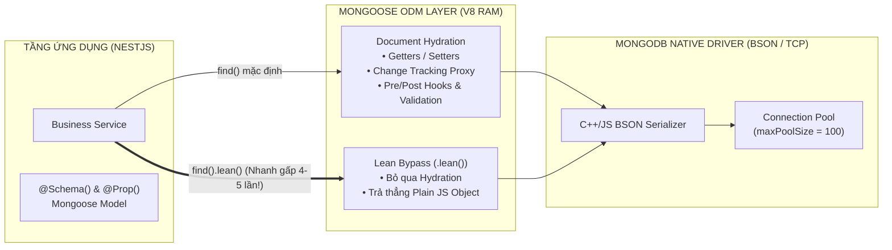
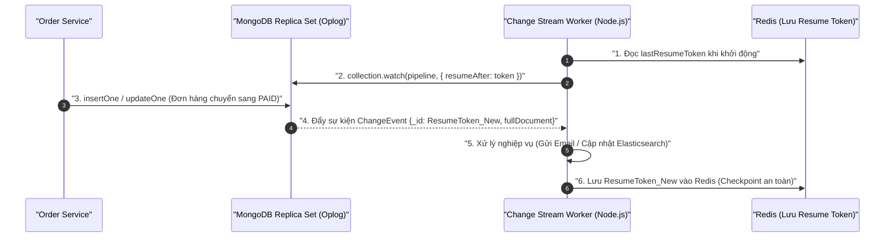

## I. KHÁI QUÁT (OVERVIEW)

### 1. Kiến trúc Tương tác giữa Node.js, Mongoose ODM và MongoDB Native Driver
Trong hệ sinh thái Node.js/NestJS, hầu hết các dự án làm việc với MongoDB thông qua **Mongoose (Object Data Modeling - ODM)** được xây dựng chồng lên trên thư viện cấp thấp **`mongodb` (Official Native Driver)**.



Mặc dù Mongoose giúp kiểm soát cấu trúc dữ liệu (Schema Validation), ép kiểu và quản lý Middleware tiện lợi, việc sử dụng Mongoose theo cách mặc định mà không hiểu cơ chế nội bộ sẽ dẫn tới **3 điểm nghẽn hiệu năng nghiêm trọng trên Production**:
1. **Chi phí Hydration khổng lồ khi quên dùng `.lean()`:** Làm tăng mức tiêu thụ RAM lên gấp **4–5 lần** và giảm thông lượng (Throughput) của API đọc dữ liệu đi **70%**.
2. **Thực thi vòng lặp `save()` rời rạc thay vì dùng `bulkWrite()`:** Biến 1 thao tác lô 5,000 bản ghi thành 5,000 lượt đi-về qua mạng (Network Round-trips).
3. **Bật `autoIndex: true` trên Production:** Khiến Mongoose tự động chạy lệnh `createIndex` ngay lúc khởi động Pod Kubernetes, làm tăng tải đĩa và treo tiến trình khởi động.

---

## II. CHI TIẾT KỸ THUẬT (DETAILED DEEP DIVE)

### 1. Bẫy Hydration trong Mongoose và Sức mạnh của `.lean()`

Khi bạn chạy câu lệnh mặc định `const docs = await this.productModel.find({ status: 'ACTIVE' })`, Mongoose không trả về các đối tượng JavaScript thuần túy (POJO), mà khởi tạo các thực thể **`HydratedDocument`** cực kỳ nặng nề:
* Gắn các bộ theo dõi thay đổi (`$__`, `isModified`, Dirty Tracking) lên mọi thuộc tính và mảng lồng nhau.
* Thiết lập hệ thống `Getter`/`Setter` ảo, hàm `.save()`, `.populate()`, và cây trạng thái Validation.

| Tiêu chí Đo đạc (Đọc 10,000 Documents) | `Model.find()` (Mặc định - Hydrated) | `Model.find().lean()` (Plain Object) | Mức độ Chênh lệch |
| :--- | :--- | :--- | :--- |
| **Thời gian thực thi CPU (V8)** | `~340 ms` | **`~65 ms`** | **Nhanh hơn 5.2 lần** |
| **Bộ nhớ Heap tiêu thụ** | `~115 MB` | **`~24 MB`** | **Tiết kiệm 79% RAM** |
| **Khi nào sử dụng?** | Chỉ khi bạn cần sửa thuộc tính trong code rồi gọi `doc.save()` để kích hoạt `@Pre('save')` hooks. | **95% mọi truy vấn đọc (`GET` APIs, xuất báo cáo, kiểm tra tồn tại).** | Chuẩn bắt buộc cho Production |

---

### 2. Thiết kế Schema Đa hình với Discriminators & Tối ưu Toán tử Nguyên tử

#### a. Đa hình Lược đồ (Polymorphic Schemas) với `Discriminators`
Trong MongoDB, nhiều thực thể có chung các trường cơ sở nhưng khác nhau ở phần dữ liệu đặc thù (ví dụ: bảng `notifications` chứa cả thông báo `EMAIL`, `SMS`, và `PUSH_APP`, hoặc bảng `events` chứa nhiều loại sự kiện khác nhau). Thay vì tạo cột `payload: Object` lỏng lẻo không có kiểm tra kiểu, **Mongoose Discriminators** cho phép lưu trữ tất cả trong **cùng 1 Collection** nhưng vẫn đảm bảo **Strict Schema Validation riêng biệt cho từng loại** dựa trên trường phân biệt (`discriminatorKey`, mặc định là `__t` hoặc `type`).

#### b. Các Toán tử Cập nhật Nguyên tử Cấp Tài Liệu (Atomic Update Operators)
Do WiredTiger đảm bảo tính ACID nguyên tử 100% trên một Document đơn lẻ, bạn **tuyệt đối không nên `findById()` lên Node.js rồi sửa mảng và gọi `.save()`** (dễ bị lỗi ghi đè Lost Update). Hãy đẩy toàn bộ logic xuống toán tử nguyên tử của MongoDB:

| Toán tử MongoDB | Tác dụng Kỹ thuật | Ví dụ Ứng dụng Thực tế |
| :--- | :--- | :--- |
| **`$inc`** | Cộng/trừ số nguyên hoặc số thực nguyên tử ngay tại RAM của WiredTiger. | Trừ tồn kho: `{ $inc: { stock: -1, soldCount: 1 } }` kèm điều kiện lọc `{ stock: { $gte: 1 } }`. |
| **`$setOnInsert`** | Chỉ gán giá trị nếu lệnh `updateOne(..., { upsert: true })` thực hiện tạo mới Document. | Gán `createdAt` hoặc số dư khởi tạo khi Upsert ví khách hàng. |
| **`$addToSet`** | Chỉ thêm phần tử vào mảng nếu phần tử đó **chưa tồn tại** trong mảng. | Thêm `tag` hoặc `role` vào mảng mà không sợ trùng lặp. |
| **`$push` + `$each` + `$slice`** | Thêm phần tử mới vào mảng, sắp xếp (`$sort`) và **cắt giữ lại đúng $N$ phần tử mới nhất (`$slice: -10`)** trong 1 lệnh nguyên tử! | Áp dụng hoàn hảo cho **Subset Pattern**: chỉ giữ lại 10 bình luận mới nhất hoặc 20 lịch sử đăng nhập gần nhất ngay trong Document cha, chống vượt ngưỡng 16MB BSON! |

```javascript
// Ví dụ: Thêm bình luận mới và tự động cắt giữ đúng 5 bình luận mới nhất trong 1 lệnh nguyên tử
await ProductModel.updateOne(
  { _id: productId },
  {
    $inc: { reviewCount: 1, totalStars: newReview.stars },
    $push: {
      recentReviews: {
        $each: [newReview],
        $sort: { createdAt: -1 },
        $slice: 5, // Luôn giới hạn mảng con đúng 5 phần tử!
      },
    },
  },
);
```

---

### 3. Thao tác Lô Hiệu năng Cao với `bulkWrite()`

Khi cần đồng bộ giá sản phẩm, cập nhật trạng thái hàng ngàn đơn hàng hoặc chèn dữ liệu từ luồng Kafka/RabbitMQ, phương thức **`Model.bulkWrite(operations, { ordered: false })`** cho phép đóng gói hàng ngàn lệnh `insertOne`, `updateOne`, `updateMany`, `deleteOne` khác nhau vào **một gói tin BSON duy nhất** gửi tới MongoDB Server:
* **`ordered: true` (Mặc định):** MongoDB thực thi tuần tự từng lệnh; nếu lệnh thứ 5 bị lỗi (ví dụ trùng Unique Key), nó dừng ngay và bỏ qua 995 lệnh phía sau.
* **`ordered: false` (Khuyên dùng cho Hiệu năng Cực đại):** MongoDB thực thi **song song (Parallel Execution)** các lệnh không phụ thuộc nhau và nếu 1 dòng lỗi, 999 dòng hợp lệ còn lại vẫn được ghi thành công!

---

### 4. Kiến trúc Hướng Sự kiện Thời gian thực với MongoDB Change Streams (`watch()`)

Từ MongoDB 3.6+, **Change Streams** cho phép ứng dụng Node.js đăng ký lắng nghe mọi sự kiện thay đổi dữ liệu (`insert`, `update`, `replace`, `delete`) theo thời gian thực trực tiếp từ **Oplog của Replica Set** mà không cần tự viết cơ chế Polling quét DB định kỳ.



> [!IMPORTANT]
> **Bí quyết Chống Mất Sự kiện Khi Worker Sập (`resumeAfter` Token):**
> Mỗi sự kiện trong Change Stream đều mang một trường `_id` chứa **`ResumeToken`** (đánh dấu vị trí con trỏ chính xác trong `oplog.rs`). Bằng cách lưu `changeEvent._id` này vào Redis sau khi xử lý xong, nếu container Node.js bị tắt đột ngột và khởi động lại sau 10 phút, bạn chỉ cần truyền `{ resumeAfter: savedToken }` vào hàm `.watch()` — MongoDB sẽ phát lại chính xác từ sự kiện tiếp theo mà không bị sót bất kỳ bản ghi nào!

---

## III. VÍ DỤ MINH HỌA VÀ PHÂN TÍCH CODE THỰC CHIẾN

### Triển khai Dịch vụ Đồng bộ Tồn kho (`bulkWrite`), Giao dịch Đa Tài liệu có Tự động Retry (`withTransaction`) và Change Stream có Resume Token trong NestJS

```typescript
// ==============================================================
// File: src/inventory/mongo-inventory-production.service.ts
// Thực chiến Mongoose & MongoDB Native Driver chuẩn Production
// ==============================================================
import {
  Injectable,
  OnModuleInit,
  OnModuleDestroy,
  BadRequestException,
  Logger,
} from '@nestjs/common';
import { InjectConnection, InjectModel } from '@nestjs/mongoose';
import { Connection, Model, Types } from 'mongoose';
import { ChangeStream, ResumeToken } from 'mongodb';
import Redis from 'ioredis';

export interface SkuStockAdjustment {
  sku: string;
  deltaQty: number;
  newPrice?: number;
}

@Injectable()
export class MongoInventoryProductionService implements OnModuleInit, OnModuleDestroy {
  private readonly logger = new Logger(MongoInventoryProductionService.name);
  private changeStream?: ChangeStream;
  private readonly RESUME_TOKEN_REDIS_KEY = 'mongo:changestream:orders:resume_token';

  constructor(
    @InjectConnection() private readonly connection: Connection,
    @InjectModel('Product') private readonly productModel: Model<any>,
    @InjectModel('Order') private readonly orderModel: Model<any>,
    private readonly redis: Redis,
  ) {}

  /**
   * 1. Truy vấn Danh sách Sản phẩm Siêu tốc với .lean() + Projection + Cursor Pagination
   */
  async listActiveProductsCursor(category: string, lastId?: string, limit = 20) {
    const filter: Record<string, any> = {
      category,
      status: 'ACTIVE',
    };

    if (lastId) {
      filter._id = { $lt: new Types.ObjectId(lastId) };
    }

    return await this.productModel
      .find(filter)
      .select({ sku: 1, title: 1, price: 1, stock: 1, recentReviews: 1 })
      .sort({ _id: -1 })
      .limit(limit)
      .lean() // BẮT BUỘC: Bỏ qua Mongoose Hydration, giảm 80% RAM và tăng tốc 5 lần!
      .exec();
  }

  /**
   * 2. Cập nhật Hàng loạt 5,000 Mã hàng trong 1 Lượt Mạng bằng unordered bulkWrite()
   */
  async syncInventoryBatch(adjustments: SkuStockAdjustment[]) {
    if (adjustments.length === 0) return { modifiedCount: 0, upsertedCount: 0 };

    const bulkOps = adjustments.map((item) => ({
      updateOne: {
        filter: { sku: item.sku },
        update: {
          $inc: { stock: item.deltaQty },
          ...(item.newPrice !== undefined ? { $set: { price: item.newPrice } } : {}),
          $setOnInsert: { createdAt: new Date(), status: 'ACTIVE' },
        },
        upsert: true,
      },
    }));

    // ordered: false giúp MongoDB chạy song song và không dừng lại nếu 1 SKU bị lỗi
    const result = await this.productModel.bulkWrite(bulkOps, { ordered: false });

    return {
      matchedCount: result.matchedCount,
      modifiedCount: result.modifiedCount,
      upsertedCount: result.upsertedCount,
    };
  }

  /**
   * 3. Giao dịch Đa Tài liệu (Multi-Document ACID Transaction) với withTransaction()
   * Tự động retry khi gặp lỗi xung đột khóa tạm thời (TransientTransactionError)
   */
  async placeOrderTransaction(userId: string, sku: string, quantity: number) {
    const session = await this.connection.startSession();

    try {
      let createdOrder: any = null;

      // withTransaction() tự động xử lý vòng lặp Retry khi có WriteConflict hoặc bầu cử Primary mới!
      await session.withTransaction(
        async () => {
          // Bước 1: Khấu trừ tồn kho nguyên tử (Chỉ thành công nếu stock >= quantity)
          const updatedProduct = await this.productModel
            .findOneAndUpdate(
              { sku, status: 'ACTIVE', stock: { $gte: quantity } },
              { $inc: { stock: -quantity, soldCount: quantity } },
              { new: true, session, lean: true },
            )
            .exec();

          if (!updatedProduct) {
            throw new BadRequestException(
              `Sản phẩm ${sku} không tồn tại hoặc không đủ số lượng tồn kho`,
            );
          }

          // Bước 2: Tạo đơn hàng mới trong cùng Session Transaction
          const [orderDoc] = await this.orderModel.create(
            [
              {
                userId: new Types.ObjectId(userId),
                items: [
                  {
                    productId: updatedProduct._id,
                    sku: updatedProduct.sku,
                    unitPrice: updatedProduct.price,
                    quantity,
                  },
                ],
                totalAmount: updatedProduct.price * quantity,
                status: 'PAID',
              },
            ],
            { session },
          );

          createdOrder = orderDoc.toObject();
        },
        {
          readPreference: 'primary',
          readConcern: { level: 'snapshot' },
          writeConcern: { w: 'majority', j: true },
        },
      );

      return createdOrder;
    } finally {
      // LUÔN LUÔN giải phóng ClientSession trong khối finally
      await session.endSession();
    }
  }

  /**
   * 4. Lắng nghe Sự kiện Đơn hàng Thời gian thực qua Change Stream có Lưu Resume Token
   */
  async onModuleInit() {
    const savedTokenJson = await this.redis.get(this.RESUME_TOKEN_REDIS_KEY);
    const resumeAfter: ResumeToken | undefined = savedTokenJson
      ? JSON.parse(savedTokenJson)
      : undefined;

    // Chỉ lắng nghe các đơn hàng vừa được tạo mới hoặc chuyển trạng thái sang 'PAID'
    const pipeline = [
      {
        $match: {
          operationType: { $in: ['insert', 'update'] },
          'fullDocument.status': 'PAID',
        },
      },
    ];

    this.changeStream = this.orderModel.collection.watch(pipeline, {
      fullDocument: 'updateLookup',
      ...(resumeAfter ? { resumeAfter } : {}),
    });

    this.changeStream.on('change', async (changeEvent) => {
      try {
        this.logger.log(
          `[ChangeStream] Phát hiện đơn hàng PAID: ${changeEvent.fullDocument?._id}`,
        );
        // Xử lý đồng bộ sang Elasticsearch / Bắn thông báo...

        // Lưu lại Resume Token mới nhất vào Redis để không mất sự kiện khi restart Pod
        await this.redis.set(
          this.RESUME_TOKEN_REDIS_KEY,
          JSON.stringify(changeEvent._id),
        );
      } catch (err: any) {
        this.logger.error(`[ChangeStream Error]: ${err.message}`);
      }
    });
  }

  async onModuleDestroy() {
    if (this.changeStream) {
      await this.changeStream.close();
    }
  }
}
```

---

## IV. LƯU Ý, CẠM BẪY VÀ QUY TẮC CỐT LÕI (BEST PRACTICES)

> [!CAUTION]
> ### 1. Cạm bẫy Quên truyền `{ session }` vào bên trong Transaction của Mongoose
> Khác với một số ORM sử dụng `AsyncLocalStorage` tự động, trong Mongoose/MongoDB Driver, nếu bạn mở `session.withTransaction()` nhưng ở một câu lệnh bên trong bạn viết `await this.orderModel.create(data)` mà **quên truyền `{ session }` vào đối số thứ hai** (và khi dùng `create()` với `session`, đối số đầu tiên **bắt buộc phải là một Mảng `[data]`**!), câu lệnh đó sẽ **chạy hoàn toàn bên ngoài Transaction** và được commit ngay lập tức bất chấp các bước sau bị Rollback!

> [!WARNING]
> ### 2. Cạm bẫy dùng `.populate()` của Mongoose trên Danh sách Lớn
> Hàm `.populate('author')` trong Mongoose thực chất không phải là phép JOIN ở mức Database, mà Mongoose đợi câu lệnh `find()` chính chạy xong, gom các `authorId` lại rồi **bắn thêm một câu lệnh `find({ _id: { $in: [...] } })` thứ hai** xuống MongoDB!
> * Nếu một bảng danh sách cần hiển thị tên và ảnh đại diện của tác giả với tần suất đọc cao, hãy áp dụng **Extended Reference Pattern** (nhúng sẵn `{ authorId, authorName, authorAvatar }` vào bài viết) thay vì lạm dụng `.populate()` hoặc `$lookup` ở mọi request.
