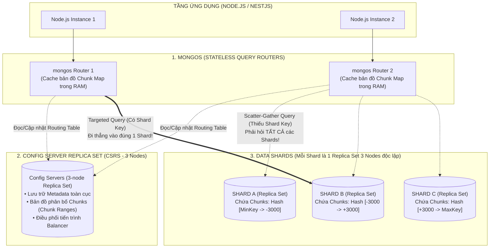
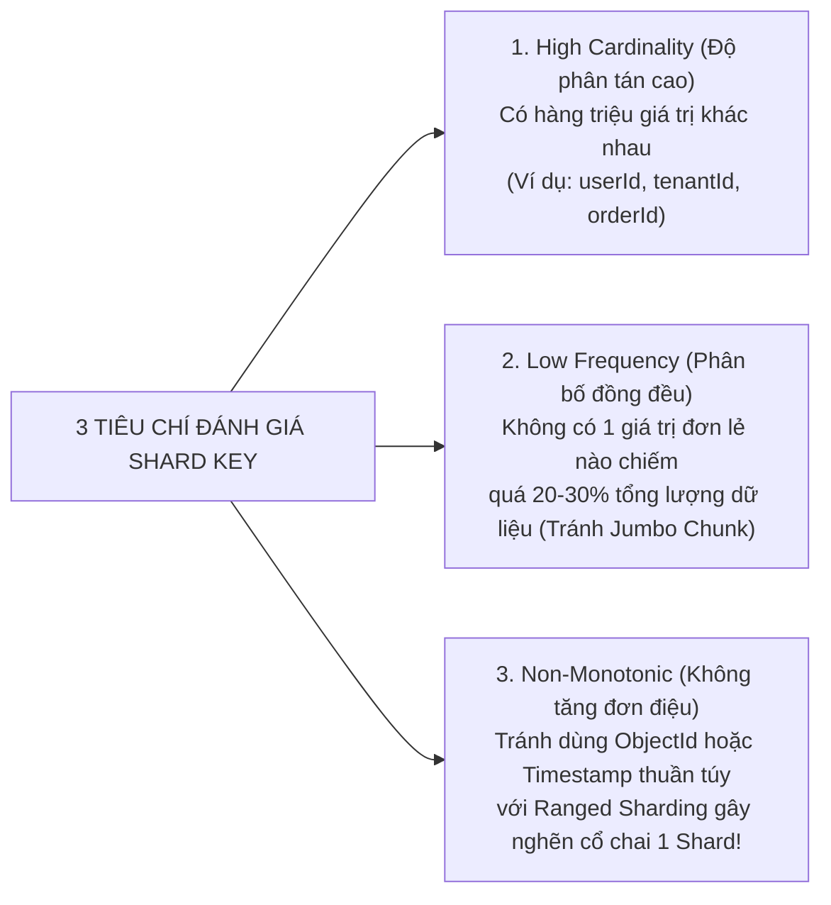
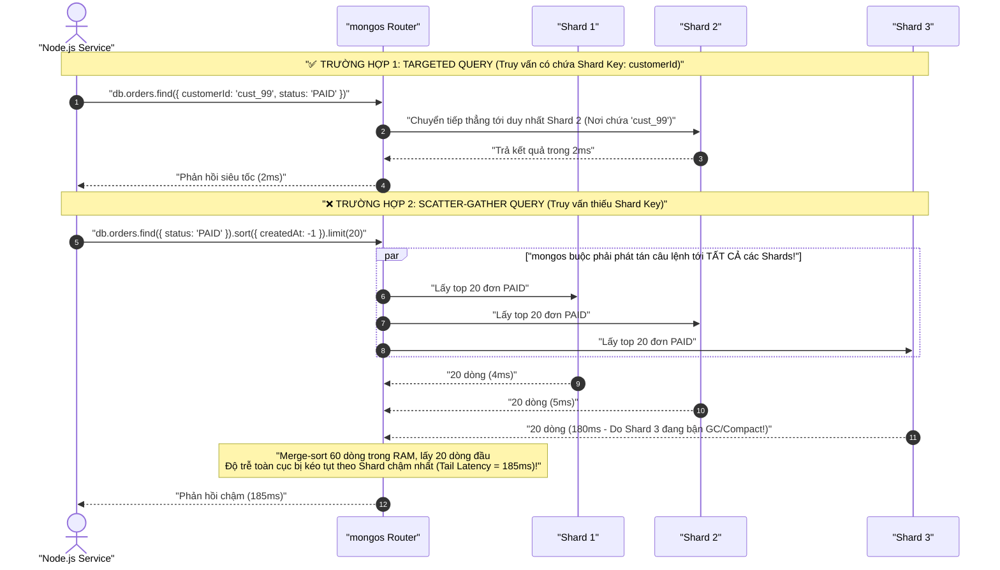

## I. KHÁI QUÁT (OVERVIEW)

### 1. Khi nào Replica Set chạm trần và Bắt buộc phải tiến tới Sharding?
Một cụm **MongoDB Replica Set** (1 Primary + 2 Secondaries) chỉ mở rộng được khả năng chịu tải **Đọc (Read Scaling)** và **Độ sẵn sàng cao (High Availability)**, nhưng **toàn bộ 100% tải Ghi (Writes) và toàn bộ dung lượng đĩa vẫn dồn lên duy nhất 1 máy chủ Primary**.

Hệ thống của bạn bắt buộc phải chuyển sang kiến trúc phân tán ngang (**Sharded Cluster**) khi chạm một trong 3 ngưỡng vật lý sau:
1. **Working Set vượt quá dung lượng RAM của máy chủ lớn nhất:** Tập dữ liệu nóng cùng toàn bộ B-Tree Indexes vượt quá khả năng lưu trữ của `WiredTiger Cache` (50% RAM), khiến tỷ lệ đọc đĩa (Cache Miss / Page Faults) tăng vọt làm sập hiệu năng.
2. **Băng thông Ghi (Write IOPS) vượt ngưỡng chịu đựng của 1 Primary Node:** Hàng chục ngàn lượt `INSERT`/`UPDATE` mỗi giây làm nghẽn ổ cứng NVMe và hàng đợi Journal của một máy đơn lẻ.
3. **Dung lượng lưu trữ vượt quá hàng chục Terabytes (TB):** Thời gian sao lưu (Backup) và khôi phục (Restore) một node đơn lẻ kéo dài quá lâu, vi phạm cam kết RTO/RPO.

---

## II. CHI TIẾT KỸ THUẬT (DETAILED DEEP DIVE)

### 1. Giải phẫu Kiến trúc Cụm Phân tán MongoDB (Sharded Cluster Architecture)

Một cụm MongoDB Sharded Cluster hoàn chỉnh bao gồm **3 thành phần cốt lõi** phối hợp chặt chẽ:



1. **`mongos` (Stateless Query Router):** Ứng dụng Node.js **không kết nối trực tiếp vào từng Shard**, mà kết nối vào các tiến trình `mongos`. `mongos` không lưu dữ liệu; nó giữ bản đồ định tuyến (Routing Table) trong RAM để biết khóa `tenantId = 'acme'` đang nằm ở Shard nào và chuyển tiếp câu truy vấn tới đúng Shard đó.
2. **Config Server Replica Set (CSRS):** Bộ não lưu trữ bảng mục lục phân vùng (**Chunk Metadata**) của toàn bộ cụm. Bắt buộc chạy dưới dạng Replica Set 3 nodes sử dụng giao thức đồng thuận Raft-like để đảm bảo an toàn tuyệt đối.
3. **Data Shards:** Nơi lưu trữ dữ liệu thực sự. **Mỗi Shard bắt buộc phải là một Replica Set (ít nhất 3 nodes: 1 Primary + 2 Secondaries)** để nếu 1 máy chủ vật lý trong Shard A bị cháy nổ, Shard A tự động bầu Primary mới mà không làm hỏng toàn bộ cụm Sharded Cluster.

---

### 2. Nghệ thuật Chọn Khóa Phân mảnh (Shard Key Selection) — Quyết định Sống Còn

Dữ liệu trong một Collection được chia thành các khối nhỏ gọi là **Chunks** (kích thước mặc định mỗi Chunk là **64MB** hoặc **128MB**) dựa trên giá trị của **Shard Key**. Một Shard Key tốt bắt buộc phải thỏa mãn **3 tiêu chí vàng**:



#### a. Tại sao dùng `_id` (`ObjectId`) hoặc `createdAt` với Ranged Sharding là một Thảm họa?
4 bytes đầu tiên của `ObjectId` là **Unix Timestamp tăng dần đều theo thời gian**. Nếu bạn chọn Ranged Sharding trên `{ _id: 1 }` hoặc `{ createdAt: 1 }`:
* Mọi bản ghi mới được `INSERT` vào hệ thống đều mang thời gian lớn nhất hiện tại $\to$ Tất cả 100% lệnh `INSERT` từ khắp nơi đều dồn vào **duy nhất 1 Chunk cuối cùng nằm trên 1 Shard duy nhất (Hot Shard / Last-Shard Bottleneck)**!
* 9 Shards còn lại trong cụm ngồi chơi không nhận được bất kỳ lệnh ghi nào, sau đó tiến trình **Balancer** lại phải tốn băng thông mạng và ổ cứng để cắt Chunk từ Shard cuối di chuyển ngược về các Shard kia!

#### b. So sánh 3 Chiến lược Thiết kế Shard Key Chuẩn Production

| Chiến lược Shard Key | Cú pháp Khai báo | Ưu điểm Vượt trội | Nhược điểm & Khi nào Sử dụng |
| :--- | :--- | :--- | :--- |
| **1. Hashed Sharding** | `sh.shardCollection("db.events", { userId: "hashed" })` | Băm giá trị `userId` bằng hàm MD5/xxHash 64-bit, giúp **phân tán đều 100% tải INSERT** ra toàn bộ các Shards ngay cả khi khóa gốc tăng dần! | Không tối ưu cho truy vấn quét khoảng giá trị (`$gt`, `$lt`) trên chính khóa đó. Rất tốt cho bảng Logs, IoT, Events. |
| **2. Ranged Sharding** | `sh.shardCollection("db.metrics", { zipCode: 1 })` | Các tài liệu có khóa gần nhau nằm cùng 1 Chunk/Shard $\to$ Truy vấn khoảng (`BETWEEN`) cực nhanh. | Dễ tạo Hot Shard nếu khóa tăng đơn điệu. |
| **3. Compound Shard Key (Khuyên dùng số 1)** | `sh.shardCollection("db.orders", { tenantId: 1, createdAt: 1 })` | **Kết hợp hoàn hảo:** `tenantId` (hoặc `customerId`) ở đầu giúp gom toàn bộ đơn hàng của 1 khách hàng về **đúng 1 Shard (Targeted Query)**, còn `createdAt` ở vị trí thứ 2 giúp chia nhỏ dữ liệu của khách hàng lớn và sắp xếp sẵn theo thời gian! | Chuẩn vàng cho hầu hết các ứng dụng SaaS, E-commerce, Fintech. |

---

### 3. Targeted Queries vs Scatter-Gather Queries (Sát thủ Độ trễ)



> [!IMPORTANT]
> **Quy tắc Thiết kế Truy vấn trên Cụm Sharded Cluster:**
> 95% các câu truy vấn OLTP có tần suất gọi cao trong ứng dụng của bạn **bắt buộc phải đính kèm tiền tố của Shard Key (Shard Key Prefix)** trong mệnh đề `filter` để `mongos` thực hiện **Targeted Query**!

---

### 4. Ma trận Cấu hình Read Concern, Write Concern & Causal Consistency

Trong một hệ thống phân tán nhiều nodes, nếu cấu hình sai cặp `writeConcern` và `readConcern`, bạn sẽ gặp hai lỗi nghiêm trọng:
1. **Mất dữ liệu đã báo thành công (Dirty Read / Write Rollback on Failover):**
   Nếu bạn ghi với `{ w: 1 }` (chỉ cần Primary ghi vào RAM xong là báo `200 OK` cho khách hàng), và đúng 1 mili-giây sau Primary bị đứt cáp mạng trước khi kịp chép Oplog sang Secondary $\to$ Secondary lên làm Primary mới. Khi Primary cũ sống lại, nó sẽ **Rollback (vứt bỏ)** bản ghi chưa kịp đồng bộ đó!
2. **Đọc trên Secondary bị thấy dữ liệu quá khứ (Causal Anomaly):**
   Nếu bạn dùng `readPreference: 'secondaryPreferred'` để giảm tải cho Primary, luồng đọc có thể rơi vào một Secondary đang trễ Oplog 50ms.

#### Bảng Cấu hình Chuẩn theo Cấp độ Nghiệp vụ

| Phân loại Nghiệp vụ | `writeConcern` | `readConcern` | `readPreference` | Giải thích & Đảm bảo Toàn vẹn |
| :--- | :--- | :--- | :--- | :--- |
| **1. Giao dịch Tài chính, Đơn hàng, Ví tiền, Tồn kho** | `{ w: 'majority', j: true, wtimeout: 5000 }` | `'majority'` *(hoặc `'snapshot'` trong Tx)* | `'primary'` | **An toàn Tuyệt đối 100%:** Dữ liệu đã được ghi xuống đĩa Journal của đa số nodes, không bao giờ bị Rollback kể cả khi Primary cháy ổ cứng ngay lập tức! |
| **2. Hồ sơ người dùng, Bài viết, Bình luận** | `{ w: 'majority' }` | `'majority'` | `'primaryPreferred'` *(hoặc dùng Causal Session)* | Cân bằng tối ưu giữa tốc độ và tính nhất quán. |
| **3. Ghi Log hành vi, Tracking Click, IoT Telemetry** | `{ w: 1, j: false }` | `'local'` | `'secondaryPreferred'` | **Tốc độ Ghi Cực đại:** Phản hồi dưới 0.5ms, chấp nhận rủi ro mất vài giây log nếu máy chủ mất điện đột ngột. |

---

## III. VÍ DỤ MINH HỌA VÀ PHÂN TÍCH CODE THỰC CHIẾN

### 1. Cấu hình Kết nối MongoDB Chuẩn Production & Đảm bảo Causal Consistency (Read-Your-Own-Writes trên Secondary) trong NestJS

Khi bật cờ `causalConsistency: true` trên `ClientSession`, MongoDB Driver sẽ tự động đính kèm dấu thời gian logic (`operationTime` và `$clusterTime` dựa trên đồng hồ Lamport / Hybrid Logical Clock) vào các câu truy vấn. Khi câu lệnh đọc tiếp theo được gửi tới một **Secondary Node**, nếu Secondary đó chưa đồng bộ Oplog tới mốc `operationTime` vừa ghi, **Secondary sẽ tự động đợi vài mili-giây cho tới khi Oplog bắt kịp rồi mới trả kết quả** — đảm bảo 100% bạn đọc trên Secondary nhưng luôn thấy dữ liệu mình vừa ghi trên Primary!

```typescript
// ==============================================================
// File: src/database/mongo-causal-consistency.service.ts
// Tận dụng Secondary Replicas để giảm tải cho Primary mà vẫn đảm bảo
// 100% Read-Your-Own-Writes & Monotonic Reads nhờ Causal Consistency!
// ==============================================================
import { Injectable } from '@nestjs/common';
import { InjectConnection, InjectModel } from '@nestjs/mongoose';
import { Connection, Model } from 'mongoose';
import { ReadConcernLevel, ReadPreferenceMode } from 'mongodb';

@Injectable()
export class MongoCausalConsistencyService {
  constructor(
    @InjectConnection() private readonly connection: Connection,
    @InjectModel('Order') private readonly orderModel: Model<any>,
  ) {}

  /**
   * Thực thi chuỗi thao tác: Ghi vào Primary -> Đọc ngay lập tức từ Secondary
   * với cam kết 100% không bao giờ bị đọc phải dữ liệu cũ (Stale Read)!
   */
  async createOrderAndReadFromSecondarySafely(
    tenantId: string,
    orderPayload: Record<string, any>,
  ) {
    // 1. Khởi tạo Session với cờ causalConsistency: true
    const session = await this.connection.startSession({
      causalConsistency: true,
      defaultTransactionOptions: {
        readConcern: { level: 'majority' as ReadConcernLevel },
        writeConcern: { w: 'majority', j: true, wtimeout: 5000 },
      },
    });

    try {
      // 2. GHI vào Primary Node (Có truyền kèm Shard Key: tenantId)
      const [created] = await this.orderModel.create(
        [
          {
            tenantId,
            ...orderPayload,
            createdAt: new Date(),
          },
        ],
        { session },
      );

      // Lúc này session.operationTime đã tự động lưu lại mốc thời gian Oplog vừa ghi trên Primary!

      // 3. ĐỌC từ Secondary Node (Giảm tải cho Primary) nhưng vẫn truyền kèm session!
      // Secondary sẽ tự động đối chiếu operationTime và chờ đồng bộ xong mốc đó mới trả về!
      const verifiedOrder = await this.orderModel
        .findOne({
          tenantId, // Luôn truyền Shard Key để mongos thực hiện Targeted Query!
          _id: created._id,
        })
        .session(session)
        .read('secondaryPreferred' as ReadPreferenceMode)
        .readConcern('majority')
        .lean()
        .exec();

      return verifiedOrder;
    } finally {
      await session.endSession();
    }
  }
}
```

---

## IV. LƯU Ý, CẠM BẪY VÀ QUY TẮC CỐT LÕI (BEST PRACTICES)

> [!CAUTION]
> ### 1. Cạm bẫy Tràn Bộ nhớ `OOMKilled` khi chạy MongoDB trong Docker / Kubernetes
> * Mặc định, WiredTiger tính toán kích thước bộ nhớ đệm theo công thức: `50% * (Tổng RAM vật lý của máy chủ Host) - 1GB`.
> * Nếu máy chủ vật lý có **64GB RAM**, nhưng bạn giới hạn Docker Container / Kubernetes Pod của MongoDB chỉ được dùng **8GB RAM** (`resources.limits.memory: 8Gi`) mà không cấu hình tường minh `--wiredTigerCacheSizeGB`, MongoDB có thể nhìn nhầm tổng RAM của Host (64GB) và cố cấp phát tới **31GB Cache**, khiến Linux Kernel lập tức tiêu diệt container với lỗi **`OOMKilled (Exit Code 137)`**!
> * **Quy tắc bắt buộc trên Container/K8s:** Luôn truyền cờ khởi động tường minh:
>   ```bash
>   mongod --wiredTigerCacheSizeGB 3.5 --bind_ip_all
>   ```
>   *(Đặt bằng khoảng 45% – 50% giới hạn Memory Limit của Container).*

> [!WARNING]
> ### 2. Cạm bẫy Bầu cử Replica Set với Số lượng Node Chẵn (2 hoặc 4 Nodes)
> Thuật toán bầu cử Primary của MongoDB yêu cầu đạt được **Quorum quá bán ($\lfloor N/2 \rfloor + 1$ phiếu bầu)**:
> * Cụm **3 nodes** cần $\lfloor 3/2 \rfloor + 1 = 2$ phiếu $\to$ Chịu được **1 node chết**.
> * Cụm **4 nodes** cần $\lfloor 4/2 \rfloor + 1 = 3$ phiếu $\to$ Cũng chỉ chịu được **1 node chết** (nếu đứt mạng chia đôi 2-2, không bên nào đủ 3 phiếu nên cả cụm tự hạ cấp xuống Read-Only hoàn toàn!).
> * **Quy tắc cốt lõi:** Luôn triển khai Replica Set với **số lượng thành phần có quyền bỏ phiếu là số lẻ (3 hoặc 5 nodes)**, tiêu chuẩn vàng là **1 Primary + 2 Secondaries** phân bổ trên 3 Availability Zones (AZs) khác nhau.

> [!TIP]
> ### 3. Tinh chỉnh Connection Pool trong NestJS (`MongooseModule.forRoot`)
> Để tránh hiện tượng tạo mới kết nối TCP/TLS liên tục khi có gai lưu lượng (Traffic Spike), hãy cấu hình rõ các thông số Pool trong NestJS:
> ```typescript
> MongooseModule.forRoot(process.env.MONGODB_URI, {
>   autoIndex: process.env.NODE_ENV !== 'production', // Tắt autoIndex trên Production!
>   maxPoolSize: 50,             // Tối đa 50 kết nối đồng thời trên mỗi Node.js instance
>   minPoolSize: 10,             // Luôn giữ ấm 10 kết nối sẵn sàng
>   maxIdleTimeMS: 30000,        // Đóng kết nối nhàn rỗi quá 30 giây
>   serverSelectionTimeoutMS: 5000,
>   socketTimeoutMS: 45000,
>   writeConcern: { w: 'majority', j: true, wtimeoutMS: 5000 },
> });
> ```
