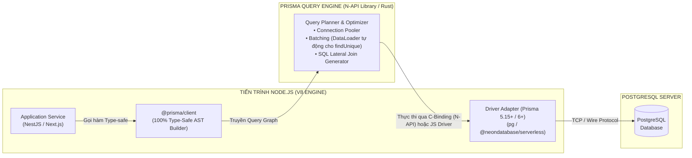
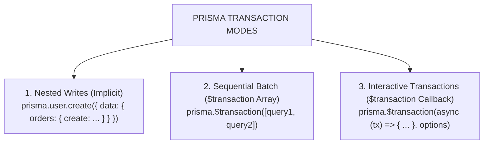

## I. KHÁI QUÁT (OVERVIEW)

### 1. Kiến trúc Động cơ của Prisma (Prisma Engine Architecture)
Khác với các ORM truyền thống trong Node.js (như TypeORM, Sequelize, MikroORM) vốn biên dịch các lời gọi hàm TypeScript thành chuỗi SQL ngay bên trong luồng JavaScript của V8 Engine, **Prisma** tách biệt hoàn toàn tầng định kiểu (**Generated TypeScript Client**) và tầng thực thi truy vấn (**Query Engine**).



#### Hai điểm đột phá kỹ thuật của Prisma trong Production:
1. **Tự động gộp truy vấn chống N+1 (`findUnique` Automatic Batching):**
   Khi bạn chạy `Promise.all(ids.map(id => prisma.user.findUnique({ where: { id } })))` trong cùng một tick của Event Loop, Prisma Engine tự động tích hợp sẵn cơ chế **DataLoader**: nó gom toàn bộ các lệnh `findUnique` rời rạc đó thành **1 câu lệnh duy nhất** `SELECT ... WHERE id IN ($1, $2, ...)`!
2. **Chiến lược Nạp Quan hệ `relationLoadStrategy: 'join'` (Prisma 5.10+ / 6+):**
   * **Hành vi cũ (`'query'` strategy):** Khi bạn gọi `prisma.user.findMany({ include: { orders: true } })`, Prisma thực hiện **2 câu lệnh SQL riêng biệt** (`SELECT FROM users` rồi `SELECT FROM orders WHERE user_id IN (...)`) và ghép dữ liệu trong RAM.
   * **Hành vi mới (`'join'` strategy):** Prisma sinh ra một câu lệnh SQL duy nhất sử dụng **`LEFT JOIN LATERAL` kết hợp `json_agg`** ngay bên dưới PostgreSQL Engine, giảm 50% độ trễ mạng (Network Round-trips) và tiết kiệm RAM!

---

## II. CHI TIẾT KỸ THUẬT (DETAILED DEEP DIVE)

### 1. Thiết kế `schema.prisma` Chuẩn Production cho PostgreSQL

Nhiều lập trình viên chỉ dùng các kiểu mặc định của Prisma (`String`, `Int`, `Float`, `DateTime`) mà không chỉ định **Native Database Types (`@db.*`)**, dẫn đến việc Prisma mặc định tạo cột `TEXT` cho mọi chuỗi, `TIMESTAMP(3)` (mất độ chính xác microsecond và không có múi giờ `TIMESTAMPTZ`!), hoặc `DOUBLE PRECISION` cho tiền tệ.

```prisma
// ==============================================================
// File: prisma/schema.prisma
// Cấu hình chuẩn Production với Native Types, Multi-Schema & Indexes
// ==============================================================
datasource db {
  provider = "postgresql"
  url      = env("DATABASE_URL")
}

generator client {
  provider        = "prisma-client-js"
  previewFeatures = ["relationJoins", "typedSql", "views"]
}

enum LedgerStatus {
  PENDING
  SETTLED
  REVERSED

  @@map("ledger_status")
}

model MerchantAccount {
  id             String   @id @default(dbgenerated("gen_random_uuid()")) @db.Uuid
  merchantCode   String   @unique @map("merchant_code") @db.VarChar(50)
  balance        Decimal  @default(0) @db.Decimal(19, 4)
  version        Int      @default(1) // Dùng cho Optimistic Concurrency Control (OCC)
  metadata       Json?    @db.JsonB
  createdAt      DateTime @default(now()) @map("created_at") @db.Timestamptz(6)
  updatedAt      DateTime @updatedAt @map("updated_at") @db.Timestamptz(6)
  deletedAt      DateTime? @map("deleted_at") @db.Timestamptz(6)

  ledgers        LedgerEntry[]

  // Đánh GIN Index trực tiếp trên cột JSONB để tăng tốc truy vấn @>
  @@index([metadata(ops: JsonbPathOps)], type: Gin, name: "idx_merchant_metadata_gin")
  @@index([createdAt(sort: Desc)], name: "idx_merchant_created_desc")
  @@map("merchant_accounts")
}

model LedgerEntry {
  id             String       @id @default(dbgenerated("gen_random_uuid()")) @db.Uuid
  merchantId     String       @map("merchant_id") @db.Uuid
  idempotencyKey String       @map("idempotency_key") @db.VarChar(100)
  amount         Decimal      @db.Decimal(19, 4)
  status         LedgerStatus @default(PENDING)
  createdAt      DateTime     @default(now()) @map("created_at") @db.Timestamptz(6)

  merchant       MerchantAccount @relation(fields: [merchantId], references: [id], onDelete: Restrict)

  // Ràng buộc chống trùng lặp giao dịch theo từng Merchant (Idempotency)
  @@unique([merchantId, idempotencyKey], name: "uq_merchant_idempotency")
  @@index([merchantId, status, createdAt(sort: Desc)], name: "idx_ledger_lookup")
  @@map("ledger_entries")
}
```

> [!IMPORTANT]
> **3 Quy tắc Sống còn trong `schema.prisma`:**
> 1. **Luôn khai báo `@db.Timestamptz(6)`** cho mọi trường `DateTime`: Mặc định Prisma sinh ra kiểu `TIMESTAMP(3)` (Without Time Zone) trên PostgreSQL, rất dễ gây sai lệch múi giờ khi chạy đa vùng (Multi-region).
> 2. **Luôn khai báo `onDelete: Restrict` (hoặc `NoAction`)** cho các bảng giao dịch tài chính / đơn hàng để ngăn chặn việc xóa nhầm một tài khoản kéo theo xóa sạch lịch sử dòng tiền (`onDelete: Cascade`).
> 3. **Sử dụng `Decimal` (`@db.Decimal(19, 4)`) cùng thư viện `decimal.js`** (được Prisma tích hợp sẵn thông qua `Prisma.Decimal`) để tính toán tiền tệ chính xác tuyệt đối, không bao giờ ép kiểu về `Number` trước khi tính toán.

---

### 2. Quản lý Giao dịch Chuyên Sâu (`$transaction`) & Khóa Dòng trong Prisma

Prisma cung cấp 3 cơ chế thực thi Transaction từ đơn giản đến phức tạp:



#### a. Cấu hình `maxWait`, `timeout` và `isolationLevel` cho Interactive Transactions
Mặc định, một Interactive Transaction trong Prisma có `timeout = 5000ms` (5 giây) và `maxWait = 2000ms` (thời gian tối đa chờ lấy connection từ Pool).

```typescript
import { Prisma } from '@prisma/client';

await prisma.$transaction(
  async (tx) => {
    // Logic nghiệp vụ bên trong Transaction
  },
  {
    maxWait: 3000, // Chờ lấy connection tối đa 3 giây
    timeout: 10000, // Transaction được chạy tối đa 10 giây
    isolationLevel: Prisma.TransactionIsolationLevel.Serializable, // Hoặc ReadCommitted
  },
);
```

#### b. Làm sao để dùng Pessimistic Locking (`SELECT ... FOR NO KEY UPDATE`) trong Prisma?
Vì cú pháp DSL `tx.model.findUnique()` của Prisma hiện chưa có cờ `lock: 'FOR NO KEY UPDATE'` trực tiếp, trong các nghiệp vụ cần khóa dòng bi quan bên trong Interactive Transaction, bạn kết hợp **`tx.$queryRaw`** (với Tagged Template an toàn 100% chống SQL Injection) cùng các hàm update của `tx`:

```typescript
// Khóa dòng an toàn bên trong Interactive Transaction của Prisma
const [lockedAccount] = await tx.$queryRaw<Array<{ id: string; balance: Prisma.Decimal }>>`
  SELECT id, balance 
  FROM merchant_accounts 
  WHERE id = ${merchantId}::uuid 
  FOR NO KEY UPDATE
`;
```

---

### 3. Kiến trúc Mở rộng với Prisma Client Extensions (`$extends`)

Từ Prisma 4.16+ và Prisma 5/6, cơ chế Middleware cũ (`prisma.$use`) đã bị **Deprecated** vì làm mất tính an toàn kiểu dữ liệu (Type Safety) và chạy tuần tự chậm chạp. Thay vào đó, **`$extends`** cho phép bạn can thiệp vào 4 tầng: `model`, `client`, `query`, và `result` với **100% Type Inference**.

#### Ứng dụng Thực chiến: Tự động Cô lập Dữ liệu Đa Khách hàng (Multi-Tenant Isolation) & Soft Delete
Trong hệ thống SaaS B2B, mọi câu lệnh đọc/ghi đều phải tự động gắn `WHERE deleted_at IS NULL` để không làm lộ dữ liệu đã xóa mềm:

```typescript
// ==============================================================
// File: src/prisma/prisma.extension.ts
// Mở rộng Prisma Client với Soft Delete & Method Tùy biến Type-Safe
// ==============================================================
import { Prisma, PrismaClient } from '@prisma/client';

export const createExtendedPrismaClient = (baseClient: PrismaClient) => {
  return baseClient.$extends({
    name: 'ProductionExtensions',

    // 1. Tầng QUERY: Tự động chặn và gắn điều kiện deletedAt: null cho mọi truy vấn đọc
    query: {
      merchantAccount: {
        async findMany({ args, query }) {
          args.where = { deletedAt: null, ...args.where };
          return query(args);
        },
        async findFirst({ args, query }) {
          args.where = { deletedAt: null, ...args.where };
          return query(args);
        },
      },
    },

    // 2. Tầng MODEL: Thêm hàm nghiệp vụ softDelete() trực tiếp vào mọi Model
    model: {
      $allModels: {
        async softDelete<T>(
          this: T,
          where: Prisma.Args<T, 'update'>['where'],
        ): Promise<Prisma.Result<T, { where: any; data: { deletedAt: Date } }, 'update'>> {
          const context = Prisma.getExtensionContext(this);
          return await (context as any).update({
            where,
            data: { deletedAt: new Date() },
          });
        },
      },
    },

    // 3. Tầng RESULT: Thêm trường tính toán ảo (Computed Field) ở tầng V8 (Không tốn cột DB)
    result: {
      merchantAccount: {
        formattedBalance: {
          needs: { balance: true },
          compute(merchant) {
            return `${merchant.balance.toFixed(2)} VND`;
          },
        },
      },
    },
  });
};

export type ExtendedPrismaClient = ReturnType<typeof createExtendedPrismaClient>;
```

---

## III. VÍ DỤ MINH HỌA VÀ PHÂN TÍCH CODE THỰC CHIẾN

### Xây dựng Dịch vụ Thanh toán Chống Trùng Lặp (Idempotent Ledger Payment) với Optimistic Concurrency Control (OCC) trong Prisma

```typescript
// ==============================================================
// File: src/ledger/ledger-payment.service.ts
// Kết hợp Idempotency Key + Optimistic Locking (Version) + relationLoadStrategy: 'join'
// ==============================================================
import {
  Injectable,
  ConflictException,
  BadRequestException,
  NotFoundException,
} from '@nestjs/common';
import { Prisma, PrismaClient } from '@prisma/client';

@Injectable()
export class LedgerPaymentService {
  constructor(private readonly prisma: PrismaClient) {}

  /**
   * 1. Lấy thông tin Merchant kèm 10 giao dịch mới nhất chỉ bằng 1 câu SQL LATERAL JOIN duy nhất
   */
  async getMerchantDashboard(merchantId: string) {
    const merchant = await this.prisma.merchantAccount.findUnique({
      where: { id: merchantId },
      relationLoadStrategy: 'join', // Bắt buộc Prisma gộp thành 1 câu SQL Lateral Join!
      include: {
        ledgers: {
          where: { status: 'SETTLED' },
          orderBy: { createdAt: 'desc' },
          take: 10,
          select: {
            id: true,
            amount: true,
            idempotencyKey: true,
            createdAt: true,
          },
        },
      },
    });

    if (!merchant) {
      throw new NotFoundException('Không tìm thấy tài khoản Merchant');
    }
    return merchant;
  }

  /**
   * 2. Khấu trừ Số dư An toàn với Idempotency Key + Optimistic Locking (OCC)
   */
  async debitMerchantAccount(params: {
    merchantId: string;
    amountStr: string;
    idempotencyKey: string;
  }) {
    const amount = new Prisma.Decimal(params.amountStr);
    if (amount.lte(0)) {
      throw new BadRequestException('Số tiền khấu trừ phải lớn hơn 0');
    }

    try {
      return await this.prisma.$transaction(async (tx) => {
        // Bước 1: Kiểm tra xem Idempotency Key này đã từng được xử lý chưa
        const existingEntry = await tx.ledgerEntry.findUnique({
          where: {
            uq_merchant_idempotency: {
              merchantId: params.merchantId,
              idempotencyKey: params.idempotencyKey,
            },
          },
        });

        if (existingEntry) {
          // Trả về ngay kết quả cũ nếu mạng retry trùng lặp (Idempotent!)
          return { duplicated: true, entry: existingEntry };
        }

        // Bước 2: Đọc thông tin số dư và version hiện tại của Merchant
        const account = await tx.merchantAccount.findUnique({
          where: { id: params.merchantId },
          select: { id: true, balance: true, version: true },
        });

        if (!account) {
          throw new NotFoundException('Merchant không tồn tại');
        }
        if (account.balance.lessThan(amount)) {
          throw new BadRequestException('Số dư tài khoản không đủ');
        }

        // Bước 3: Cập nhật số dư với điều kiện Optimistic Lock (version phải khớp!)
        // Sử dụng updateMany để kiểm tra đồng thời id + version + balance >= amount
        const updateResult = await tx.merchantAccount.updateMany({
          where: {
            id: account.id,
            version: account.version,
            balance: { gte: amount },
          },
          data: {
            balance: { decrement: amount },
            version: { increment: 1 },
          },
        });

        if (updateResult.count === 0) {
          // Có một luồng khác vừa thay đổi số dư làm lệch version -> Rollback và yêu cầu Retry!
          throw new ConflictException(
            'Xung đột cập nhật đồng thời (Optimistic Lock Mismatch), vui lòng thử lại.',
          );
        }

        // Bước 4: Ghi bút toán Ledger
        const newEntry = await tx.ledgerEntry.create({
          data: {
            merchantId: account.id,
            idempotencyKey: params.idempotencyKey,
            amount: amount.negated(),
            status: 'SETTLED',
          },
        });

        return { duplicated: false, entry: newEntry };
      });
    } catch (error) {
      // Bắt mã lỗi Unique Constraint P2002 của Prisma nếu 2 request cùng chèn 1 idempotencyKey ở cùng mili-giây
      if (
        error instanceof Prisma.PrismaClientKnownRequestError &&
        error.code === 'P2002'
      ) {
        const entry = await this.prisma.ledgerEntry.findUnique({
          where: {
            uq_merchant_idempotency: {
              merchantId: params.merchantId,
              idempotencyKey: params.idempotencyKey,
            },
          },
        });
        return { duplicated: true, entry };
      }
      throw error;
    }
  }
}
```

---

## IV. LƯU Ý, CẠM BẪY VÀ QUY TẮC CỐT LÕI (BEST PRACTICES)

> [!CAUTION]
> ### 1. Cạm bẫy SQL Injection khi dùng `$queryRawUnsafe` và Cách Truyền Mảng `IN (...)` An Toàn
> * **Tuyệt đối không bao giờ dùng** `prisma.$queryRawUnsafe(\`SELECT * FROM users WHERE email = '\${email}'\`)`!
> * Luôn dùng Tagged Template `prisma.$queryRaw\`SELECT * FROM users WHERE email = \${email}\`` (Prisma tự động biến `${email}` thành tham số `$1`).
> * **Khi cần truyền mảng vào mệnh đề `WHERE id IN (...)` hoặc tên cột động**, bắt buộc phải dùng `Prisma.join()` và `Prisma.raw()`:
>   ```typescript
>   import { Prisma } from '@prisma/client';
>   
>   const ids = ['id-1', 'id-2', 'id-3'];
>   const users = await prisma.$queryRaw`
>     SELECT id, email 
>     FROM users 
>     WHERE id IN (${Prisma.join(ids)})
>   `;
>   ```

> [!WARNING]
> ### 2. Cạm bẫy Giới hạn `connection_limit` Mặc định của Prisma trên Server Đa Lõi
> Công thức tính Connection Pool mặc định của Prisma là:
> $$\text{connection\_limit} = (\text{Số nhân CPU của Container Node.js} \times 2) + 1$$
> * Nếu bạn triển khai **20 Pods Kubernetes** của ứng dụng Node.js (mỗi Pod được cấp 4 vCPU $\to$ `connection_limit = 9`), tổng cộng 20 Pods sẽ mở tới $20 \times 9 = 180$ kết nối trực tiếp vào PostgreSQL, làm cạn kiệt `max_connections` (mặc định 100) của Postgres!
> * **Quy tắc bắt buộc:** Luôn cấu hình rõ tham số `?connection_limit=5&pool_timeout=10` trong chuỗi `DATABASE_URL` (và thêm `&pgbouncer=true` nếu đi qua PgBouncer ở chế độ Transaction Pooling).
