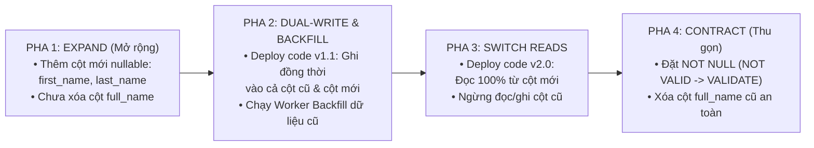
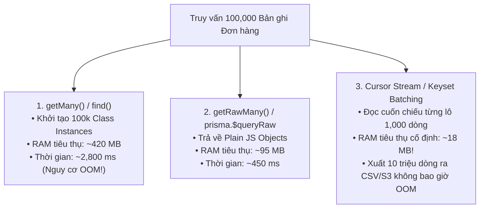

## I. KHÁI QUÁT (OVERVIEW)

### 1. Tại sao một File Migration chạy mượt trên Local lại làm Sập Hệ thống Production?
Trên máy tính cá nhân của lập trình viên (chỉ có 50 dòng dữ liệu giả lập), câu lệnh `ALTER TABLE orders ADD COLUMN is_verified BOOLEAN NOT NULL DEFAULT false` hoặc `ALTER TABLE orders ADD CONSTRAINT fk_user FOREIGN KEY (user_id) REFERENCES users(id)` chạy xong trong **5 mili-giây**.

Nhưng khi CI/CD chạy chính file Migration đó trên cơ sở dữ liệu Production đang có **80,000,000 bản ghi** và **5,000 requests/giây**:
1. Lệnh `ADD CONSTRAINT ... FOREIGN KEY` giữ khóa **`SHARE ROW EXCLUSIVE`** trên cả bảng `orders` và bảng `users`, sau đó quét toàn bộ 80 triệu dòng để kiểm tra tính hợp lệ (mất **15 phút**).
2. Trong suốt 15 phút đó, mọi giao dịch đặt hàng mới của khách hàng đều bị treo cứng $\to$ Connection Pool của Node.js cạn kiệt trong 10 giây $\to$ **Toàn bộ hệ thống sập 100% (Total Outage)**!

Bài học này trang bị cho bạn các kỹ thuật thực chiến cấp độ **Senior / Staff Engineer**:
1. **Quy trình Zero-Downtime Database Migrations** (Thêm cột `NOT NULL`, thêm `FOREIGN KEY`, tạo Index và đổi tên cột trên bảng hàng trăm triệu dòng mà không khóa bảng dù chỉ 1 giây).
2. **Chiến lược Backfill dữ liệu theo lô (Batch Backfilling)** không làm tràn WAL và Autovacuum.
3. **Tối ưu Hiệu năng ORM ở Quy mô Lớn:** Triệt tiêu chi phí Hydration, Streaming hàng triệu dòng với 20MB RAM, và Bulk Upsert tốc độ cao.

---

## II. CHI TIẾT KỸ THUẬT (DETAILED DEEP DIVE)

### 1. Bảng Cấm Kỵ & Giải pháp Thay thế Zero-Downtime trên PostgreSQL

| Thao tác Migration | ❌ Cách làm Ngây thơ (Gây Downtime) | ✅ Giải pháp Chuẩn Zero-Downtime | Giải thích Cơ chế Nội bộ PostgreSQL |
| :--- | :--- | :--- | :--- |
| **1. Tạo Index mới** | `CREATE INDEX idx_name ON tbl(col);`<br/>*(Chặn mọi INSERT/UPDATE/DELETE)* | `CREATE INDEX CONCURRENTLY idx_name ON tbl(col);` | Quét bảng 2 lần ở chế độ nền (`ShareUpdateExclusiveLock`), không chặn bất kỳ lệnh đọc/ghi nào của người dùng. |
| **2. Thêm cột có `DEFAULT`** | *(Trên PG < 11: Ghi lại toàn bộ bảng)* | Trên **PG 11+**, `ADD COLUMN col INT DEFAULT 0 NOT NULL` là **tức thì (Instant Metadata-only)** — miễn là giá trị Default không phải hàm biến thiên (`volatile`). | Postgres lưu giá trị Default vào bảng hệ thống `pg_attribute.atthasdef`, không cần sửa các dòng cũ trên đĩa! |
| **3. Thêm `FOREIGN KEY` vào bảng lớn** | `ALTER TABLE orders ADD CONSTRAINT fk_u FOREIGN KEY (user_id) REFERENCES users(id);` | **Bước 1:** `ADD CONSTRAINT fk_u FOREIGN KEY (...) NOT VALID;`<br/>**Bước 2:** `VALIDATE CONSTRAINT fk_u;` | Cờ **`NOT VALID`** chỉ áp dụng khóa `AccessExclusiveLock` trong **1ms** để ghi metadata (bỏ qua quét dữ liệu cũ). Lệnh `VALIDATE CONSTRAINT` sau đó chỉ giữ khóa yếu (`ShareUpdateExclusive`), không chặn đọc/ghi! |
| **4. Đặt `SET NOT NULL` cho cột cũ** | `ALTER TABLE tbl ALTER COLUMN col SET NOT NULL;`<br/>*(Phải Seq Scan toàn bảng trong lúc giữ `AccessExclusiveLock`!)* | **Bước 1:** Tạo `CHECK (col IS NOT NULL) NOT VALID`<br/>**Bước 2:** `VALIDATE CONSTRAINT`<br/>**Bước 3:** `ALTER COLUMN col SET NOT NULL` (PG 12+ nhận diện đã có Check hợp lệ nên hoàn tất trong 1ms!) | Biến thao tác quét bảng khóa độc quyền thành thao tác kiểm tra không khóa bảng. |
| **5. Đổi tên cột / Đổi kiểu dữ liệu** | `ALTER TABLE tbl RENAME COLUMN a TO b;` | **Mô hình Expand-and-Contract (4 pha)** | Giữa lúc DB vừa đổi tên cột mà Pods Node.js cũ vẫn đang chạy bản code cũ tìm cột `a`, toàn bộ Pods cũ sẽ văng lỗi `column "a" does not exist`! |

---

### 2. Giải phẫu Mô hình Expand-and-Contract (Đổi tên / Tách cột Không Gián đoạn)

Giả sử bạn muốn đổi cột `full_name` thành `first_name` và `last_name` trên hệ thống đang chạy Kubernetes Rolling Update (các container code cũ `v1` và code mới `v2` chạy song song trong vài phút):



---

### 3. Tối ưu Hóa Hiệu Năng ORM: Hydration Overhead, Streaming & Bulk Operations

#### a. Chi phí Ẩn của Quá trình Hydration (Object Mapping Overhead)
Khi bạn gọi `repository.find()` hoặc `queryBuilder.getMany()` để lấy 50,000 bản ghi trong TypeORM:
1. Driver `pg` nhận 50,000 dòng nhị phân từ socket mạng và chuyển thành 50,000 Plain JS Objects.
2. TypeORM chạy vòng lặp qua 50,000 dòng đó, khởi tạo `new Entity()` cho từng dòng, gọi `reflect-metadata`, chạy các `ValueTransformer`, xử lý ghép cây quan hệ (`RelationIdLoader`) và kiểm tra trùng lặp thực thể.
* **Hệ quả thực tế:** Tốc độ chậm hơn **4–6 lần** và tiêu tốn bộ nhớ RAM gấp **3–5 lần** so với truy vấn dữ liệu thô!



#### b. Cạm bẫy `repository.save(entitiesArray)` khi Lưu Hàng Loạt
Nhiều lập trình viên dùng `await userRepo.save(arrayOf5000Users)` để chèn hoặc cập nhật 5,000 bản ghi.
* **Sự thật bên dưới TypeORM:** Phương thức `.save()` được thiết kế để hỗ trợ Lifecycle Hooks (`@BeforeInsert`, `@AfterUpdate`) và kiểm tra sự tồn tại của bản ghi trước khi lưu:
  1. Nó thực hiện các câu lệnh `SELECT` để kiểm tra xem các ID đó đã có trong DB chưa.
  2. Nó chia nhỏ và chạy hàng loạt câu lệnh `INSERT` / `UPDATE` riêng lẻ, gây tắc nghẽn hoàn toàn Connection Pool!
* **Quy tắc bắt buộc khi xử lý lô lớn (> 100 bản ghi):**
  * Dùng **`createQueryBuilder().insert().into(Entity).values(chunk).orUpdate(...).execute()`** trong TypeORM.
  * Hoặc dùng **`prisma.model.createManyAndReturn({ data: chunk, skipDuplicates: true })`** trong Prisma!

---

## III. VÍ DỤ MINH HỌA VÀ PHÂN TÍCH CODE THỰC CHIẾN

### 1. Viết File Migration Zero-Downtime Chuẩn Xác trong TypeORM
Để chạy được lệnh `CREATE INDEX CONCURRENTLY` trong PostgreSQL, lệnh đó **bắt buộc phải nằm ngoài khối `BEGIN ... COMMIT` Transaction**. Trong TypeORM, mặc định mọi file Migration đều bị bọc trong 1 Transaction trừ khi bạn tắt cờ `transaction = false`:

```typescript
// ==============================================================
// File: src/migrations/1731845000000-ZeroDowntimeOrderEnhancement.ts
// Migration chuẩn Production: Không khóa bảng trên hệ thống 100 triệu dòng
// ==============================================================
import { MigrationInterface, QueryRunner } from 'typeorm';

export class ZeroDowntimeOrderEnhancement1731845000000 implements MigrationInterface {
  // BẮT BUỘC: Tắt Transaction mặc định của TypeORM để chạy được CREATE INDEX CONCURRENTLY
  public transaction = false;

  public async up(queryRunner: QueryRunner): Promise<void> {
    // 1. Đặt chốt chặn an toàn: Nếu sau 2 giây không lấy được khóa metadata thì hủy ngay,
    // tuyệt đối không xếp hàng làm tắc nghẽn luồng traffic của khách hàng!
    await queryRunner.query(`SET lock_timeout = '2s'`);
    await queryRunner.query(`SET statement_timeout = '0'`);

    // 2. Tạo Index mới ở chế độ CONCURRENTLY (Hoàn toàn không khóa INSERT/UPDATE/DELETE)
    await queryRunner.query(`
      CREATE INDEX CONCURRENTLY IF NOT EXISTS "idx_orders_merchant_status_created"
      ON "orders" ("merchant_id", "status", "created_at" DESC)
    `);

    // 3. Thêm Foreign Key an toàn bằng kỹ thuật NOT VALID + VALIDATE CONSTRAINT
    await queryRunner.query(`
      ALTER TABLE "orders"
      ADD CONSTRAINT "fk_orders_merchant_id"
      FOREIGN KEY ("merchant_id") REFERENCES "merchant_accounts"("id")
      ON DELETE RESTRICT
      NOT VALID
    `);

    // Lệnh VALIDATE chỉ giữ ShareUpdateExclusiveLock (Không chặn đọc/ghi trên bảng!)
    await queryRunner.query(`
      ALTER TABLE "orders"
      VALIDATE CONSTRAINT "fk_orders_merchant_id"
    `);

    // 4. Đặt NOT NULL cho cột cũ mà không cần quét bảng với AccessExclusiveLock
    await queryRunner.query(`
      ALTER TABLE "orders"
      ADD CONSTRAINT "chk_orders_currency_not_null"
      CHECK ("currency" IS NOT NULL) NOT VALID
    `);

    await queryRunner.query(`
      ALTER TABLE "orders"
      VALIDATE CONSTRAINT "chk_orders_currency_not_null"
    `);

    // Từ PostgreSQL 12+, vì đã có CHECK constraint hợp lệ ở trên, lệnh SET NOT NULL dưới đây hoàn tất trong 1ms!
    await queryRunner.query(`
      ALTER TABLE "orders"
      ALTER COLUMN "currency" SET NOT NULL
    `);

    // Xóa CHECK constraint tạm sau khi cột đã chính thức thành NOT NULL
    await queryRunner.query(`
      ALTER TABLE "orders"
      DROP CONSTRAINT "chk_orders_currency_not_null"
    `);
  }

  public async down(queryRunner: QueryRunner): Promise<void> {
    await queryRunner.query(`SET lock_timeout = '2s'`);
    await queryRunner.query(`ALTER TABLE "orders" ALTER COLUMN "currency" DROP NOT NULL`);
    await queryRunner.query(`ALTER TABLE "orders" DROP CONSTRAINT IF EXISTS "fk_orders_merchant_id"`);
    await queryRunner.query(`DROP INDEX CONCURRENTLY IF EXISTS "idx_orders_merchant_status_created"`);
  }
}
```

---

### 2. Kỹ thuật Xuất Báo Cáo Hàng Triệu Dòng Không Tràn RAM (Keyset Cursor Stream) & Bulk Upsert

```typescript
// ==============================================================
// File: src/orders/high-scale-order.service.ts
// Xử lý dữ liệu quy mô lớn: Bulk Upsert theo Lô & Keyset Streaming Xuất File
// ==============================================================
import { Injectable } from '@nestjs/common';
import { DataSource } from 'typeorm';
import { Response } from 'express';

export interface ProductPriceSyncItem {
  sku: string;
  title: string;
  priceMinor: number;
  stock: number;
}

@Injectable()
export class HighScaleOrderService {
  constructor(private readonly dataSource: DataSource) {}

  /**
   * 1. Đồng bộ 50,000 Sản phẩm bằng Bulk Upsert chia theo lô (Chunking 1,000 bản ghi/lần)
   * Tránh lỗi vượt quá giới hạn 65,535 tham số ($1..$65535) của PostgreSQL Wire Protocol!
   */
  async bulkUpsertProducts(items: ProductPriceSyncItem[]): Promise<number> {
    // PostgreSQL giới hạn tối đa 65,535 bind parameters cho 1 câu lệnh.
    // Mỗi item có 4 trường -> Kích thước lô 1,000 items = 4,000 tham số (An toàn và tối ưu nhất).
    const CHUNK_SIZE = 1000;
    let totalProcessed = 0;

    for (let i = 0; i < items.length; i += CHUNK_SIZE) {
      const chunk = items.slice(i, i + CHUNK_SIZE);

      await this.dataSource
        .createQueryBuilder()
        .insert()
        .into('products')
        .values(
          chunk.map((item) => ({
            sku: item.sku,
            title: item.title,
            price_minor: item.priceMinor,
            stock: item.stock,
          })),
        )
        // Tương đương ON CONFLICT (sku) DO UPDATE SET ...
        .orUpdate(['title', 'price_minor', 'stock', 'updated_at'], ['sku'])
        .execute();

      totalProcessed += chunk.length;
    }

    return totalProcessed;
  }

  /**
   * 2. Xuất 5,000,000 Đơn hàng ra CSV trực tiếp về HTTP Response bằng Keyset Batch Streaming
   * Dung lượng RAM tiêu thụ luôn giữ phẳng ở mức < 25MB và không giữ kết nối DB quá lâu!
   */
  async streamOrdersToCsvResponse(res: Response, year: number): Promise<void> {
    res.setHeader('Content-Type', 'text/csv; charset=utf-8');
    res.setHeader(
      'Content-Disposition',
      `attachment; filename="orders_report_${year}.csv"`,
    );

    // Ghi dòng tiêu đề CSV
    res.write('id,customer_id,total_amount,status,created_at\n');

    const BATCH_SIZE = 2000;
    let lastId: string | null = null;

    while (true) {
      // Dùng Keyset Pagination (WHERE id > lastId) để mỗi lô đọc tốn dưới 3ms trên B-Tree Index!
      const rows: Array<{
        id: string;
        customer_id: string;
        total_amount: string;
        status: string;
        created_at: Date;
      }> = await this.dataSource.query(
        `SELECT id, customer_id, total_amount, status, created_at
         FROM orders
         WHERE created_at >= MAKE_DATE($1, 1, 1)
           AND created_at < MAKE_DATE($1 + 1, 1, 1)
           AND ($2::UUID IS NULL OR id > $2::UUID)
         ORDER BY id ASC
         LIMIT $3`,
        [year, lastId, BATCH_SIZE],
      );

      if (rows.length === 0) {
        break; // Đã đọc hết toàn bộ dữ liệu
      }

      const csvChunk = rows
        .map(
          (r) =>
            `${r.id},${r.customer_id},${r.total_amount},${r.status},${r.created_at.toISOString()}`,
        )
        .join('\n') + '\n';

      // Kiểm tra Backpressure của luồng mạng (Nếu client mạng chậm thì đợi xả buffer)
      const canContinue = res.write(csvChunk);
      if (!canContinue) {
        await new Promise<void>((resolve) => res.once('drain', resolve));
      }

      lastId = rows[rows.length - 1].id;
    }

    res.end();
  }
}
```

---

## IV. LƯU Ý, CẠM BẪY VÀ QUY TẮC CỐT LÕI (BEST PRACTICES)

> [!CAUTION]
> ### 1. Cạm bẫy Giới hạn 65,535 Tham số (`PostgreSQL Bind Parameters Limit`)
> Giao thức mạng nhị phân của PostgreSQL sử dụng số nguyên **16-bit (`Int16`)** để đếm số lượng tham số truyền vào câu lệnh (`$1, $2, ...`), nghĩa là một câu truy vấn chỉ được phép chứa tối đa **65,535 tham số**.
> * Nếu một bảng có 10 cột và bạn truyền mảng **7,000 đối tượng** vào một lệnh `insert().values(7000_items)` hoặc `WHERE id IN (...70000_ids)`, ứng dụng sẽ sập ngay lập tức với lỗi: `bind message has X parameter formats but 0 parameters`!
> * **Quy tắc cốt lõi:** Luôn cắt mảng dữ liệu lớn thành từng lô (**Chunk size = 500 đến 1,000 bản ghi**) trước khi gọi Bulk Insert hoặc truy vấn `IN`.

> [!WARNING]
> ### 2. Tại sao Keyset Batching vượt trội hơn Database Cursor (`.stream()`) khi Đi qua PgBouncer?
> * Khi bạn dùng `queryBuilder.stream()` (sử dụng con trỏ `DECLARE CURSOR` của Postgres), tiến trình Node.js phải **giữ khư khư 1 kết nối Database mở liên tục** trong suốt thời gian người dùng tải file (có thể kéo dài 2–3 phút nếu mạng 4G của khách hàng chậm).
> * Ngược lại, kỹ thuật **Keyset Batching (`WHERE id > lastId LIMIT 2000`)** ở Ví dụ 2 chỉ mượn kết nối DB trong **3 mili-giây** để lấy 2,000 dòng, trả kết nối về lại PgBouncer Pool ngay lập tức, rồi chờ mạng xả dữ liệu về cho Client xong mới lấy lô tiếp theo!

> [!IMPORTANT]
> ### 3. Cấm tuyệt đối `synchronize: true` hoặc `prisma db push` trên Staging / Production
> Cờ `synchronize: true` trong TypeORM tự động so sánh Class Entity với Database mỗi khi khởi động server. Nếu bạn đổi tên một thuộc tính trong TypeScript từ `phone` thành `phoneNumber`, TypeORM sẽ hiểu là **"Xóa cột `phone` cũ và tạo cột `phoneNumber` mới rỗng" (`DROP COLUMN phone`)** — làm bay màu vĩnh viễn toàn bộ dữ liệu số điện thoại của khách hàng ngay khi vừa deploy!
