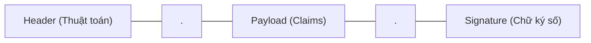
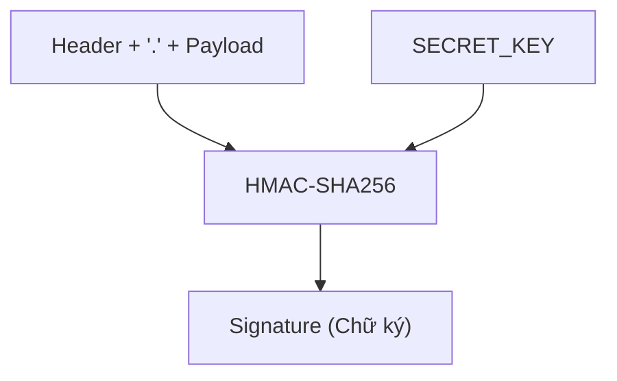

## I. JWT LÀ GÌ? VỊ TRÍ TRONG HỆ THỐNG XÁC THỰC
**JWT (JSON Web Token - RFC 7519)** là một chuẩn mở định nghĩa cách truyền tải thông tin an toàn, nhỏ gọn và độc lập (Self-contained) giữa các bên dưới dạng một đối tượng JSON.



Một chuỗi JWT hoàn chỉnh luôn có định dạng:
$$\text{JWT} = \text{Base64Url}(\text{Header}) \ .\ \text{Base64Url}(\text{Payload}) \ .\ \text{Signature}$$

---

## II. BÓC TÁCH 3 THÀNH PHẦN CỐT LÕI

### 1. Header (Tiêu đề)
Header thông báo cho Server biết token này được tạo bởi loại token nào và sử dụng thuật toán mật mã nào để ký:
```json
{
  "alg": "HS256",
  "typ": "JWT"
}
```
* `alg`: Thuật toán ký số (ví dụ: `HS256` - HMAC SHA-256 đối xứng, hoặc `RS256` - RSA bất đối xứng Private/Public Key).
* `typ`: Luôn luôn là `"JWT"`.
Chuỗi JSON này sau đó được chuyển thành chuỗi nhị phân và mã hóa dạng `Base64Url`.

---

### 2. Payload (Dữ liệu / Claims)
Payload chứa các thông tin (Claims) mà hệ thống muốn token mang theo. Claims được chia làm 3 nhóm:

#### a. Registered Claims (Các thuộc tính tiêu chuẩn theo chuẩn RFC 7519)
| Claim | Tên đầy đủ | Ý nghĩa thực tế |
| :--- | :--- | :--- |
| `sub` | Subject | Định danh duy nhất của chủ thể (thường là `userId`: `"usr_100234"`). |
| `iat` | Issued At | Thời điểm phát hành token (Unix timestamp tính bằng giây: `1700000000`). |
| `exp` | Expiration Time | Thời điểm hết hạn token (Unix timestamp tính bằng giây). |
| `iss` | Issuer | Đơn vị phát hành token (ví dụ: `"auth.mycompany.com"`). |
| `jti` | JWT ID | **Mã định danh duy nhất của token** (chuỗi UUID). Cực kỳ quan trọng để lưu Whitelist/Blacklist thu hồi phiên. |

#### b. Custom Claims (Thuộc tính tùy chỉnh của ứng dụng)
Các thông tin nghiệp vụ cần thiết để Server phân quyền nhanh mà không cần query Database:
```json
{
  "sub": "usr_998877",
  "email": "dohuy@example.com",
  "role": "ADMIN",
  "permissions": ["USER_READ", "USER_WRITE", "PAYMENT_EXEC"],
  "jti": "e6a47a76-2e71-4a5f-9204-58a2d3b4e999",
  "iat": 1710000000,
  "exp": 1710000900
}
```

> [!CAUTION]
> ### 🚨 LƯU Ý BẢO MẬT QUAN TRỌNG:
> **Payload CHỈ được mã hóa dạng Base64Url, HOÀN TOÀN KHÔNG PHẢI MÃ HÓA BẢO MẬT (Not Encrypted)!**
> Bất kỳ ai chặn được gói tin hoặc có token đều có thể vào trang web `https://jwt.io` và giải mã đọc 100% nội dung Payload dạng văn bản thuần.
> 
> **Quy tắc bất di bất dịch:**
> * ❌ **CẤM LƯU:** Password, mã OTP, số thẻ tín dụng, API Secret Keys vào Payload.
> * ✅ **CHỈ LƯU:** ID người dùng (`sub`), vai trò (`role`), thời gian sống (`exp`), mã phiên (`jti`).

---

### 3. Signature (Chữ ký số - Trái tim an ninh của JWT)
Chữ ký số được dùng để đảm bảo thông tin bên trong Header và Payload **chưa từng bị chỉnh sửa (Tamper-proof)** trên đường truyền.

#### Cách thức Server tính toán chữ ký (Với thuật toán đối xứng HS256):
$$\text{Signature} = \text{HMAC-SHA256}\Big(\text{Base64Url}(\text{Header}) + \text{"."} + \text{Base64Url}(\text{Payload}), \ \text{SECRET\_KEY}\Big)$$



#### Kịch bản kẻ tấn công can thiệp dữ liệu:
1. Giả sử hacker muốn nâng quyền tài khoản. Hacker giải mã Payload và sửa `"role": "USER"` thành `"role": "ADMIN"`.
2. Hacker mã hóa lại Base64Url rồi gửi token này lên Server.
3. Khi Server nhận token, Server lấy Header và Payload mới gửi lên, rồi dùng `SECRET_KEY` giấu kín trên server để tính toán lại chữ ký:
   $$\text{Chữ ký Server tự tính} \neq \text{Chữ ký Hacker gửi kèm trong token}$$
4. Server phát hiện dữ liệu đã bị sửa đổi $\rightarrow$ Lập tức từ chối request với mã lỗi **HTTP 401 Unauthorized**.
