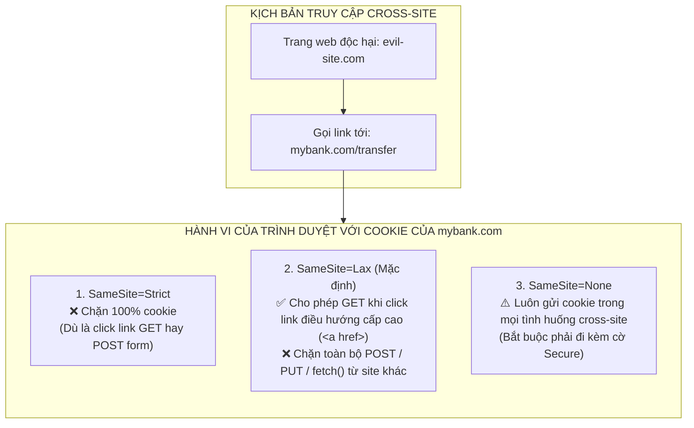

# CHUYÊN ĐỀ 02: COOKIE & CƠ CHẾ TRÌNH DUYỆT VẬN HÀNH

---

## I. TRÌNH DUYỆT LƯU TRỮ VÀ QUẢN LÝ COOKIE NHƯ THẾ NÀO?
Cookie là một mẩu dữ liệu nhỏ do Server chỉ thị cho Trình duyệt lưu trữ thông qua HTTP Response Header: `Set-Cookie`.
Trình duyệt quản lý các cookie trong một kho chuyên dụng gọi là **Cookie Jar (Cookie Store)** và phân vùng tách biệt theo từng tên miền (Origin/Domain).

```mermaid
sequenceDiagram
    autonumber
    actor User as "Người dùng / Trình duyệt"
    participant App as "Frontend (Next.js)"
    participant API as "Backend (NestJS)"

    User->>App: "Nhập Email & Mật khẩu"
    App->>API: "POST /auth/login { email, pass }"
    Note over API: "Xác thực mật khẩu hợp lệ.<br/>Tạo Refresh Token."
    API-->>User: "HTTP 200 OK<br/>Set-Cookie: refreshToken=abc...; HttpOnly; Secure; SameSite=Lax; Path=/<br/>Body: { accessToken: 'xyz...' }"
    Note over User: "Trình duyệt tự động lưu 'refreshToken' vào Cookie Jar.<br/>JavaScript KHÔNG THỂ đọc được vì có cờ HttpOnly."
    
    User->>App: "Bấm xem hồ sơ cá nhân"
    App->>API: "GET /auth/profile<br/>Header: { Authorization: 'Bearer xyz...' }<br/>(Trình duyệt tự động đính kèm Cookie: refreshToken=abc...)"
    API-->>App: "HTTP 200 OK (Dữ liệu Profile)"
```

---

## II. 5 CỜ AN NINH SỐNG CÒN CỦA COOKIE (SECURITY FLAGS)

Khi chỉ thị trình duyệt lưu Cookie, Server gửi chuỗi chỉ thị theo chuẩn RFC 6265:
```http
Set-Cookie: refreshToken=eyJhbGci...; Path=/; Max-Age=604800; HttpOnly; Secure; SameSite=Lax
```

| Cờ an ninh (Flag) | Bản chất kỹ thuật | Ý nghĩa bảo mật thực tế |
| :--- | :--- | :--- |
| **`HttpOnly`** | Trình duyệt cấm hoàn toàn mã lệnh JavaScript (thông qua `document.cookie`) đọc hoặc ghi cookie này. | **Khắc phục 100% nguy cơ đánh cắp token qua lỗ hổng XSS (Cross-Site Scripting).** Dù web dính XSS thì hacker cũng không lấy được token. |
| **`Secure`** | Trình duyệt chỉ gửi kèm cookie này khi kết nối được mã hóa bằng giao thức **HTTPS** (trừ ngoại lệ `localhost` khi lập trình viên dev). | Chống nghe lén gói tin (Man-In-The-Middle - MITM) khi người dùng dùng Wi-Fi công cộng. |
| **`SameSite`** | Kiểm soát việc trình duyệt có gửi cookie hay không khi người dùng thực hiện truy vấn Cross-Site (từ website thứ ba). | **Vũ khí phòng thủ số 1 chống lại tấn công CSRF (Cross-Site Request Forgery).** |
| **`Path`** | Đường dẫn URL hợp lệ mà cookie được phép gửi lên (ví dụ: `Path=/` hoặc `Path=/auth/refresh`). | Giới hạn cookie chỉ gửi cho các API thực sự cần thiết. |
| **`Max-Age` / `Expires`** | Thời gian sống của cookie (tính bằng giây). | Nếu không đặt cờ này, cookie sẽ trở thành **Session Cookie** (tự động biến mất khi người dùng đóng trình duyệt). |

---

## III. BÓC TÁCH CƠ CHẾ `SameSite`: STRICT vs LAX vs NONE

Hiểu rõ `SameSite` là bài kiểm tra phân loại Senior Engineer:



1. **`SameSite=Strict`:** Cookie **chỉ được gửi** nếu request xuất phát từ chính tên miền đó (Same-Site). Nếu người dùng đang lướt Facebook mà bấm vào link dẫn sang `mybank.com`, trình duyệt sẽ **không** gửi cookie của `mybank.com`. Khách hàng phải đăng nhập lại.
2. **`SameSite=Lax` (Khuyến nghị chuẩn Production):** Cân bằng giữa an ninh và trải nghiệm người dùng. Cho phép gửi cookie khi người dùng bấm link điều hướng an toàn (`GET` từ thẻ `<a>`), nhưng **chặn tuyệt đối** các request có khả năng thay đổi trạng thái như `POST`, `PUT`, `DELETE`, `iframe` hoặc `fetch()` từ trang web khác.
3. **`SameSite=None`:** Cho phép gửi cookie trong mọi trường hợp cross-site. **Bắt buộc phải có cờ `Secure`**. Chỉ dùng khi làm hệ thống Single Sign-On (SSO) hoặc nhúng Widget bên thứ ba.

---

## IV. CƠ CHẾ CORS & ĐIỀU KIỆN GỬI COOKIE CROSS-ORIGIN

Khi Frontend chạy tại `http://localhost:3000` và Backend chạy tại `http://localhost:4000`, trình duyệt coi đây là **2 Origin khác nhau** (khác Port).

### 1. Phía Frontend: Bắt buộc cấu hình Credentials
Theo cơ chế bảo mật của trình duyệt, các hàm `fetch` hay `axios` mặc định **sẽ không gửi cookie** sang origin khác và cũng **bỏ qua cookie trả về từ response**.
* **Với Fetch API:** Bắt buộc phải thêm `credentials: 'include'`:
  ```typescript
  fetch('http://localhost:4000/auth/refresh', {
    method: 'POST',
    credentials: 'include', // 👉 Yêu cầu trình duyệt tự gửi & nhận Cookie
  });
  ```
* **Với Axios:** Bắt buộc cấu hình: `axios.defaults.withCredentials = true;`.

### 2. Phía Backend: Cấu hình CORS Response Headers
Backend phải trả về 2 headers bắt buộc:
1. `Access-Control-Allow-Credentials: true`
2. `Access-Control-Allow-Origin: http://localhost:3000`

> [!WARNING]
> ### 🚨 CẠM BẪY CHẾT NGƯỜI:
> Khi đã bật `Access-Control-Allow-Credentials: true`, header `Access-Control-Allow-Origin` **TUYỆT ĐỐI KHÔNG ĐƯỢC ĐẶT LÀ `*`**.
> Nếu bạn đặt `*`, trình duyệt sẽ lập tức chặn đứng response và in lỗi đỏ rực lên Console:
> *`The value of the 'Access-Control-Allow-Origin' header in the response must not be the wildcard '*' when the request's credentials mode is 'include'.`*

---

## V. SO SÁNH NƠI LƯU TRỮ TOKEN: `localStorage` VS `HttpOnly Cookie`

| Tiêu chí | Lưu trong `localStorage` | Lưu trong `HttpOnly Cookie` |
| :--- | :--- | :--- |
| **Truy cập bởi JavaScript** | Có (`window.localStorage.getItem(...)`). | **Không** (Trình duyệt cấm hoàn toàn). |
| **Nguy cơ XSS (Cross-Site Scripting)** | **Rất nguy hiểm:** Chỉ cần 1 dòng script độc là hacker lấy sạch token. | **An toàn tuyệt đối trước XSS:** Script độc không thể đọc được giá trị cookie. |
| **Nguy cơ CSRF** | Miễn nhiễm (vì JS phải tự đính kèm header). | Có thể bị tấn công nếu cấu hình sai `SameSite`. (Nhưng an toàn nếu dùng `SameSite=Lax`). |
| **Tự động gửi kèm request** | Không (Lập trình viên phải tự viết code gắn Header). | **Có** (Trình duyệt tự động đính kèm vào HTTP Request). |
| **Khuyến nghị kiến trúc chuẩn** | **Chỉ lưu Access Token ngắn hạn (hoặc lưu trong RAM Memory).** | **Bắt buộc dùng để lưu Refresh Token dài hạn.** |
