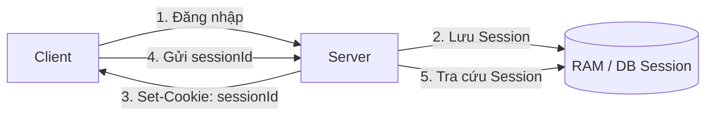
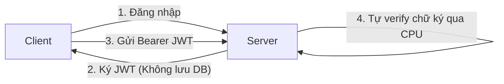

## I. STATEFUL AUTHENTICATION (SESSION-BASED TRUYỀN THỐNG)

Trong mô hình Stateful, **Server nắm giữ toàn bộ trạng thái phiên của người dùng** trong bộ nhớ RAM, Redis hoặc Database.

### Ưu điểm:
1. **Kiểm soát phiên tuyệt đối:** Nếu admin muốn khóa tài khoản hoặc người dùng bấm Đăng xuất, server chỉ cần xóa record `sess_123` trong Database/Redis. Phiên đăng nhập chết ngay lập tức ($O(1)$).
2. **Kích thước dữ liệu gửi đi siêu nhỏ:** Client chỉ mang một chuỗi Session ID ngắn gọn.

### Nhược điểm:
1. **Khó Scale ngang (Horizontal Scaling Bottleneck):** Nếu triển khai nhiều server API chạy song song phía sau Load Balancer, nếu Server A giữ session trong RAM thì request tiếp theo lọt vào Server B sẽ bị coi là chưa đăng nhập (buộc phải dùng *Sticky Sessions* hoặc *Centralized Redis Session Store*).
2. **Tốn tài nguyên bộ nhớ Server:** Với hệ thống có 10.000.000 người dùng trực tuyến, RAM lưu session phình to khổng lồ.

---

## II. STATELESS AUTHENTICATION (PURE JWT THUẦN TÚY)

Trong mô hình Stateless, **Server hoàn toàn không lưu bất kỳ thông tin phiên nào**. Toàn bộ dữ liệu phiên (ID, vai trò, quyền hạn, thời gian sống) đều được đóng gói vào Payload của Token và giao cho Client tự giữ.

### Ưu điểm:
1. **Khả năng Scale ngang vô tận:** Bất kỳ Server API nào trong cụm (kể cả 1.000 instances) chỉ cần có chung `SECRET_KEY` là có thể xác thực ngay request mà không cần giao tiếp với nhau hoặc đụng vào Database.
2. **Không tốn RAM lưu trữ trạng thái phiên.**

---

## III. NGHỊCH LÝ CHÍ MẠNG CỦA JWT STATELESS THUẦN TÚY

Đây là kiến thức quan trọng nhất mà mọi kỹ sư phần mềm chuyên nghiệp cần thấu hiểu:

> [!CAUTION]
> ### 🚨 NGHỊCH LÝ LỚN NHẤT CỦA JWT THUẦN TÚY:
> Một khi JWT đã được ký và cấp phát, **Server KHÔNG THỂ thu hồi (Revoke) hoặc hủy nó trước hạn**!

### Các kịch bản thảm họa trong thực tế:
1. **Người dùng bấm "Đăng xuất (Logout)":**
   * Trong JWT thuần túy, thao tác Logout ở Client chỉ là xóa token trong trình duyệt.
   * Nếu trước đó hacker đã kịp sao chép chuỗi token đó, **hacker vẫn có thể dùng token đó để gọi API bình thường** cho đến khi token hết hạn!
2. **Người dùng đổi Mật khẩu:**
   * Sau khi đổi mật khẩu, người dùng kỳ vọng tất cả các thiết bị khác phải bị đăng xuất.
   * Với JWT thuần túy, các thiết bị khác vẫn tiếp tục truy cập dữ liệu bình thường!
3. **Admin Khóa Tài Khoản (Banned User):**
   * Admin bấm "Khóa tài khoản", nhưng user bị khóa vẫn ung dung gọi các API được bảo vệ bởi JWT trong suốt thời gian token còn hiệu lực!
4. **Cách "chữa cháy" duy nhất của JWT thuần túy:**
   * Thay đổi `SECRET_KEY` trên Server. Nhưng hành động này sẽ làm **toàn bộ hàng triệu người dùng trên toàn hệ thống bị văng ra ngoài cùng lúc**!

---

## IV. BẢNG SO SÁNH TOÀN DIỆN: STATEFUL VS STATELESS

| Tiêu chí so sánh | Stateful (Session-based) | Pure Stateless (JWT thuần túy) |
| :--- | :--- | :--- |
| **Nơi lưu trạng thái phiên** | Tại Server (RAM / Redis / RDBMS). | Tại Client (Tự mang dữ liệu bên trong token). |
| **Gánh nặng Server** | Tốn dung lượng RAM & I/O Database khi truy vấn session. | Tốn chu kỳ CPU để tính toán giải mã chữ ký mật mã. |
| **Khả năng Scale ngang** | Phức tạp (Cần cụm Redis tập trung hoặc Sticky Sessions). | **Rất dễ dàng** (Tăng từ 1 lên 100 server tức thì). |
| **Khả năng Thu hồi (Logout)** | **Tức thì ($O(1)$):** Xóa session key trong Redis là xong. | **BẤT KHẢ THI:** Token sống đến khi chạm mốc `exp`. |
| **Rủi ro rò rỉ dữ liệu** | Thấp hơn: Server hủy session là hacker mất quyền. | **Cực cao:** Lộ token là mất quyền kiểm soát tới khi hết hạn. |
| **Hỗ trợ Cross-Domain** | Khó khăn vì Cookie bị giới hạn theo domain gốc. | Rất linh hoạt vì token có thể gửi qua Header `Authorization`. |

👉 **KẾT LUẬN KIẾN TRÚC:**
Để dung hòa ưu điểm của cả hai bên (vừa scale ngang nhanh, vừa kiểm soát được phiên đăng nhập và logout tức thì), thế giới công nghệ hiện đại áp dụng **Kiến trúc Lai (Hybrid Architecture: Dual Token + Redis Session Whitelist)** ở Chuyên đề 04.
