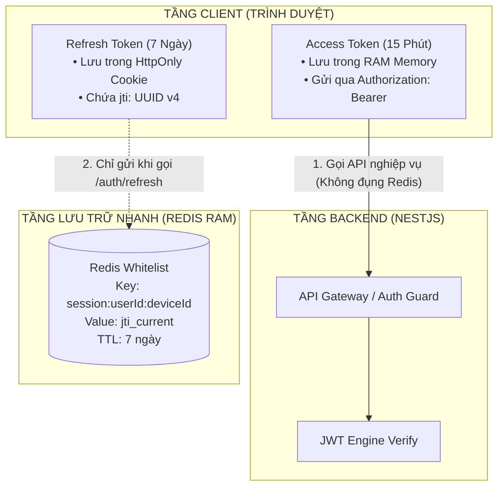
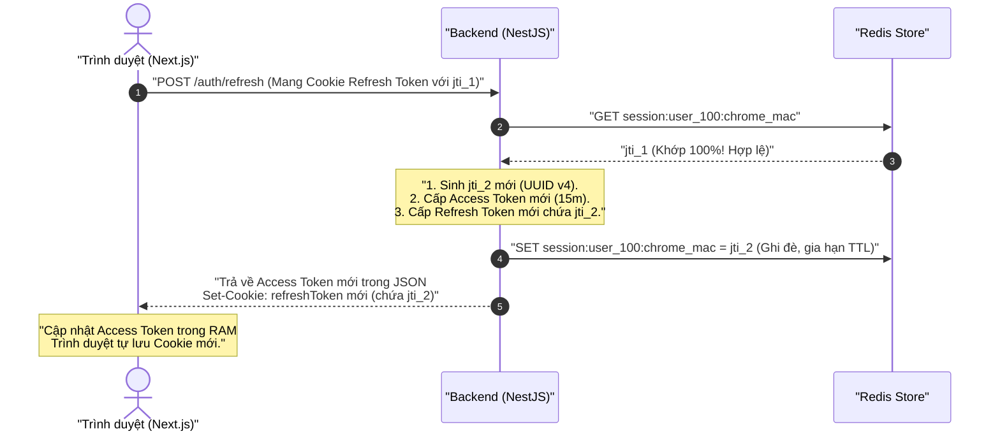
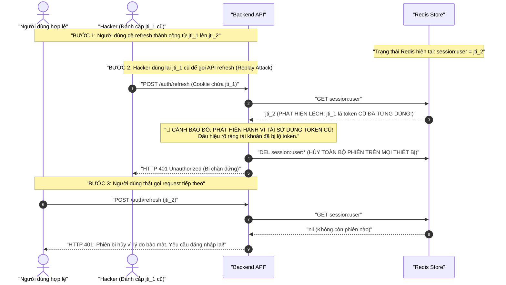

# CHUYÊN ĐỀ 04: KIẾN TRÚC LAI PRODUCTION (HYBRID ARCHITECTURE)
## Dual Token (Access & Refresh), Redis Whitelist & JTI Token Rotation

---

## I. MÔ HÌNH KIẾN TRÚC HYBRID LÀ GÌ?
Kiến trúc Hybrid là sự kết hợp hoàn hảo giữa **Stateless JWT** và **Stateful Session**:
* **Access Token (Ngắn hạn - 10 đến 15 phút):** Vận hành hoàn toàn **Stateless**. Không lưu vào Database/Redis. Các API thông thường chỉ cần kiểm tra chữ ký qua CPU $\rightarrow$ Đạt hiệu năng hàng triệu request/giây.
* **Refresh Token (Dài hạn - 7 đến 30 ngày):** Vận hành dạng **Stateful**. Lưu trữ an toàn trong `HttpOnly Cookie`. Bên trong Refresh Token có mã định danh ngẫu nhiên duy nhất: `jti` (JWT ID).
* **Redis Session Whitelist:** Server duy trì một danh sách các `jti` hợp lệ tương ứng với từng phiên đăng nhập của người dùng.



---

## II. VÒNG ĐỜI VÀ CƠ CHẾ TOKEN ROTATION (XOAY VÒNG TOKEN)

Mỗi khi người dùng sử dụng Refresh Token để lấy Access Token mới, Server sẽ **thu hồi Refresh Token cũ và cấp phát một Refresh Token mới toanh** (cùng một cặp `jti` mới). Cơ chế này gọi là **Refresh Token Rotation**.

### Kịch bản 1: Luồng làm mới phiên bình thường (Happy Path)


---

## III. CƠ CHẾ PHÁT HIỆN TẤN CÔNG ĐÁNH CẮP TOKEN (REPLAY ATTACK DETECTION)

Điều gì xảy ra nếu hacker đánh cắp được Refresh Token của người dùng?
Cơ chế **JTI Token Rotation** có khả năng tự động phát hiện hacker và kích hoạt lá chắn tự vệ:



> [!IMPORTANT]
> ### 🛡️ Sức mạnh của Replay Attack Detection:
> Kẻ tấn công vừa gửi token cũ lên, **ngay lập tức toàn bộ phiên của nạn nhân trên mọi thiết bị (laptop, điện thoại, máy tính bảng) đều bị hủy ngay lập tức**. Nạn nhân được bảo vệ và buộc phải đổi mật khẩu.

---

## IV. QUẢN LÝ ĐĂNG XUẤT (LOGOUT) CHUẨN PRODUCTION

### 1. Đăng xuất trên thiết bị hiện tại (Single Device Logout)
* Client gọi: `POST /auth/logout`.
* Server:
  1. Xóa key phiên tương ứng trong Redis: `DEL session:<userId>:<deviceId>`.
  2. Gửi lệnh xóa cookie về trình duyệt: `res.clearCookie('refreshToken')`.
* Kết quả: Refresh token của thiết bị đó bị vô hiệu hóa ngay lập tức. Access Token trong RAM bị xóa.

### 2. Đăng xuất khỏi toàn bộ thiết bị (Kick-out All Devices)
* Sử dụng khi người dùng bấm *"Đăng xuất khỏi tất cả các thiết bị khác"* hoặc khi **Đổi mật khẩu thành công**:
* Server thực thi lệnh quét và xóa toàn bộ session của user:
  ```typescript
  // Quét bằng SCAN để không gây nghẽn Redis
  const pattern = `session:${userId}:*`;
  // Xóa toàn bộ keys tìm thấy
  ```
* Kết quả: Toàn bộ phiên đăng nhập trên toàn thế giới của user đều bị hủy tức thì ($O(1)$).
