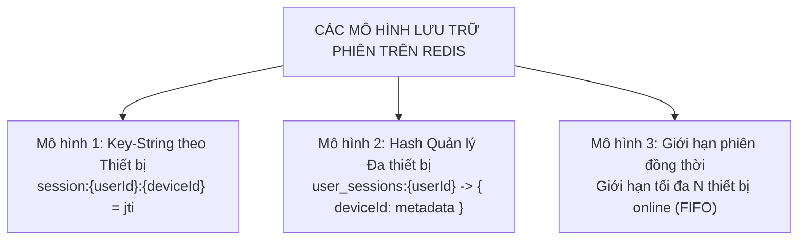
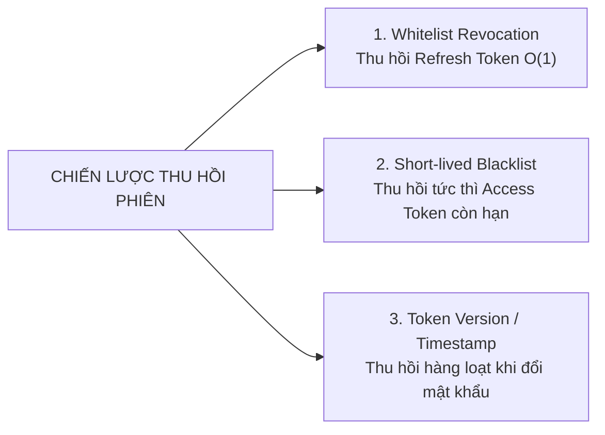

## I. BẢN CHẤT CỦA `jti` (JWT ID) TRONG KIẾN TRÚC PHIÊN

### 1. `jti` là gì theo chuẩn RFC 7519?
`jti` (viết tắt của **JWT ID**) là một trường chuẩn (Registered Claim) được định nghĩa trong RFC 7519. Bản chất của nó là một **chuỗi ký tự ngẫu nhiên duy nhất (Globally Unique Identifier - thường là UUID v4)** được gắn vào bên trong Payload khi Server ký token:

```json
{
  "sub": "user_998877",
  "email": "alex@example.com",
  "role": "ADMIN",
  "deviceId": "macbook_pro_m2",
  "jti": "d3b07384-d113-4944-9343-4f9fa5d69112",
  "iat": 1710000000,
  "exp": 1710604800
}
```

### 2. Tại sao Access Token + Refresh Token là chưa đủ nếu thiếu `jti`?
Nếu không có `jti`, một Refresh Token chỉ là một chuỗi ký tự chứa `userId` và `exp`. Khi đó:
* **Mọi Refresh Token của cùng một User trông giống hệt nhau** (hoặc chỉ khác nhau vài giây ở `iat`).
* Server **không thể phân biệt** được đây là Refresh Token được cấp lúc sáng hay lúc chiều, được cấp cho điện thoại hay laptop.
* Khi người dùng muốn đăng xuất trên laptop mà vẫn giữ đăng nhập trên điện thoại: Server hoàn toàn bất lực vì không có mã định danh để phân biệt 2 phiên này!
* Khi hacker đánh cắp một Refresh Token cũ và gửi lên: Server không thể phát hiện token này đã từng được sử dụng hay chưa.

👉 **`jti` chính là "chứng minh thư" độc nhất vô nhị của từng token.** Nhờ `jti`, Server có thể theo dõi, kiểm soát và thu hồi từng phiên riêng biệt.

---

## II. CÁC MÔ HÌNH LƯU TRỮ PHIÊN ĐĂNG NHẬP TRONG REDIS

Khi kết hợp JWT với Redis, Server không lưu toàn bộ dữ liệu người dùng (tránh biến hệ thống thành Stateful thuần túy gây tốn RAM), mà **chỉ lưu mã định danh `jti` hoặc metadata phiên**. Có 3 mô hình lưu trữ từ cơ bản đến nâng cao:



---

### Mô hình 1: Key-Value đơn giản theo Thiết bị (Phổ biến nhất)
* **Cấu trúc Key:** `session:<userId>:<deviceId>`
* **Giá trị Value:** Chuỗi `jti` hiện tại.
* **Thời gian sống (TTL):** Bằng đúng thời gian sống của Refresh Token (ví dụ: 7 ngày = 604800 giây).

```text
REDIS STORAGE:
Key: session:usr_99:chrome_windows   ==> Value: "uuid-aaa-111" (TTL: 7d)
Key: session:usr_99:iphone_safari    ==> Value: "uuid-bbb-222" (TTL: 7d)
```

* **Ưu điểm:**
  * Tra cứu cực nhanh: Lệnh `GET session:usr_99:chrome_windows` đạt $O(1)$ tốn dưới 0.2 mili-giây.
  * Tận dụng cơ chế tự động dọn rác của Redis: Sau 7 ngày không refresh, key tự động biến mất, không lo phình bộ nhớ RAM.

---

### Mô hình 2: Hash Metadata Quản lý Đa Thiết bị (Chuẩn Google/Facebook)
Nếu ứng dụng có màn hình *"Quản lý thiết bị đã đăng nhập"* (hiển thị vị trí, thiết bị, IP, lần hoạt động cuối và nút "Đăng xuất thiết bị này"):

* **Cấu trúc Key:** `user_devices:<userId>` (Kiểu dữ liệu Redis `Hash`)
* **Field:** `<deviceId>`
* **Value:** Chuỗi JSON chứa metadata phiên:
  ```json
  {
    "jti": "uuid-aaa-111",
    "deviceName": "Chrome trên MacOS",
    "ipAddress": "14.241.12.89",
    "lastActiveAt": 1710005000,
    "createdAt": 1710000000
  }
  ```

* **Thao tác trong Redis:**
  * Lấy danh sách tất cả thiết bị của user: `HGETALL user_devices:usr_99`.
  * Đăng xuất một thiết bị cụ thể: `HDEL user_devices:usr_99 chrome_windows`.
  * Đăng xuất mọi thiết bị khác ngoại trừ máy hiện tại: Xóa hết các field khác trong Hash.

---

### Mô hình 3: Giới hạn số lượng phiên đồng thời (Concurrent Session Limiting)
Nhiều nền tảng (như Netflix, Spotify, ứng dụng học trực tuyến) yêu cầu: **Một tài khoản chỉ được đăng nhập tối đa $N$ thiết bị cùng một lúc** (ví dụ: tối đa 2 thiết bị).

* **Thuật toán xử lý bằng Redis Sorted Set (`ZSET`):**
  * Key: `active_sessions:<userId>`
  * Member: `<deviceId>:<jti>`
  * Score: `Timestamp đăng nhập`
* **Quy trình khi đăng nhập thiết bị thứ 3:**
  1. Thêm phiên mới vào ZSET: `ZADD active_sessions:usr_99 <timestamp> "device_tablet:uuid_3"`.
  2. Đếm số lượng phiên: `ZCARD active_sessions:usr_99`.
  3. Nếu số lượng $> 2$:
     * Lấy phiên cũ nhất ra: `ZRANGE active_sessions:usr_99 0 0`.
     * Xóa phiên cũ nhất khỏi ZSET và xóa token tương ứng: Thiết bị đầu tiên bị đá văng (cơ chế FIFO).

---

## III. 3 CHIẾN LƯỢC THU HỒI TOKEN (TOKEN REVOCATION STRATEGIES)



### 1. Chiến lược 1: Thu hồi Refresh Token qua Whitelist (Chuẩn kinh điển)
* **Cách hoạt động:** Khi người dùng bấm Đăng xuất, Server xóa key `session:<userId>:<deviceId>` trong Redis.
* **Hệ quả:**
  * Refresh Token lập tức trở thành phế thải: Lần tiếp theo Client gọi `/auth/refresh`, Redis trả về `nil` $\rightarrow$ Server từ chối cấp token mới.
  * Access Token hiện tại trong RAM client vẫn sống tối đa 15 phút rồi tự chết (đây là khoảng trễ chấp nhận được trong đa số hệ thống web thông thường).

---

### 2. Chiến lược 2: Thu hồi tức thì Access Token qua Blacklist ngắn hạn
Nếu ứng dụng tài chính hoặc ngân hàng yêu cầu: **Ngay giây phút bấm Logout, Access Token phải chết lập tức, không được phép chờ 15 phút**:

* **Nghịch lý ban đầu:** Access Token là Stateless, làm sao Server biết nó đã bị logout?
* **Giải pháp: Short-lived Blacklist trên Redis:**
  1. Khi người dùng bấm Logout, Client gửi Access Token lên.
  2. Server giải mã token, lấy mã `jti` và thời gian hết hạn `exp`.
  3. Tính thời gian sống còn lại: $\text{Remaining TTL} = exp - now$ (ví dụ: còn 8 phút = 480s).
  4. Lưu `jti` này vào Redis Blacklist với đúng thời gian sống còn lại:
     ```text
     SET blacklist:access:uuid-xyz "1" EX 480
     ```
  5. Trong Auth Guard của NestJS:
     * Bước 1: Verify chữ ký CPU (nhanh).
     * Bước 2: Kiểm tra nhanh `EXISTS blacklist:access:<jti>` (dưới 0.2ms). Nếu có trong Blacklist $\rightarrow$ Chặn đứng 401.
* **Ưu điểm tuyệt đối:** Blacklist này **tự động biến mất sau vài phút**, không bao giờ bị phình to làm đầy RAM của Redis như các hệ thống Blacklist vĩnh viễn lỗi thời.

---

### 3. Chiến lược 3: Thu hồi toàn bộ qua `tokenVersion` / `passwordChangedAt`
Dùng khi người dùng **Đổi mật khẩu** hoặc bị **Admin khóa tài khoản**:

* **Cách triển khai:**
  * Trong bảng `User` ở Database hoặc key trạng thái trên Redis lưu trường: `tokenVersion: 1`.
  * Khi ký Access Token, nhúng trường này vào payload: `{ "userId": "usr_99", "tokenVersion": 1 }`.
* **Khi đổi mật khẩu:**
  * Server chỉ cần tăng giá trị: `user.tokenVersion = user.tokenVersion + 1` (lên thành 2).
  * Đồng thời xóa toàn bộ session trong Redis: `DEL session:usr_99:*`.
* **Khi Client gửi request lên:**
  * Nếu token mang `tokenVersion: 1` mà phiên bản hiện tại là `2` $\rightarrow$ Từ chối ngay lập tức.
  * **Chỉ 1 lệnh tăng số nguyên duy nhất, hàng chục phiên trên mọi thiết bị lập tức bị vô hiệu hóa toàn bộ.**

---

## IV. TRỌN VẸN 5 LUỒNG HOẠT ĐỘNG THỰC TẾ (STEP-BY-STEP FLOWS)

---

### Luồng 1: Đăng nhập lần đầu & Khởi tạo phiên
1. Client gửi `POST /auth/login` kèm Email, Mật khẩu và Định danh thiết bị (`deviceId`).
2. Server xác thực thông tin trong Database.
3. Server sinh cặp token:
   * **Access Token:** Mang `{ userId, role }`, TTL 15 phút, ký bằng `JWT_ACCESS_SECRET`.
   * **Refresh Token:** Mang `{ userId, deviceId, jti: UUID_1 }`, TTL 7 ngày, ký bằng `JWT_REFRESH_SECRET`.
4. Server lưu vào Redis: `SET session:<userId>:<deviceId> = UUID_1 EX 604800`.
5. Server phản hồi:
   * `Set-Cookie: refreshToken=...; HttpOnly; Secure; SameSite=Lax`.
   * Body JSON: `{ accessToken: "..." }`.

---

### Luồng 2: Gọi API dữ liệu thông thường (Stateless hoàn toàn)
1. Client gửi `GET /api/orders` kèm Header: `Authorization: Bearer <accessToken>`.
2. NestJS `JwtAuthGuard` chặn request:
   * Dùng CPU giải mã và kiểm tra chữ ký HMAC-SHA256 với `JWT_ACCESS_SECRET`.
   * Kiểm tra mốc thời gian `exp`.
3. **Hoàn toàn không chạm vào Database hay Redis!**
4. Trả về dữ liệu cho Client với tốc độ cực đại (Sub-millisecond).

---

### Luồng 3: Làm mới phiên & Xoay vòng Token (Token Rotation)
1. Sau 15 phút, Access Token hết hạn. Client gọi API bị lỗi `401 Unauthorized`.
2. Fetch Interceptor ở Client âm thầm gửi `POST /auth/refresh` (Trình duyệt tự động đính kèm Cookie `refreshToken` chứa `UUID_1`).
3. Server bóc tách token:
   * Verify chữ ký Refresh Token.
   * Lấy `UUID_1` từ payload và tra cứu Redis: `GET session:<userId>:<deviceId>`.
4. **Kiểm tra tính hợp lệ:**
   * Nếu giá trị trong Redis khớp `UUID_1`:
     * Sinh `UUID_2` mới toanh.
     * Cấp Access Token mới (15 phút).
     * Cấp Refresh Token mới chứa `UUID_2`.
     * Cập nhật Redis: `SET session:<userId>:<deviceId> = UUID_2 EX 604800` (Ghi đè `UUID_1`).
     * Set-Cookie mới và trả Access Token mới về cho Client.
5. Client cập nhật Access Token vào RAM và gửi lại request ban đầu.

---

### Luồng 4: Kích hoạt lá chắn khi bị đánh cắp Token (Replay Attack Detection)
Kịch bản: Hacker đánh cắp được Refresh Token (`UUID_1`) từ đường truyền hoặc máy cũ của nạn nhân.
1. Người dùng thật đã thực hiện refresh: Redis đã cập nhật lên `UUID_2`.
2. Kẻ tấn công gửi `UUID_1` cũ lên Server gọi `POST /auth/refresh`.
3. Server kiểm tra:
   $$\text{JTI gửi lên } (UUID_1) \neq \text{JTI hiện tại trong Redis } (UUID_2)$$
4. **Phát hiện Token đã từng được dùng trong quá khứ!**
5. Server kích hoạt quy trình ứng phó khẩn cấp:
   * Quét và xóa toàn bộ session của nạn nhân: `DEL session:<userId>:*`.
   * Trả về HTTP `401 Unauthorized` chặn kẻ tấn công.
   * Người dùng thật ở request kế tiếp cũng bị buộc đăng nhập lại để đảm bảo an toàn.

---

### Luồng 5: Đăng xuất thiết bị & Đăng xuất toàn bộ
* **Đăng xuất thiết bị hiện tại (Single Logout):**
  * Lệnh Redis: `DEL session:<userId>:<deviceId>`.
  * Phản hồi: `res.clearCookie('refreshToken')`.
  * Chỉ thiết bị hiện tại bị out; các thiết bị khác (điện thoại, tablet) vẫn hoạt động bình thường.
* **Đăng xuất tất cả thiết bị (Remote Logout All):**
  * Quét danh sách key bằng lệnh con trỏ: `SCAN 0 MATCH session:<userId>:* COUNT 100`.
  * Xóa toàn bộ keys tìm được: `DEL key1 key2 ...`.
  * Toàn bộ các phiên trên toàn thế giới của tài khoản bị hủy trong 1 chu kỳ CPU.

---

## V. TỔNG KẾT: KIẾN TRÚC PHÒNG THỦ CHIỀU SÂU (DEFENSE IN DEPTH)

```text
┌─────────────────────────────────────────────────────────────────────────┐
│                    KIẾN TRÚC PHÒNG THỦ 3 TẦNG BẢO MẬT                   │
├─────────────────────────────────────────────────────────────────────────┤
│ 1. TẦNG TRÌNH DUYỆT (BROWSER LAYER)                                     │
│    • Refresh Token được bọc trong Cookie HttpOnly (Miễn nhiễm XSS 100%) │
│    • Cờ SameSite=Lax (Triệt tiêu nguy cơ CSRF)                          │
│    • Access Token chỉ lưu trong Memory RAM (Mất khi tắt tab)            │
├─────────────────────────────────────────────────────────────────────────┤
│ 2. TẦNG API GATEWAY (STATELESS SPEED LAYER)                             │
│    • Access Token sống 15 phút verify qua CPU Signature                │
│    • Chịu tải hàng trăm ngàn requests/giây không gây nghẽn Redis/DB     │
├─────────────────────────────────────────────────────────────────────────┤
│ 3. TẦNG REDIS SESSION (STATEFUL CONTROL LAYER)                          │
│    • Quản lý mã JTI theo từng thiết bị                                  │
│    • Xoay vòng Token Rotation chống Replay Attack                       │
│    • Hỗ trợ Logout tức thì, xem danh sách thiết bị và Kick-out từ xa    │
└─────────────────────────────────────────────────────────────────────────┘
```

---

## VI. CÁC BƯỚC TRIỂN KHAI THỰC TẾ
Để bắt tay vào lập trình từng phần, bạn có thể xem chi tiết từng bước tại thư mục [`02. Thực hành/`](file:///home/hy/Documents/Obsidian%20Vault/Tranning/B%C3%A0i%2001%20-%20Authentication%20&%20Session%20Management/02.%20Th%E1%BB%B1c%20h%C3%A0nh):
* [**Bước 1:** Cấu hình Redis & Quản lý Session JTI](file:///home/hy/Documents/Obsidian%20Vault/Tranning/B%C3%A0i%2001%20-%20Authentication%20&%20Session%20Management/02.%20Th%E1%BB%B1c%20h%C3%A0nh/01.%20B%C6%B0%E1%BB%9Bc%201%20-%20C%E1%BA%A5u%20h%C3%ACnh%20Redis%20&%20Qu%E1%BA%A3n%20l%C3%BD%20Session%20JTI.md)
* [**Bước 2:** Luồng Đăng nhập & Cấp phát HttpOnly Cookie](file:///home/hy/Documents/Obsidian%20Vault/Tranning/B%C3%A0i%2001%20-%20Authentication%20&%20Session%20Management/02.%20Th%E1%BB%B1c%20h%C3%A0nh/02.%20B%C6%B0%E1%BB%9Bc%202%20-%20Lu%E1%BB%93ng%20%C4%90%C4%83ng%20nh%E1%BA%ADp%20&%20C%E1%BA%A5p%20ph%C3%A1t%20HttpOnly%20Cookie.md)
* [**Bước 3:** Bảo vệ API với Access Token Stateless](file:///home/hy/Documents/Obsidian%20Vault/Tranning/B%C3%A0i%2001%20-%20Authentication%20&%20Session%20Management/02.%20Th%E1%BB%B1c%20h%C3%A0nh/03.%20B%C6%B0%E1%BB%9Bc%203%20-%20B%E1%BA%A3o%20v%E1%BB%87%20API%20v%E1%BB%9Bi%20Access%20Token%20Stateless.md)
* [**Bước 4:** Luồng Refresh Token Rotation & Chống Replay Attack](file:///home/hy/Documents/Obsidian%20Vault/Tranning/B%C3%A0i%2001%20-%20Authentication%20&%20Session%20Management/02.%20Th%E1%BB%B1c%20h%C3%A0nh/04.%20B%C6%B0%E1%BB%9Bc%204%20-%20Lu%E1%BB%93ng%20Refresh%20Token%20Rotation%20&%20Ch%E1%BB%91ng%20Replay%20Attack.md)
* [**Bước 5:** Cơ chế Đăng xuất & Thu hồi phiên (Revoke Token)](file:///home/hy/Documents/Obsidian%20Vault/Tranning/B%C3%A0i%2001%20-%20Authentication%20&%20Session%20Management/02.%20Th%E1%BB%B1c%20h%C3%A0nh/05.%20B%C6%B0%E1%BB%9Bc%205%20-%20C%C6%A1%20ch%E1%BA%BF%20%C4%90%C4%83ng%20xu%E1%BA%A5t%20&%20Thu%20h%E1%BB%93i%20phi%C3%AAn%20%28Revoke%20Token%29.md)
* [**Bước 6:** Kịch bản 4 Bài Lab thực nghiệm kiểm chứng](file:///home/hy/Documents/Obsidian%20Vault/Tranning/B%C3%A0i%2001%20-%20Authentication%20&%20Session%20Management/02.%20Th%E1%BB%B1c%20h%C3%A0nh/06.%20K%E1%BB%8Bch%20b%E1%BA%A3n%204%20B%C3%A0i%20Lab%20th%E1%BB%B1c%20nghi%E1%BB%87m%20ki%E1%BB%83m%20ch%E1%BB%A9ng.md)
