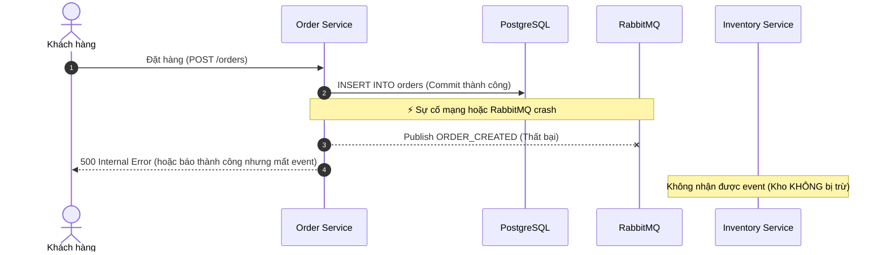
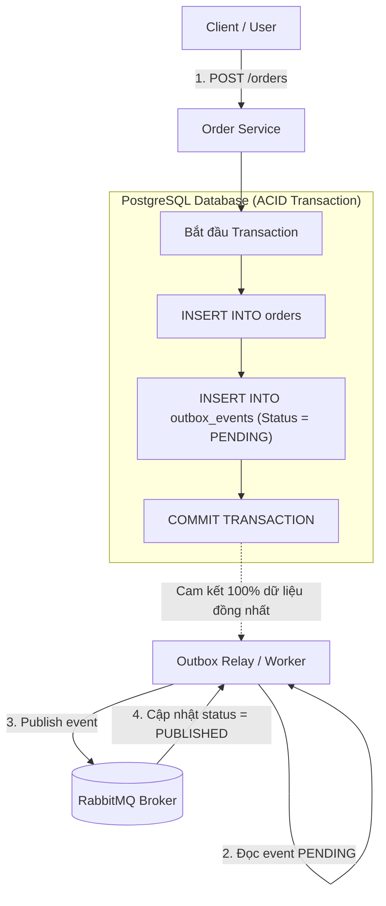
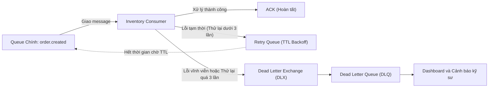

> [!TIP]
> 📌 **Liên kết:** [Quay lại Đề bài kiểm tra](../01.%20%C4%90%E1%BB%81%20b%C3%A0i/C%C3%A2u%205%20%E2%80%93%20Transactional%20Outbox%20&%20Message%20Queue%20(%C4%90%E1%BB%81%20b%C3%A0i).md)

---

## I. ĐẶT VẤN ĐỀ: BÀI TOÁN DUAL-WRITE & NGUY CƠ BẤT ĐỒNG BỘ DỮ LIỆU

Hệ thống đặt hàng (Order Service) được xây dựng bằng **NestJS**, **PostgreSQL** và **RabbitMQ**. Khi khách hàng đặt hàng, hệ thống phải thực hiện 2 thao tác:
1. Lưu thông tin đơn hàng vào PostgreSQL.
2. Gửi event `ORDER_CREATED` lên RabbitMQ để Inventory Service nhận và trừ tồn kho.

### Hiện trạng mã nguồn ban đầu:
```typescript
async createOrder(dto: CreateOrderDto) {
  // Thao tác 1: Ghi vào Database
  const order = await this.orderRepository.create(dto);

  // Thao tác 2: Gửi Message lên Broker
  await this.rabbitMQ.publish('ORDER_CREATED', {
    orderId: order.id,
  });

  return order;
}
```

> [!CAUTION]
> ### 🚨 VẤN ĐỀ CHÍ MẠNG: DUAL-WRITE PROBLEM
> Hai hệ thống lưu trữ độc lập (PostgreSQL và RabbitMQ) **không thể tham gia vào cùng một ACID Transaction cục bộ**. Nếu một trong hai bước gặp sự cố (mất mạng, crash, timeout), hệ thống sẽ rơi vào trạng thái bất nhất dữ liệu nghiêm trọng.



---

## II. LỜI GIẢI CHI TIẾT CHO 4 TÌNH HUỐNG THỰC CHIẾN

---

### TÌNH HUỐNG 1: Database và RabbitMQ không đồng bộ (Dual-Write Failure)

#### 1. Vấn đề thực tế xảy ra:
* Nếu DB lưu Order thành công nhưng RabbitMQ bị ngắt kết nối:
  * Khách hàng đã bị tạo đơn hàng trong database, tiền có thể đã trừ.
  * Nhưng event `ORDER_CREATED` không bao giờ bay tới RabbitMQ $\rightarrow$ Inventory Service hoàn toàn không biết có đơn hàng mới $\rightarrow$ **Tồn kho không được cập nhật, hàng không được chuẩn bị xuất**.
* Nếu đảo ngược thứ tự (Publish event trước, lưu DB sau):
  * Nếu Publish thành công nhưng DB bị lỗi (Unique constraint, thiếu bộ nhớ, DB crash) $\rightarrow$ Event đã phát tán vào hệ thống, kho đã trừ hàng nhưng **đơn hàng thực tế lại không tồn tại trong DB**.

#### 2. Giải pháp kiến trúc: Transactional Outbox Pattern
Đưa việc ghi nhận sự kiện vào **cùng một Local Transaction của Database** với việc tạo đơn hàng.



* **Thiết kế bảng `outbox_events`:**
```sql
CREATE TABLE outbox_events (
    id UUID PRIMARY KEY DEFAULT gen_random_uuid(),
    aggregate_type VARCHAR(50) NOT NULL,    -- 'ORDER'
    aggregate_id VARCHAR(50) NOT NULL,      -- order.id
    event_type VARCHAR(100) NOT NULL,       -- 'ORDER_CREATED'
    payload JSONB NOT NULL,                 -- { "orderId": "...", "items": [...] }
    status VARCHAR(20) DEFAULT 'PENDING',   -- 'PENDING', 'PROCESSING', 'PUBLISHED', 'FAILED'
    retry_count INT DEFAULT 0,
    created_at TIMESTAMP WITH TIME ZONE DEFAULT NOW(),
    updated_at TIMESTAMP WITH TIME ZONE DEFAULT NOW()
);

CREATE INDEX idx_outbox_pending ON outbox_events (status, created_at) WHERE status = 'PENDING';
```

* **Cơ chế chuyển tiếp sự kiện (Message Relay):**
  1. **Cách 1 - Polling Publisher (Đơn giản, hiệu quả cao):** Một cron worker định kỳ (mỗi 1-2 giây) quét các bản ghi `PENDING`, publish lên RabbitMQ, sau đó đánh dấu `PUBLISHED`.
  2. **Cách 2 - Transaction Log Tailing (CDC - Change Data Capture):** Dùng công cụ như **Debezium** lắng nghe PostgreSQL Write-Ahead Log (WAL) để tự động bắn event lên Message Queue mà không cần worker poll DB.

---

### TÌNH HUỐNG 2: Worker bị chết sau khi Publish (At-Least-Once Delivery)

#### 1. Vấn đề thực tế xảy ra khi Worker khởi động lại:
* Worker đọc một OutboxEvent (`id = evt_123`).
* Worker publish `ORDER_CREATED` lên RabbitMQ thành công.
* Chưa kịp thực hiện `UPDATE outbox_events SET status = 'PUBLISHED' WHERE id = 'evt_123'` thì server bị crash (OOM, mất điện, kill process).
* **Khi Worker khởi động lại:**
  * Bản ghi `evt_123` trong database vẫn mang trạng thái `PENDING` (hoặc timeout lock).
  * Worker sẽ đọc lại bản ghi này và tiếp tục publish lên RabbitMQ lần thứ hai!
  * **Hệ quả:** Event `ORDER_CREATED` của đơn hàng này bị **gửi lặp (Duplicate Message)** lên Broker.

> [!IMPORTANT]
> Trong hệ thống phân tán, cơ chế truyền tin giữa các node chỉ có thể đảm bảo **At-Least-Once Delivery** (Ít nhất một lần), **KHÔNG THỂ đảm bảo Exactly-Once Delivery ở tầng mạng**. Bất kỳ hệ thống nào cũng phải chấp nhận việc message có thể bị gửi trùng lặp.

#### 2. Giải pháp xử lý triệt để:
1. **Phía Outbox Worker (Hạn chế tối đa gửi lặp):**
   * Sử dụng cơ chế khóa phân tán hoặc câu lệnh SQL locking tránh nhiều worker tranh chấp:
   ```sql
   -- Lấy và khóa bản ghi, bỏ qua các bản ghi đang bị worker khác xử lý
   UPDATE outbox_events
   SET status = 'PROCESSING', updated_at = NOW()
   WHERE id IN (
       SELECT id FROM outbox_events
       WHERE status = 'PENDING'
       ORDER BY created_at ASC
       LIMIT 100
       FOR UPDATE SKIP LOCKED
   )
   RETURNING *;
   ```
2. **Dịch chuyển trọng tâm an toàn sang Consumer:**
   * Vì không thể triệt tiêu 100% duplicate ở phía Producer/Worker, **bên nhận (Consumer) BẮT BUỘC phải có tính năng Idempotent (Xử lý trùng lặp an toàn)**.

---

### TÌNH HUỐNG 3: Consumer xử lý trùng Event (Idempotent Consumer Pattern)

#### 1. Vấn đề thực tế xảy ra:
Inventory Service nhận được cùng một event `ORDER_CREATED` cho đơn hàng `order_001` tới 2 lần. Nếu code xử lý ngây thơ (`stock = stock - qty`), tồn kho sẽ bị trừ **2 lần** cho cùng 1 đơn hàng!

#### 2. Thiết kế Database & Logic Consumer Idempotent:
Áp dụng mẫu hình **Idempotent Consumer** kết hợp bảng kiểm soát phiên xử lý sự kiện:

* **Thiết kế bảng `processed_events` tại Inventory DB:**
```sql
CREATE TABLE processed_events (
    event_id VARCHAR(100) NOT NULL,
    consumer_name VARCHAR(100) NOT NULL,
    processed_at TIMESTAMP WITH TIME ZONE DEFAULT NOW(),
    PRIMARY KEY (event_id, consumer_name)
);
```

* **Logic xử lý nguyên tử (Atomic Execution) trong Consumer:**
```typescript
async handleOrderCreated(event: OrderCreatedEvent, messageContext: any) {
  const queryRunner = this.dataSource.createQueryRunner();
  await queryRunner.connect();
  await queryRunner.startTransaction();

  try {
    // 1. Thử ghi nhận Event vào bảng processed_events
    // Nhờ khóa chính (event_id, consumer_name), nếu trùng sẽ văng lỗi Unique Violation
    await queryRunner.query(
      `INSERT INTO processed_events (event_id, consumer_name) VALUES ($1, $2)`,
      [event.eventId, 'INVENTORY_SERVICE']
    );

    // 2. Thực hiện trừ tồn kho nghiệp vụ
    await this.inventoryService.deductStock(queryRunner, event.items);

    // 3. Commit Transaction
    await queryRunner.commitTransaction();

    // 4. Xác nhận đã xử lý thành công với RabbitMQ
    messageContext.channel.ack(messageContext.originalMessage);
  } catch (error) {
    await queryRunner.rollbackTransaction();

    // Nếu lỗi do trùng lặp event (PostgreSQL error code 23505 = Unique Violation)
    if (error.code === '23505') {
      console.warn(`[DUPLICATE] Event ${event.eventId} đã được xử lý trước đó. Bỏ qua!`);
      // Vẫn phải ACK để RabbitMQ giải phóng message trùng lặp khỏi hàng đợi
      messageContext.channel.ack(messageContext.originalMessage);
      return;
    }

    // Các lỗi khác (mất DB, lỗi hệ thống) -> NACK để retry
    messageContext.channel.nack(messageContext.originalMessage, false, true);
  } finally {
    await queryRunner.release();
  }
}
```

#### 3. Nếu Consumer xử lý xong DB nhưng chết trước khi gửi ACK:
* Database đã commit (tồn kho đã trừ và `processed_events` đã lưu `event_id`).
* Consumer chết $\rightarrow$ RabbitMQ phát hiện mất kết nối TCP $\rightarrow$ Re-queue message và giao cho Consumer khác (hoặc chính Consumer đó sau khi sống lại).
* Khi Consumer mới nhận lại event $\rightarrow$ Câu lệnh `INSERT INTO processed_events` báo lỗi trùng khóa chính $\rightarrow$ Consumer nhận biết ngay đây là message đã xử lý $\rightarrow$ **Chỉ gửi `ACK` và bỏ qua, không trừ tồn kho lần 2**.
* **Kết quả:** Đảm bảo toàn vẹn dữ liệu 100%.

---

### TÌNH HUỐNG 4: Consumer xử lý thất bại & Cơ chế Retry (DLQ Pattern)

#### 1. Phân loại lỗi: Transient Error vs Permanent Error

| Tiêu chí | Lỗi tạm thời (Transient Error) | Lỗi vĩnh viễn (Permanent / Poison Pill) |
| :--- | :--- | :--- |
| **Bản chất** | Sự cố xảy ra ngắn hạn, hệ thống tự phục hồi được sau vài giây đến vài phút. | Lỗi logic hoặc dữ liệu sai phạm, thử lại bao nhiêu lần cũng sẽ thất bại. |
| **Ví dụ** | • PostgreSQL mất kết nối trong 5 giây.<br>• DB connection pool bị đầy.<br>• Lock timeout do deadlock tạm thời. | • Payload JSON sai định dạng.<br>• Thiếu trường dữ liệu bắt buộc (Validation error).<br>• Sản phẩm không tồn tại trong hệ thống. |
| **Xử lý** | **Cho phép Retry** với cơ chế Exponential Backoff. | **Không Retry!** Đẩy thẳng sang Dead Letter Queue (DLQ) để log và cảnh báo. |

#### 2. Thiết kế cơ chế Retry với Exponential Backoff & Jitter:
Nếu chỉ đơn giản gọi `nack(requeue = true)`, message sẽ lập tức bị gửi lại ngay trong 1 mili-giây $\rightarrow$ Tạo ra **Retry Storm**, làm tê liệt hoàn toàn PostgreSQL đang bị ngộp.

* **Công thức tính độ trễ:**
$$\text{Delay} = \min(\text{MaxDelay}, \text{BaseDelay} \times 2^{\text{retry\_count}}) + \text{Jitter}$$
*(Jitter là một số ngẫu nhiên nhỏ để phân tán các request, tránh hiện tượng hàng ngàn consumer cùng retry vào cùng một thời điểm).*

#### 3. Mô hình xử lý Dead Letter Queue (DLQ) trong RabbitMQ:


* **Quy trình vận hành chuẩn:**
  1. Thiết lập biến header `x-retry-count` đính kèm message.
  2. Khi gặp lỗi tạm thời:
     * Nếu `retry_count < 3`: Tăng `retry_count += 1`, gửi vào hàng đợi Retry có đặt độ trễ (TTL). Khi hết TTL, message được định tuyến trở lại Queue chính.
     * Nếu `retry_count >= 3`: Đánh dấu thất bại hoàn toàn $\rightarrow$ Chuyển message sang **Dead Letter Queue (DLQ)**.
  3. Khi gặp lỗi vĩnh viễn: Chuyển ngay lập tức sang DLQ mà không tốn công retry.
  4. **Cảnh báo (Alerting):** Tích hợp thông báo (Slack/Telegram/PagerDuty) khi DLQ có message để đội ngũ kỹ sư can thiệp kiểm tra nguyên nhân gốc rễ và Replay lại thủ công.

---

## III. BẢNG TỔNG KẾT NGUYÊN TẮC VÀNG VẬN HÀNH THỰC TẾ

```text
┌────────────────────────────────────────────────────────────────────────┐
│             4 NGUYÊN TẮC VÀNG TRONG HỆ THỐNG MESSAGE QUEUE             │
├────────────────────────────────────────────────────────────────────────┤
│ 1. Giải quyết Dual-Write:                                             │
│    -> Bắt buộc dùng Transactional Outbox Pattern (Ghi DB + Outbox)    │
│ 2. Bản chất truyền tin phân tán:                                       │
│    -> Luôn là At-Least-Once Delivery (Không thể có Exactly-Once)      │
│ 3. Phòng thủ tại Consumer:                                             │
│    -> Bắt buộc thiết kế Idempotent Consumer (Chống xử lý trùng lặp)   │
│ 4. Phòng thủ trước sự cố sập DB:                                      │
│    -> Phân loại Transient vs Permanent Error + Exponential Backoff     │
│    -> Giới hạn Max Retries (3-5 lần) và đưa vào Dead Letter Queue (DLQ)│
└────────────────────────────────────────────────────────────────────────┘
```
